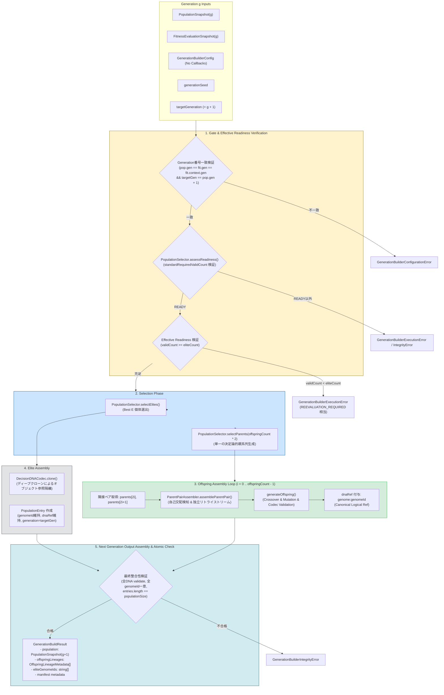

# BlackPoker Simulator Next Generation Builder Design V1 (Follow-up R3)
# (Generation g $\rightarrow$ Generation g+1 次世代母集団構築境界契約)

作業ID: `BP-SIM-AI-GENERATION-BUILDER-DESIGN-V1-R3`
ステータス: **PROPOSED / DESIGNED (PENDING INDEPENDENT REVIEW)**  
対象リポジトリ: `BlackPoker/BlackPoker`  
対象ブランチ: `BlackPoker/issue551-core-flow`  
先行仕様:
- `tools/simulator/docs/ai-fitness-design-v1.md` (Formal Accepted)
- `tools/simulator/docs/ai-population-selection-design-v1.md` (Formal Accepted)
- `tools/simulator/docs/ai-genetic-operators-design-v1.md` (Formal Accepted)
- `tools/simulator/src/domain/ai/PopulationSelectionTypes.ts` (Implemented)
- `tools/simulator/src/engine/ai/PopulationSelector.ts` (Implemented)
- `tools/simulator/src/domain/ai/GeneticOperatorTypes.ts` (Implemented)
- `tools/simulator/src/engine/ai/GeneticOperators.ts` (Implemented)
- `tools/simulator/src/engine/ai/ParentPairAssembler.ts` (Implemented)
- `tools/simulator/src/engine/ai/DecisionDNACodec.ts` (Implemented)

---

## 1. Purpose (設計目的)

本設計書は、BlackPoker Simulator AI 自己対戦進化（Phase 4.0: Self-Play Evolution）において、先行して Formal Accepted 済みとなった **Population Selection（トーナメント親選択・エリート選出）**、**Genetic Operators（交叉・突然変異・自己交配回避ペアリング）**、および **Runtime Match Telemetry** を統合し、

$$\text{PopulationSnapshot}(g) + \text{FitnessEvaluationSnapshot}(g) \xrightarrow{\quad\text{Generation Builder}\quad} \text{PopulationSnapshot}(g+1)$$

として、世代 $g$ の評価済み母集団から世代 $g+1$ の未評価母集団スナップショットを **決定論的（Deterministic）かつ完全フェイルクローズ（Fail-Closed）** に組み立てる **Generation Builder / Next Generation Assembly** の境界契約（Boundary Contract）を定義する。

### R3 Follow-up における確定・厳格化事項
1. **Canonical Evolution Stream Key Contract への完全一致 (Finding 1)**:
   - Section 16.1 に存在していた誤った Stream Key 例（`generation-selection`, `generation-offspring-{k}`, `generation-mating-retry-{k}-{attempt}`）を完全に削除。
   - `deriveSeed(baseSeed, streamKey)` においては streamKey 文字列そのものが Seed 派生入力であるため、表記揺れや異なる文字列は数学的に異なる Seed を生成する。
   - 先行仕様 `ai-genetic-operators-design-v1.md` Section 14.3 および本設計書 Section 8 に完全整合させ、次の **Canonical Evolution Stream Keys** に厳格固定（エイリアス・非推奨名としての残存も一切禁止）:
     - `evolution-selection-v1`
     - `evolution-offspring-v1-${offspringIndex}`
     - `evolution-crossover-v1`
     - `evolution-mutation-v1`
     - `evolution-self-mating-retry-v1-${retryIndex}`
2. **Test 33 契約条件の厳格化と明示 (Finding 2)**:
   - Implementation Test Plan の Test 33 において、`targetGeneration`、`Canonical Evolution Stream Key Contract`、`Generation Builder implementation version`、`Genetic Operator implementation version` を明示し、Bit-exact / Deep Equal 完全一致契約を厳密化。

### R2 Follow-up における確定・厳格化事項
1. **決定論保証の境界整合 (Finding 1)**:
   - 先行仕様 `ai-genetic-operators-design-v1.md` Section 13.3（Formal Accepted）に完全整合させ、無条件な「あらゆる未知の環境で100% bit-exact一致」という過剰保証表現を廃止。
   - **Supported Deterministic Runtime 境界**: 同一のサポート対象ランタイム（Node.js LTS等）、同一実装バージョン、同一入力DNA、同一設定、同一シード、同一 Stream Key 契約において Bit-exact / Deep Equal な再現性を保証。
   - **Cross-Platform Conformance Target**: 異なる OS（Linux, Windows, macOS）や CPU アーキテクチャ（x64, arm64）間は、テストベクトルにより実測検証される適合目標（Conformance Target）として位置付け。
2. **未定義の Population 上限記述の完全削除 (Finding 2)**:
   - Section 19.2 に記載されていた根拠のない「現行仕様 (N <= 1000)」および「N > 10000」等の未定義数値を削除。
   - V1 の正式契約は `populationSize` は `finite integer >= 2` であり、アーキテクチャ上の恣意的な上限は課さないことを確認・明記。大規模個体数時のメモリ・ストリーミング処理は将来の拡張課題（Low / Future）として抽象的に整理。

### R1 Follow-up における確定・厳格化事項
1. **Custom `offspringDnaRefResolver` の V1 からの完全廃止 (Finding 1)**:
   - 外部コールバック（callback injection）による非決定性（`Date.now()`、`Math.random()`、I/O、外部状態依存）の混入リスクを根本排除するため、V1 ではリゾルバ関数を完全削除。
2. **Offspring dnaRef を Canonical Logical Ref のみに固定**:
   - `canonicalOffspringDnaRef(genomeId) = "genome:" + genomeId` の純粋・決定論的・副作用なし・I/O フリーの単一方式に完全固定。
3. **dnaRef のスコープと境界の厳密化**:
   - `genome:<genomeId>` は世代・母集団構築スコープ内での **Local Logical DNA Reference** であり、Global Artifact ID でも Content Address でも Physical File Reference でもないことを明確化。過剰なグローバル保証を排除。
4. **`eliteCount > VALID count` 境界の確定と Generation Builder Effective Readiness (Finding 2)**:
   - 既存の `PopulationSelector.assessReadiness()` を変更することなく、Generation Builder 固有の要求条件 $\text{generationBuilderRequiredValidCount} = \max(\text{standardRequiredValidCount}, \text{eliteCount})$ を定義。
   - `validCount < eliteCount` の場合は `GenerationBuilderExecutionError`（`readinessStatus: "REEVALUATION_REQUIRED"` 相当）により Fail-Closed で即時停止。エリート自動縮小や Tier 2 / INVALID からの補完を厳禁。
5. **Seed Sensitivity 保証の是正 (Finding 3)**:
   - 「異なる Seed ならば必ず異なる Population となる」という過剰保証を排除。正式契約は「Same Seed $\implies$ Same Output (完全決定論)」とし、異なる Seed は「may differ（変化し得る）」とする。固定 fixture による感度確認を Negative Control として規定。
6. **Implementation Test Plan の拡充**:
   - 上記境界（Canonical dnaRef 固定、resolver 不在、Effective Readiness 停止、Tier 2 補完禁止、Seed 感度 Negative Control）を検証するテストを追加し、全 36 項目へ拡張。

> [!IMPORTANT]
> **本作業のスコープ境界**  
> 本ドキュメントは **DESIGN ONLY（設計仕様の確定のみ）** であり、Generation Builder の TypeScript プロダクションコード実装、Generation Runner、対戦スケジュール実行、および Evolution Loop の実装は一切行いません。

---

## 2. Core Principles & Philosophy (最重要設計原則)

本設計書に基づくすべてのアーキテクチャおよび将来の実装は、次の 7 つの絶対原則に従わなければならない:

```text
【Generation Builder 最重要原則 7箇条】

1. Victory is the objective. Life is a resource, not a score.
   進化の目的は勝利であり、ライフ残量やターン数などのテレメトリを適応度や選択へ混入させてはならない。

2. Fitness は Generation g+1 へ継承しない。
   新世代の個体はすべて未評価（Unevaluated）として生成され、前世代のスコアを引き継がない。

3. Elite でも Fitness はゼロから再評価する。
   エリート個体の DNA 重みは完全保存されるが、新世代の環境下で全個体と同列に再対戦・再評価される。

4. INSUFFICIENT_EVIDENCE を親・Elite へ昇格しない。
   証拠不十分（対戦完了数・完了率不足）の個体を、暫定スコアの高さで親やエリートへ繰り上げてはならない。

5. INVALID を救済しない。
   クラッシュや例外（FAILED）を発生させた個体は完全に排除し、いかなる場合も次世代へ残さない。

6. Generation Builder は Game Rule 非依存（Rule-Agnostic）。
   Generation Builder はカード効果、アクション名、フェーズ進行、GameSession を一切参照しない。

7. Runtime Telemetry を Selection / Crossover / Mutation へ使わない。
   実行時間計測値（ms）やスループットは観測専用であり、次世代構築アルゴリズムに影響を与えてはならない。
```

---

## 3. Architecture & Layer Separation (アーキテクチャと責務分離)

Generation Builder は、進化サイクルにおける「世代交代（Transition）」のみを担当する純粋な変換コンポーネントである。

### 3.1 Canonical Architecture Flow



### 3.2 責務の明確な分離（Do / Do Not）

| 項目 | Generation Builder の責務（DO） | Generation Builder の非責務（DO NOT / 禁止） |
| :--- | :--- | :--- |
| **対戦実行** | なし。入力として完成済みのスナップショットを受け取るのみ。 | 対戦（Self-Play Match）の実行、シミュレーションループの呼出。 |
| **Fitness 計算** | なし。Fitness スコアの集計・再計算は一切行わない。 | 勝率の算出、タイブレーク判定の独自実装、テレメトリの算入。 |
| **評価コンテキスト** | `assessReadiness` を介して比較可能性（Comparability）を検証。 | コンテキスト不一致時の自動マージ、不適格個体の救済。 |
| **選択アルゴリズム** | `PopulationSelector` の既存メソッドを呼び出す。 | トーナメント選択アルゴリズムの独自再実装。 |
| **ペアリング・リトライ** | `ParentPairAssembler` の既存メソッドを呼び出す。 | 自己交配検知・リトライループの独自再実装。 |
| **遺伝的操作** | `generateOffspring` の既存ファサードを呼び出す。 | 交叉・突然変異ロジックの直接組み直し。 |
| **ゲームルール** | ルールに完全非依存。重み配列の次元数と Codec のみを参照。 | `GameSession`、`RulePackage`、Action ID、Card 構造の参照。 |
| **実行時間テレメトリ** | なし。テレメトリ値を内部状態やアルゴリズムに利用しない。 | 処理時間による足切り、動的変異率変更、ログ出力。 |
| **物理永続化 (I/O)** | なし。インメモリで純粋に次世代スナップショットを構築。 | `fs`, `path`, 外部ファイル保存、DB 保存、Git 操作。 |

---

## 4. Generation Builder Configuration (設定型定義と検証)

Generation Builder の挙動を制御する設定パラメータを定義する。

### 4.1 設定インターフェース定義 (コールバック完全排除)

```typescript
export interface GenerationBuilderConfig {
  /** 次世代の目標母集団サイズ N (有限整数 >= 2) */
  readonly populationSize: number;
  /** 親選択設定パラメータ (minimumValidPopulationCount, tournamentSize, eliteCount) */
  readonly selectionConfig: PopulationSelectionConfig;
  /** 遺伝的操作子設定パラメータ (mutationRate, mutationSigma, clamp, maxRetries) */
  readonly geneticOperatorConfig: GeneticOperatorConfig;
}
```

> [!IMPORTANT]
> **R1 確定事項: `offspringDnaRefResolver` コールバックの廃止**
> V1 においては、外部関数インジェクション（`offspringDnaRefResolver` 等）は **一切持たせない**。
> 外部コールバックは `Date.now()`、`Math.random()`、I/O、外部可変状態に依存可能であり、同一の入力・シードに対する完全な決定論性保証を破壊するためである。

### 4.2 設定の初期仮値 (Provisional Engineering Defaults)

```typescript
export const DEFAULT_GENERATION_BUILDER_CONFIG: GenerationBuilderConfig = Object.freeze({
  populationSize: 100,
  selectionConfig: DEFAULT_POPULATION_SELECTION_CONFIG,       // minValid: 2, tournamentSize: 3, eliteCount: 1
  geneticOperatorConfig: DEFAULT_GENETIC_OPERATOR_CONFIG,   // mutationRate: 0.01, sigma: 0.05, clamp: [-10, 10], retries: 3
});
```

### 4.3 populationSize の厳格なバリデーション
- `populationSize` は **有限な正の整数** かつ **$\ge 2$** でなければならない。
- **ハードコード 100 の禁止**: `populationSize` は設定可能でなければならず、20、100、500 等の任意の有効母集団サイズを受け入れなければならない。
- **母集団サイズ上限の非強制**: V1 契約において、アーキテクチャ上の恣意的な上限（例: $N \le 1000$ 等）は一切設定しない。有限な正の整数 $\ge 2$ であれば任意のサイズを受け入れる（実行可能性やメモリ制限はホスト環境のリソースに依存）。
- `NaN`、`Infinity`、負数、小数、0、1 は `GenerationBuilderConfigurationError` を送出して即座に拒絶する。

---

## 5. Generation Sizing & Boundary Constraints (母集団サイズと境界不変式)

### 5.1 母集団構成の基本関係式
次世代母集団サイズ $N$（`populationSize`）、エリート保存数 $E$（`selectionConfig.eliteCount`）、および生成子個体数 $M$（`offspringCount`）は、常に次の完全な等式を満たさなければならない:

$$\text{populationSize} = \text{eliteCount} + \text{offspringCount}$$

$$\text{offspringCount} = \text{populationSize} - \text{eliteCount}$$

### 5.2 eliteCount の境界契約 ($0 \le E < N$)
Generation Builder においては、エリート保存数 $E$ に対し、次の厳格な制約を課す:

$$0 \le \text{eliteCount} < \text{populationSize}$$

- **`eliteCount === populationSize` の禁止**: Offspring が 1 体も生成されない構成（$\text{offspringCount} = 0$）は、探索を完全に停止させるため禁止する。
- **既存仕様との整合**: `ai-genetic-operators-design-v1.md` Section 17.1 に明記された $0 \le \text{eliteCount} < \text{populationSize}$ 契約を厳格に継承する。
- **Fail-Fast 検証**: `eliteCount >= populationSize`（または `eliteCount < 0`）の場合は、処理を開始する前に `GenerationBuilderConfigurationError` を送出する。

### 5.3 現在世代サイズと次世代サイズの関係
- 現在世代の母集団サイズ $N_g$（`population.entries.length`）と次世代の目標サイズ $N_{g+1}$（`config.populationSize`）が異なる場合（例: $N_g = 20 \rightarrow N_{g+1} = 100$）を **許可（Support）** する。
- 親選択の適格性（`SelectionReadiness`）は現在世代の VALID 個体プールに対して判定されるため、目標サイズへの拡大・縮小を妨げない。

---

## 6. Generation Alignment & Preconditions (世代番号整合性契約)

```typescript
// 世代整合性の Fail-Closed 検証
if (population.generation !== fitnessSnapshot.generation) {
  throw new GenerationBuilderConfigurationError(
    `Generation mismatch: population.generation (${population.generation}) !== fitnessSnapshot.generation (${fitnessSnapshot.generation})`
  );
}

if (fitnessSnapshot.context.generation !== population.generation) {
  throw new GenerationBuilderConfigurationError(
    `Context generation mismatch: fitnessSnapshot.context.generation (${fitnessSnapshot.context.generation}) !== population.generation (${population.generation})`
  );
}

if (targetGeneration !== population.generation + 1) {
  throw new GenerationBuilderConfigurationError(
    `Target generation mismatch: targetGeneration (${targetGeneration}) must equal population.generation + 1 (${population.generation + 1})`
  );
}
```

- API 入力として `targetGeneration` を明示的に受け取り、`targetGeneration === population.generation + 1` を Fail-Fast で照合する。

---

## 7. Selection Readiness & Generation Builder Effective Readiness (親選択適格性ゲートと Effective 判定)

### 7.1 Standard Selection Readiness を変更しない原則
`PopulationSelector.assessReadiness()` の既存契約（`tools/simulator/docs/ai-population-selection-design-v1.md`）は Formal Accepted 済みであり、**一切変更しない**。
既存の Standard Selection において要求される VALID 個体数は次式で定義されている:

$$\text{standardRequiredValidCount} = \max(\text{minimumValidPopulationCount}, \text{tournamentSize})$$

### 7.2 Generation Builder 固有の Effective Required Valid Count
Generation Builder は、親選択に加えて **エリート選出（$E$ 体）** を実行する。
したがって、Generation Builder が世代交代を安全に開始するために必要な有効個体数は、次の **Effective Required Valid Count** となる:

$$\text{generationBuilderRequiredValidCount} = \max(\text{standardRequiredValidCount}, \text{eliteCount})$$

$$\text{generationBuilderRequiredValidCount} = \max(\text{minimumValidPopulationCount}, \text{tournamentSize}, \text{eliteCount})$$

### 7.3 Gate 実行シーケンスと Fail-Closed 停止契約
Generation Builder は、次の 2 段階のゲート判定を実行する:

1. **Step 1: Standard Readiness 判定**:
   - `readiness = PopulationSelector.assessReadiness(population, fitnessSnapshot, config.selectionConfig, expectedContext)` を呼び出す。
   - `readiness.status !== "READY"` の場合:
     - `INVALID_POPULATION` $\implies$ 即座に `GenerationBuilderIntegrityError` を送出。
     - `INCOMPARABLE_EVALUATION` $\implies$ 即座に `GenerationBuilderExecutionError` を送出。
     - `REEVALUATION_REQUIRED` $\implies$ 即座に `GenerationBuilderExecutionError`（`readinessStatus: "REEVALUATION_REQUIRED"`）を送出。
2. **Step 2: Effective Readiness 判定 (`validCount < eliteCount` の遮断)**:
   - Step 1 が `READY` であっても、`readiness.validCount < config.selectionConfig.eliteCount` の場合:
     - **即座に `GenerationBuilderExecutionError`（`readinessStatus: "REEVALUATION_REQUIRED"` 相当）を送出して停止する**。
     - エリート選出（`selectElites`）の途中クラッシュに委ねず、**世代構築開始前の Gate 段階で確実にフェイルクローズ** する。

### 7.4 なぜ `GenerationBuilderExecutionError` (REEVALUATION_REQUIRED) なのか
- `eliteCount = 5`（母集団 100 に対し）という設定そのものは、静的設定として完全に正当（合法）である。
- 問題は、**「現時点の対戦評価エビデンスにおいて、VALID 判定を得た個体が 5 体に満たない」** という動的実行状態にある。
- したがって、これは `GenerationBuilderConfigurationError`（静的設定ミス）ではなく、対戦再評価を要求する `GenerationBuilderExecutionError`（`readinessStatus: "REEVALUATION_REQUIRED"` 相当）として停止するのがアーキテクチャ上最も正確である。

### 7.5 絶対禁止事項 (No Auto Reduce & No Fallback)
```text
【Effective Readiness における絶対禁止事項】

1. エリート保存数の自動縮小（Auto Reduce）禁止:
   VALID 個体が 3 体しかないからといって、eliteCount を 5 から 3 へ勝手に引き下げて続行してはならない。
   これはユーザー設定をサイレントに変更する危険な挙動である。

2. INSUFFICIENT_EVIDENCE（Tier 2）の繰り上げ禁止:
   不足する 2 体を provisionalScore の高い INSUFFICIENT_EVIDENCE 個体で穴埋めしてはならない。
   証拠不十分の個体をエリートにしてはならない。

3. INVALID（Tier 3）の繰り上げ禁止:
   クラッシュ個体をエリート枠に補完してはならない。
```

### 7.6 Effective Readiness 判定テーブル具体例

| ケース | `tournamentSize` | `eliteCount` | `validCount` | Standard Readiness | Generation Builder 判定 | 結果 |
| :--- | :--- | :--- | :--- | :--- | :--- | :--- |
| **Ex A** | 3 | 1 | 3 | `READY` (req: 3) | $\text{valid}(3) \ge \max(3, 1)$ | **READY (正常構築へ進む)** |
| **Ex B** | 3 | 5 | 3 | `READY` (req: 3) | $\text{valid}(3) < \text{elite}(5)$ | **REEVALUATION_REQUIRED (即時停止)** |
| **Ex C** | 3 | 5 | 5 | `READY` (req: 3) | $\text{valid}(5) \ge \max(3, 5)$ | **READY (正常構築へ進む)** |
| **Ex D** | 3 | 0 | 3 | `READY` (req: 3) | $\text{valid}(3) \ge \max(3, 0)$ | **READY (正常構築へ進む)** |

---

## 8. Seed Hierarchy & PRNG Stream Architecture (シード体系と乱数消費規約)

### 8.1 generationSeed の型契約
- `generationSeed` は **明示入力必須**。
- `0` は正当なシード値として許容。
- `undefined` や `null` の場合に `0` や `Date.now()` へフォールバックすることは **厳禁**。
- 有限整数（`Number.isInteger(seed)`）であることを検証。

### 8.2 シード派生ツリー

```text
generationSeed (入力: 例 12345)
  │
  ├── deriveSeed(generationSeed, "evolution-selection-v1")
  │     └── selectionSeed (トーナメント親選択・エリート選択タイブレークに使用)
  │
  ├── deriveSeed(generationSeed, "evolution-offspring-v1-0")
  │     └── offspringSeed[0]
  │           ├── deriveSeed(offspringSeed[0], "evolution-crossover-v1") ──> crossoverSeed
  │           ├── deriveSeed(offspringSeed[0], "evolution-mutation-v1")  ──> mutationSeed
  │           └── deriveSeed(offspringSeed[0], "evolution-self-mating-retry-v1-0") ──> retrySeed[0]
  │
  ├── deriveSeed(generationSeed, "evolution-offspring-v1-1")
  │     └── offspringSeed[1]
  │           └── ...
  │
  └── deriveSeed(generationSeed, "evolution-offspring-v1-{M-1}")
        └── offspringSeed[M-1]
```

### 8.3 単一親系列生成の理由 (Why Single Parent Sequence)
次世代で必要な親の総数は $\text{offspringCount} \times 2$ である。
Generation Builder は、次の方式を採用する:

```typescript
const requiredParentsCount = offspringCount * 2;
const parentSequence = PopulationSelector.selectParents(
  requiredParentsCount,
  population,
  fitnessSnapshot,
  resolvedConfig.selectionConfig,
  selectionSeed,
  expectedContext
);
```

- **禁止候補（ループ毎の個別選択）**: 各 Offspring $i$ で毎回 `selectParents(2, ..., selectionSeed)` を呼ぶと、毎回同一の `selectionSeed` で `SeededRandom` がリセットされ、全 Offspring が同一親ペアになって多様性が壊滅する。
- **採用方式**: $2M$ 体を一括選出することで、1 つの `SeededRandom(selectionSeed)` インスタンス内で PRNG 状態が連続して進み、決定論的かつ偏りのない親系列が得られる。

---

## 9. Parent Selection & Pairing Flow (親選択とペアリング)

### 9.1 隣接ペア化 (Adjacent Pairing)
Offspring $i$（$0 \le i < \text{offspringCount}$）に対する初期親ペアは、配列の連続する 2 要素とする:

$$\text{initialParentA} = \text{parentSequence}[2i]$$

$$\text{initialParentB} = \text{parentSequence}[2i + 1]$$

### 9.2 自己交配回避と ParentPairAssembler 委譲
- 同一の親が選ばれた場合（`initialParentA.genomeId === initialParentB.genomeId`）、Generation Builder は自己交配回避ロジックを独自実装せず、既存の `ParentPairAssembler.assembleParentPair()` へ委譲する:

```typescript
const parentPair = ParentPairAssembler.assembleParentPair({
  parentA: initialParentA,
  parentB: initialParentB,
  population,
  fitnessSnapshot,
  offspringSeed, // deriveSeed(generationSeed, getOffspringStreamKey(i))
  selectionConfig: resolvedConfig.selectionConfig,
  operatorConfig: resolvedConfig.geneticOperatorConfig,
  expectedContext,
});
```

- `ParentPairAssembler` はリトライ時に `offspringSeed` から派生した独立ストリーム（`evolution-self-mating-retry-v1-${r}`）を使用するため、親選択全体の乱数列や他の Offspring の乱数系列を一切汚染しない。
- リトライ枯渇時は、既存契約に従い自己交配（無性生殖＋変異）を受容する。

---

## 10. Offspring Generation & Indexing (子個体生成とインデックス契約)

### 10.1 offspringIndex 契約 ($0 \dots \text{offspringCount} - 1$)
- `offspringIndex` は、**エリート保存数に関係なく、常に $0$ から始まる連続整数** とする。
- 例: $\text{populationSize} = 5, \text{eliteCount} = 1 \implies \text{offspringCount} = 4$
  - `offspringIndex`: $0, 1, 2, 3$
- 出力 Population のスロットインデックス（エリートの次であるインデックス $1, 2, 3, 4$）と `offspringIndex` を混同してはならない。

### 10.2 子個体ゲノム ID 規約
子個体の `genomeId` は、既存の `formatOffspringGenomeId(targetGeneration, offspringIndex)` を使用する:

$$\text{genomeId} = \text{"gen-"} + \text{padStart}(g_{\text{target}}, 6, \text{"0"}) + \text{"-offspring-"} + \text{padStart}(i, 6, \text{"0"})$$

- 例: `targetGeneration = 11, offspringIndex = 0` $\implies$ `"gen-000011-offspring-000000"`

### 10.3 generateOffspring の呼出
```typescript
const generated = generateOffspring({
  parentPair,
  generation: targetGeneration,
  offspringIndex: i,
  generationSeed,
  config: resolvedConfig.geneticOperatorConfig,
});
```
- `generateOffspring` 内部で Crossover（23,452 draws 固定）、Mutation、DNA 構築、`DecisionDNACodec.validate()` が実行され、`GeneratedOffspring`（`dna` と `lineage`）が返却される。

---

## 11. Elite Inheritance & DNA Immutability (エリート継承と不変性契約)

### 11.1 エリート選出
```typescript
const elites = PopulationSelector.selectElites(
  population,
  fitnessSnapshot,
  resolvedConfig.selectionConfig,
  selectionSeed,
  expectedContext
);
```

### 11.2 エリートの Genotype・Metadata・Fitness 契約対比表

| 属性 | エリート個体（次世代 Entry）の扱い | 理由・意味論 |
| :--- | :--- | :--- |
| **`genomeId`** | **前世代の `genomeId` を完全維持** | 同一 genotype が世代を越えて生存している系譜追跡を可能にするため。 |
| **`dnaRef`** | **前世代の `dnaRef` を完全維持** | 同一 DNA アーティファクト実体への参照であるため。 |
| **`PopulationEntry.generation`** | **`targetGeneration`（$g+1$）へ更新** | 当該個体が世代 $g+1$ の母集団メンバーであることを表すため。 |
| **`dna.patternWeights`** | **完全同一（ビット一致）** | 交叉・突然変異を行わないため。 |
| **`dna.contextPatternWeights`** | **完全同一（ビット一致）** | 交叉・突然変異を行わないため。 |
| **`dna.metadata`** | **完全同一（書き換えない）** | DNA 自体を書き換えると「DNA 完全保存」に反するため。`dna.metadata.generation` は**誕生世代（Origin）**を表す。 |
| **`fitnessScore`** | **継承禁止（一切含めない）** | **最重要原則**。次世代コンテキスト下で全個体と同列に再対戦・再評価されるため。 |

### 11.3 オブジェクト参照隔離 (Clone Isolation)
- エリートの DNA は、`DecisionDNACodec.clone(elite.dna)` により **ディープクローンして隔離（Clone Isolation）** する。
- JSON 等価性（Deep Equal）を 100% 保ちつつ、世代スナップショット間のオブジェクト可変参照共有を完全に排除する。

---

## 12. dnaRef Resolution Strategy & Scope (dnaRef 規約とスコープ境界)

### 12.1 候補方式の判定更新 (Finding 1 解決)

| 方式 | 概要 | 判定 | 理由 |
| :--- | :--- | :--- | :--- |
| **Option A<br>(Canonical Logical Ref)** | 決定論的論理 URI 形式。<br>`canonicalOffspringDnaRef(id) = "genome:" + id` | **V1 ADOPTED** | I/O 不要、副作用なし、純粋関数、完全な決定論性保証。 |
| **Option B<br>(Configurable Resolver)** | 設定コールバックによる動的解決。 | **V1 DEFERRED<br>(FUTURE)** | コールバックの非決定性リスクを排除するため V1 では不採用。将来の Persistence Layer 設計時に再検討。 |
| **Option C<br>(Unmaterialized Draft)** | 永続化完了までスナップショットを返さない二段階方式。 | **V1 NOT ADOPTED** | 不必要な中間レイヤが増加するため不採用。 |

### 12.2 Canonical V1 dnaRef 規約
V1 における Offspring の `dnaRef` は、以下の **純粋関数 1 方式のみに完全固定** する:

```typescript
export function canonicalOffspringDnaRef(genomeId: string): string {
  return `genome:${genomeId}`;
}
```

- **具体例**: `genome:gen-000011-offspring-000000`
- **性質**:
  - `pure`: 外部状態に一切依存しない。
  - `deterministic`: 同一 `genomeId` に対し常に同一文字列を返す。
  - `side-effect-free`: 一切の副作用がない。
  - `I/O-free`: ファイルシステムやネットワークにアクセスしない。
  - `Date.now()` / `Math.random()` の混入なし。

### 12.3 dnaRef のスコープと境界 (過剰保証の排除)
`genome:<genomeId>` の意味論的スコープを厳密に定義する:

```text
【dnaRef のスコープ定義】

1. NOT a Global Artifact Identifier:
   異なる Evolution Run や別環境において、同一の generation と offspringIndex から同一の genomeId
   （例: gen-000011-offspring-000000）が生成され得る。したがって、Run を越えた大域的一意性は持たない。

2. NOT a Content Address:
   DNA の内容（重み配列の SHA-256 ハッシュ等）に基づくコンテンツアドレスではない。

3. NOT a Physical File Reference:
   ディスク上のファイルパス（.json）やデータベースの主キーではない。

4. V1 での厳密な意味:
   Generation / Population スナップショットのインメモリ構築において、
   個体エントリーと DNA を論理的に紐付ける「Local Logical DNA Reference」。
```

- **禁止表現**: "globally unique DNA identifier", "content-addressed ID", "persistent artifact identifier", "immutable global URI" などの過剰な大域的保証表現は禁止する。

### 12.4 エリート個体の `dnaRef`
- エリート個体は、前世代の `PopulationEntry.dnaRef` を **そのまま維持** する（同一 genotype 実体への参照であるため）。

### 12.5 将来の Persistence Layer との境界
- 物理 DNA アーティファクトの保存（ディスク書き込み、ハッシュ計算、ファイルパス解決）が必要になった段階で、Generation Builder とは独立した **DNA Artifact Persistence Layer** を新設する。
- Generation Builder 自身が `fs`, `path`, 外部 DB を直接扱うことは将来にわたって禁止する。

---

## 13. Lineage Tracking & Manifest Boundary (系統追跡とマニフェスト境界)

### 13.1 責務境界: PopulationEntry への非侵入
- `PopulationEntry` は母集団の構成メンバー（ID, dnaRef, generation, dna）のみを表す型であり、系統情報（親 ID、使用シード、オペレータ版数等）をフィールドとして勝手に追加してはならない。
- また、`DecisionDNATypes` も変更してはならない。

### 13.2 GenerationBuildResult 型定義 (Deterministic Transition Manifest)
```typescript
export interface GenerationBuildResult {
  /** 構築された次世代 (g+1) の母集団スナップショット */
  readonly population: PopulationSnapshot;
  /** 元世代番号 g */
  readonly sourceGeneration: number;
  /** 目標世代番号 g+1 */
  readonly targetGeneration: number;
  /** 世代ベースシード */
  readonly generationSeed: number;
  /** 親選択に使用された派生シード */
  readonly selectionSeed: number;
  /** 目標母集団サイズ N */
  readonly populationSize: number;
  /** エリート保存数 E */
  readonly eliteCount: number;
  /** 生成子個体数 M */
  readonly offspringCount: number;
  /** 次世代へ継承されたエリートの genomeId 配列 (選出順) */
  readonly eliteGenomeIds: readonly string[];
  /** 全子個体の系統メタデータ配列 (offspringIndex 昇順) */
  readonly offspringLineages: readonly OffspringLineageMetadata[];
}
```

### 13.3 マニフェスト純粋性の担保
- **含めるもの**: 世代番号、シード値、サイズ構成、エリート ID 配列、子個体系統情報配列。
- **含めてはならないもの**:
  - タイムスタンプ（`Date.now()`、ISO 文字列）
  - 実行時間計測テレメトリ（ms、スループット）
  - 前世代の Fitness スコア（`fitnessScore` のコピー）
  - OS、CPU、ランタイム環境メタデータ
  - dnaRef resolver コールバック関連情報

---

## 14. Next Generation Population Assembly (次世代母集団配列構築)

### 14.1 出力エントリの決定論的順序 (Canonical Ordering)
次世代 `PopulationSnapshot.entries` の配列順序は、以下の **固定順序** で直列化する:

$$\text{entries} = [\text{elite}_0, \text{elite}_1, \dots, \text{elite}_{E-1}, \text{offspring}_0, \text{offspring}_1, \dots, \text{offspring}_{M-1}]$$

1. **第 1 セグメント（Elites: $0 \le k < E$）**: `PopulationSelector.selectElites()` の返却順。
2. **第 2 セグメント（Offspring: $0 \le i < M$）**: `offspringIndex` の昇順（$0, 1, \dots, M-1$）。

### 14.2 genomeId の一意性検証
- 次世代母集団内の全 $N$ 体の `genomeId` は厳格に一意でなければならない。
- エリート ID と Offspring ID の衝突検知時は、即座に `GenerationBuilderIntegrityError` を送出（自動リネーム禁止）。

---

## 15. Immutability, Atomicity & Error Taxonomy (不変性・原子性・エラー体系)

### 15.1 入力不変性 (Input Immutability)
- 入力された `PopulationSnapshot(g)`、`FitnessEvaluationSnapshot(g)`、および `DecisionDNA` の内部状態を一切変更しない。

### 15.2 出力不変性 (Output Immutability)
- 生成された `GenerationBuildResult`、`PopulationSnapshot`、各種配列はすべて `Object.freeze` して返却する。

### 15.3 原子性 (All-or-Nothing Atomic Build)
- 完全な次世代母集団（$N$ 体すべて）が正常に構築・検証された場合のみ結果を返却する。部分的な母集団の返却は禁止。

### 15.4 エラー分類体系 (Error Taxonomy)

```typescript
/** 設定値・引数の不備を示すエラー (Fail-Fast) */
export class GenerationBuilderConfigurationError extends Error {
  constructor(message: string) {
    super(message);
    this.name = "GenerationBuilderConfigurationError";
  }
}

/** 生成データの不整合・規約違反を示すエラー (Fail-Closed) */
export class GenerationBuilderIntegrityError extends Error {
  constructor(message: string) {
    super(message);
    this.name = "GenerationBuilderIntegrityError";
  }
}

/** 選択適格性不足等の実行停止を示すエラー (Fail-Closed) */
export class GenerationBuilderExecutionError extends Error {
  constructor(
    message: string,
    public readonly readinessStatus?: SelectionReadinessStatus
  ) {
    super(message);
    this.name = "GenerationBuilderExecutionError";
  }
}
```

- `validCount < eliteCount` による停止時は、`GenerationBuilderExecutionError` を送出し、`readinessStatus: "REEVALUATION_REQUIRED"` 相当のセマンティクスを付与する。

---

## 16. Determinism & Seed Sensitivity Boundary (決定論性保証境界)

決定論性に関する契約を、先行仕様 `ai-genetic-operators-design-v1.md` Section 13.3 に整合させ、次の 4 つのカテゴリに明確に定義する:

### 16.1 Supported Deterministic Runtime Contract (同一環境・同一入力での完全決定論性)
過剰保証（「あらゆる未知の環境・プラットフォームでビット完全一致」等）を排除し、V1 において正式に保証するスコープを次のように限定する:

- **正式保証スコープ (Supported Deterministic Runtime)**:
  - 同一のサポート対象 Node.js ランタイム（例: Node.js v20.x LTS）
  - 同一の Generation Builder 実装バージョン（`Generation Builder implementation version`）
  - 同一の Genetic Operator 実装バージョン（`Genetic Operator implementation version`）
  - 同一の入力スナップショット（`PopulationSnapshot(g)`, `FitnessEvaluationSnapshot(g)`）
  - 同一の `GenerationBuilderConfig`
  - 同一の目標世代番号（`targetGeneration`）
  - 同一の世代ベースシード（`generationSeed`）
  - 同一の **Canonical Evolution Stream Key Contract**:
    - トーナメント親選択: `evolution-selection-v1`
    - 子個体ベースシード: `evolution-offspring-v1-${offspringIndex}`
    - 交叉乱数ストリーム: `evolution-crossover-v1`
    - 突然変異乱数ストリーム: `evolution-mutation-v1`
    - 自己交配リトライ: `evolution-self-mating-retry-v1-${retryIndex}`

> [!NOTE]
> **なぜ完全一致（Exact String）が不可欠なのか**:
> `deriveSeed(baseSeed, streamKey)` においては、`streamKey` 文字列そのものが 32-bit FNV-1a ハッシュ関数の入力データとなります。したがって、表記の不一致（例: `generation-selection` vs `evolution-selection-v1`）は単なる名前の違いにとどまらず、数学的に全く異なる Seed 値を算出します。そのため、エイリアスや非推奨名としての残存を一切許容せず、本設計書 Section 8 および先行仕様 `ai-genetic-operators-design-v1.md` Section 14.3 に完全一致する Canonical Evolution Stream Keys のみを厳格に使用します。

上記が満たされる場合、生成される `GenerationBuildResult`（全エリートおよび子個体の DNA 重み、Lineage メタデータ、スナップショット構造）は常に **ビット単位・Deep Equal で 100% 完全一致（Bit-exact Reproduction）** することを保証する。

### 16.2 Cross-Platform Conformance Target (クロスプラットフォーム適合目標)
- CPU アーキテクチャ（x64 vs arm64）や OS（Linux, Windows, macOS）間については、設計段階で bit-exact を無条件に断言しない。
- 先行仕様 `ai-genetic-operators-design-v1.md` Section 13.3 と同様、「Cross-Platform Conformance Target」として位置づけ、Production 実装後に同一の Test Vector を複数環境で実行して bit-exact を実測検証する。
- 実測で一致が確認された環境のみを「Supported Deterministic Runtime Matrix」に追加する。
- 異種環境間でビット差が検出された場合は、直ちにゲーム性や適応度の破壊（Game/Fitness Correctness Failure）とは扱わず、「浮動小数点演算・ランタイム移植性課題（Portability Issue）」として切り分ける。

### 16.3 Input Ordering Independence (入力順序非依存性)
同一の Supported Runtime 下において、入力 `PopulationSnapshot.entries` や `FitnessEvaluationSnapshot.entries` の配列順序が任意にシャッフルされていたとしても、それらが同一の個体集合・スコア集合を表している限り、出力結果は **完全に同一** であることを保証する。

### 16.4 Seed Sensitivity Boundary (過剰保証の排除と Negative Control)
- **契約**: 異なる `generationSeed` は、親選択、交叉点、突然変異値、自己交配リトライにおいて異なる PRNG ストリームを生成し得るため、出力結果は変化し得る（**may differ**）。
- **過剰保証の排除**: 「異なる Seed ならば、いかなる入力に対しても必ず全 DNA が異なる（**must differ**）」という数学的普遍保証は行わない（確率的に同一の選択や同一の変異値が生じる可能性を契約上排除しない）。
- **Negative Control**: 将来の実装テストにおいては、**固定された感度確認 fixture** に対し、Seed A と Seed B で少なくとも 1 つの親選択または Offspring DNA 差が生じることを、感度が存在することの Negative Control として実証する。

---

## 17. Worked Examples (具体的適用シナリオ)

### Worked Example A: 通常の世代交代 (Normal Generation)
- **入力**: `sourceGeneration: 10`, `targetGeneration: 11`, `populationSize: 5`, `eliteCount: 1`, `generationSeed: 42`
- **算出**: `offspringCount`: 4, 必要親数: 8, `offspringIndex`: 0..3
- **結果**:
  - `entries[0]`: エリート（`genomeId: "gen-000010-offspring-000003"`, `dnaRef: "genome:gen-000010-offspring-000003"`, `generation: 11`）
  - `entries[1..4]`: 子個体（`genomeId: "gen-000011-offspring-000000..03"`, `dnaRef: "genome:gen-000011-offspring-000000..03"`）

### Worked Example B: エリート保存なし (No Elite)
- **入力**: `populationSize: 5`, `eliteCount: 0`
- **結果**: エリート 0 体、子個体 5 体（全エントリが新規 Offspring）。

### Worked Example C: 最小有効母集団 (Minimum Population)
- **入力**: `populationSize: 2`, `eliteCount: 1`
- **結果**: エリート 1 体、子個体 1 体（正当に成立）。

### Worked Example D: 不正なエリート数 (Invalid Elite Count)
- **入力**: `populationSize: 5`, `eliteCount: 5`
- **結果**: $E < N$ 違反により `GenerationBuilderConfigurationError` 送出。

### Worked Example E: Standard READY だが Elite 不足 (Effective Readiness 停止)
- **入力**: `populationSize: 10`, `eliteCount: 5`, `tournamentSize: 3`, `validCount: 3`
- **挙動**: `PopulationSelector.assessReadiness()` は Standard として `READY` を返すが、`validCount (3) < eliteCount (5)` を検知。
- **結果**: `GenerationBuilderExecutionError`（`readinessStatus: "REEVALUATION_REQUIRED"` 相当）で即時停止。エリート数を勝手に 3 に減らさず、INSUFFICIENT 個体で埋めない。

### Worked Example F: 再評価要求 (Reevaluation Required)
- **入力**: VALID 個体が 1 体のみ（`validCount: 1`）。
- **結果**: `assessReadiness` が `REEVALUATION_REQUIRED` を返し、即座に例外停止。

### Worked Example G: エリートの Fitness 非継承 (Elite Fitness)
- **世代 10**: 個体 A の適応度 `fitnessScore = 0.95`（エリート選出）。
- **世代 11**: 個体 A の DNA は完全保存されるが、`PopulationEntry` に Fitness は存在せず、前世代スコア 0.95 は完全に破棄される。

### Worked Example H: 自己交配リトライ (Self-Mating)
- **状況**: 親系列から取得したペアが `(IndX, IndX)` であった。
- **結果**: `ParentPairAssembler` が独立リトライストリームから親 B を再サンプリング。枯渇時は無性生殖＋変異として受容。

---

## 18. Implementation Test Plan (将来実装時の必須テスト 36 項目)

将来の Production TypeScript 実装時に満たすべき必須テストスイート（全 36 項目）:

```text
【Generation Builder 将来実装テストマトリクス (36項目)】

[Config Validation]
1.  populationSize デフォルト 100 が正しく適用されること
2.  populationSize オーバーライド (例: 5, 20) が反映されること
3.  populationSize 不正値 (NaN, Infinity, 0, 1, 負数, 小数) を Fail-Fast で reject すること
4.  eliteCount = 0 (エリートなし) が正常動作すること
5.  eliteCount = 1 (デフォルト) が正常動作すること
6.  eliteCount >= populationSize (全エリートまたは超過) を Fail-Fast で reject すること
7.  eliteCount 不正値 (負数, 小数) を Fail-Fast で reject すること
8.  targetGeneration !== population.generation + 1 の不一致を reject すること
9.  generationSeed 不正値 (NaN, Infinity, 非整数) を reject すること
10. GenerationBuilderConfig に custom resolver コールバックが存在せず、注入不能であること (R1)

[Effective Readiness & Fail-Closed]
11. assessReadiness が REEVALUATION_REQUIRED を返した時、即座に例外停止し母集団を生成しないこと
12. assessReadiness が INVALID_POPULATION を返した時、即座に例外停止すること
13. assessReadiness が INCOMPARABLE_EVALUATION を返した時、即座に例外停止すること
14. eliteCount=5, validCount=3, tournamentSize=3 の時、Standard READY 相当であっても Generation Builder は REEVALUATION_REQUIRED 相当で即時停止すること (Effective Readiness R1)
15. eliteCount=5, validCount=5 の時、正常に Generation 構築へ進めること (R1)
16. validCount < eliteCount の不足分を INSUFFICIENT_EVIDENCE や INVALID で絶対に補完・昇格させないこと (R1)
17. VALID で fitnessScore = 0.0 (全敗) の個体も正当な選択候補として親・エリートになり得ること
18. INSUFFICIENT_EVIDENCE (Tier 2) の個体が親・エリートに絶対に選出されないこと
19. INVALID (Tier 3) の個体が親・エリートに絶対に選出されないこと

[Elite Contract]
20. エリート個体の genomeId が前世代と完全一致すること
21. エリート個体の dnaRef が前世代と完全一致すること
22. エリート個体の DNA 重み配列がビット単位で完全一致すること
23. エリート個体の DNA がディープクローンされ、オブジェクト参照を共有していないこと
24. エリート個体の DNA metadata (誕生世代等) が改変されず保存されていること
25. エリート個体の前世代 Fitness スコアが次世代スナップショットに一切混入していないこと

[Offspring & Assembly Contract]
26. 生成される子個体数が正確に populationSize - eliteCount であること
27. 子個体の genomeId が "gen-XXXXXX-offspring-YYYYYY" 形式と完全一致すること
28. 子個体の offspringIndex が 0 から M-1 まで連続していること
29. 子個体の dnaRef が常に "genome:<genomeId>" 形式と完全一致すること (Canonical Logical Ref R1)
30. 出力母集団の全エントリの entry.generation が targetGeneration と一致すること
31. 出力母集団内の全 genomeId が一意であること
32. 出力母集団の配列順序が [Elites, Offspring] の順序と完全一致すること

[Determinism & Pure Functionality]
33. 同一の Supported Deterministic Runtime、同一の Generation Builder implementation version、同一の Genetic Operator implementation version、同一の PopulationSnapshot、同一の FitnessEvaluationSnapshot、同一の GenerationBuilderConfig、同一の targetGeneration、同一の generationSeed、および同一の Canonical Evolution Stream Key Contract（evolution-selection-v1, evolution-offspring-v1-${offspringIndex}, evolution-crossover-v1, evolution-mutation-v1, evolution-self-mating-retry-v1-${retryIndex}）に対し、生成される GenerationBuildResult が Bit-exact かつ Deep Equal で完全一致すること (Supported Deterministic Runtime Contract R3)
34. 入力 Population / Fitness のエントリ配列順序を入れ替えても、同一の結果を返すこと (Input Ordering Independence)
35. 固定感度確認 fixture に対し、Seed A と Seed B で少なくとも 1 つの選択または Offspring DNA 差が生じることを Negative Control として確認すること (Seed Sensitivity Boundary R1)
36. 異なる Seed に対して「全入力で必ず結果が異なる」という Universal Contract を要求しないこと (過剰保証排除 R1)
※ 将来の Cross-Platform Conformance は、Test Vector を用いた複数環境での実測検証テスト（Supported Matrix 追加検証）として別途実施する。
```

---

## 19. Explicit Non-Goals & Open Design Questions (非目標と設計課題)

### 19.1 明示的非目標 (Explicit Non-Goals)
- 対戦スケジュール実行エンジン（Generation Evaluation Schedule）
- ラウンドロビン対戦やスイスドロー対戦のスケジューリング
- 世代ループ（Evolution Loop）および停止基準（Stopping Criteria / Convergence Detection）
- 殿堂入り（Hall of Fame）管理
- レーティング算出（Elo / Glicko-2）
- Worker Threads やクラスタによるマルチプロセス並列評価
- DNA アーティファクトの物理ファイルライター（File Persistence Layer）

### 19.2 設計課題の整理 (Open Design Questions)

| 重要度 | 課題項目 | 現行方針 / 決定内容 | 将来フェーズでの扱い |
| :--- | :--- | :--- | :--- |
| **None (Solved)** | `dnaRef` の付与方式 | Canonical Logical Ref (`genome:<genomeId>`) に完全固定。カスタムリゾルバは廃止。 | 物理 DNA アーティファクト保存レイヤ設計時に物理パスとの対応を確立。 |
| **None (Solved)** | `validCount < eliteCount` | Generation Builder 固有の Effective Readiness で Gate 段階停止。 | 実装時に `validCount < eliteCount` チェックを追加。 |
| **None (Solved)** | エリート DNA の不変性 | Clone Isolation を採用。DNA 自体は不変、Entry.generation のみ更新。 | 実装時に `DecisionDNACodec.clone` を利用。 |
| **None (Solved)** | 親系列の PRNG 消費 | 単一の連続親系列（$2M$ 体）を一括選出する契約に確定。 | 実装時に `selectParents(2M)` を呼出。 |
| **None (Solved)** | Seed Sensitivity | Same Seed 完全決定論、Different Seed は Negative Control fixture による感度確認。 | テストスイートに感度 Negative Control を配置。 |
| **Low (Future)** | 大規模母集団時のメモリ・ストリーミング | V1 契約では人口サイズ上限を設けないが（$N \ge 2$）、全 DNA はインメモリで構築される。 | 実行環境のヒープ制限を超えるような大規模母集団の要求が生じた場合、ストリーミング生成やチャンク処理を将来検討。 |
| **Deferred** | Custom Resolver / Persistence | V1 から意図的に除外。 | DNA Artifact Persistence Layer 設計時に再検討。 |

---

## 20. Appendix: Types & Interface Reference (統合型定義リファレンス)

```typescript
import { DecisionDNA } from "../../domain/ai/DecisionDNATypes";
import {
  PopulationSnapshot,
  FitnessEvaluationSnapshot,
  PopulationSelectionConfig,
  ComparableEvaluationContext,
  SelectionReadinessStatus,
} from "../../domain/ai/PopulationSelectionTypes";
import {
  GeneticOperatorConfig,
  OffspringLineageMetadata,
} from "../../domain/ai/GeneticOperatorTypes";

/**
 * Generation Builder 設定 (コールバック不在)
 */
export interface GenerationBuilderConfig {
  readonly populationSize: number;
  readonly selectionConfig: PopulationSelectionConfig;
  readonly geneticOperatorConfig: GeneticOperatorConfig;
}

/**
 * Canonical V1 Offspring dnaRef 解決関数
 */
export function canonicalOffspringDnaRef(genomeId: string): string {
  return `genome:${genomeId}`;
}

/**
 * Generation Builder 実行入力パラメータ
 */
export interface BuildNextGenerationParams {
  /** 元世代 (g) の母集団スナップショット */
  readonly population: PopulationSnapshot;
  /** 元世代 (g) の適応度評価スナップショット */
  readonly fitnessSnapshot: FitnessEvaluationSnapshot;
  /** 目標世代番号 (g + 1) */
  readonly targetGeneration: number;
  /** 世代ベースシード (有限整数) */
  readonly generationSeed: number;
  /** ビルダー設定パラメータ */
  readonly config?: Partial<GenerationBuilderConfig>;
  /** オプションの期待評価コンテキスト */
  readonly expectedContext?: ComparableEvaluationContext;
}

/**
 * Generation Builder 構築結果 (Deterministic Transition Manifest)
 */
export interface GenerationBuildResult {
  readonly population: PopulationSnapshot;
  readonly sourceGeneration: number;
  readonly targetGeneration: number;
  readonly generationSeed: number;
  readonly selectionSeed: number;
  readonly populationSize: number;
  readonly eliteCount: number;
  readonly offspringCount: number;
  readonly eliteGenomeIds: readonly string[];
  readonly offspringLineages: readonly OffspringLineageMetadata[];
}
```
