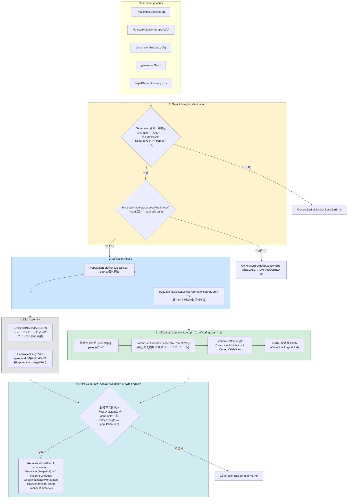

# BlackPoker Simulator Next Generation Builder Design V1
# (Generation g $\rightarrow$ Generation g+1 次世代母集団構築境界契約)

作業ID: `BP-SIM-AI-GENERATION-BUILDER-DESIGN-V1`  
ステータス: **PROPOSED / DESIGNED (PENDING INDEPENDENT REVIEW)**  
対象リポジトリ: `BlackPoker/BlackPoker`  
対象ブランチ: `BlackPoker/issue551-core-flow`  
先行仕様:
- `tools/simulator/docs/ai-fitness-design-v1.md` (Formal Accepted)
- `tools/simulator/docs/ai-population-selection-design-v1.md` (Formal Accepted)
- `tools/simulator/docs/ai-genetic-operators-design-v1.md` (Formal Accepted)
- `tools/simulator/src/domain/ai/PopulationSelectionTypes.ts` (Implemented)
- `tools/simulator/src/engine/ai/PopulationSelector.ts` (Implemented)
- `tools/simulator/src/domain/ai/GeneticOperatorTypes.ts` (Implemented)
- `tools/simulator/src/engine/ai/GeneticOperators.ts` (Implemented)
- `tools/simulator/src/engine/ai/ParentPairAssembler.ts` (Implemented)
- `tools/simulator/src/engine/ai/DecisionDNACodec.ts` (Implemented)

---

## 1. Purpose (設計目的)

本設計書は、BlackPoker Simulator AI 自己対戦進化（Phase 4.0: Self-Play Evolution）において、先行して Formal Accepted 済みとなった **Population Selection（トーナメント親選択・エリート選出）**、**Genetic Operators（交叉・突然変異・自己交配回避ペアリング）**、および **Runtime Match Telemetry** を統合し、

$$\text{PopulationSnapshot}(g) + \text{FitnessEvaluationSnapshot}(g) \xrightarrow{\quad\text{Generation Builder}\quad} \text{PopulationSnapshot}(g+1)$$

として、世代 $g$ の評価済み母集団から世代 $g+1$ の未評価母集団スナップショットを **決定論的（Deterministic）かつ完全フェイルクローズ（Fail-Closed）** に組み立てる **Generation Builder / Next Generation Assembly** の境界契約（Boundary Contract）を定義する。

### 解決する課題
1. **次世代構築の境界契約の明確化**: 単なるスクリプトやループ処理ではなく、入力不変性・原子性（Atomicity）・完全検証を満たす次世代組み立てレイヤの責務分離。
2. **Fitness 非継承原則の徹底**: エリート個体であっても前世代の適応度スコア（`fitnessScore`）を次世代へ絶対に持ち越さず、新世代においてゼロから再評価（Re-evaluated）させる契約。
3. **エリート DNA の保存とオブジェクト隔離**: エリート DNA の重み配列およびメタデータを改変せず完全保存しつつ、スナップショット間の可変参照共有を防止するクローン隔離方式の確定。
4. **乱数消費規約と親系列の一貫性**: 親選択における PRNG 状態の巻き戻りを防ぎ、1 本の連続した親系列から決定論的にペアを組み立てる方式の確定。
5. **dnaRef 設計ギャップの解消**: メモリ上で生成された Offspring DNA に対し、`PopulationEntry.dnaRef` をどのように決定論的かつ安全に付与するかの方式確定（NEW DESIGN DECISION）。
6. **系統情報（Lineage）と母集団の分離**: `PopulationEntry` や `DecisionDNA` に不要な系統フィールドを侵入させず、世代交代マニフェスト（`GenerationBuildResult`）として外部分離する境界の確定。
7. **全か無か（All-or-Nothing）の原子性**: 1 体でも生成や検証に失敗した場合、部分的な母集団を返却せず、即座に例外停止するフェイルクローズ保証。

> [!IMPORTANT]
> **本作業のスコープ境界**  
> 本ドキュメントは **DESIGN ONLY（設計仕様の確定のみ）** であり、Generation Builder の TypeScript プロダクションコード実装、Generation Runner、対戦スケジュール実行、および Evolution Loop の実装は一切行いません。

---

## 2. Core Principles & Philosophy (最重要設計原則)

本設計書に基づくすべてのアーキテクチャおよび将来の実装は、次の 7 つの絶対原則に従わなければならない:

```text
【Generation Builder 最重要原則 7箇条】

1. Victory is the objective. Life is a resource, not a score.
   進化の目的は勝利であり、ライフ残量やターン数などのテレメトリを適応度や選択へ混入させてはならない。

2. Fitness は Generation g+1 へ継承しない。
   新世代の個体はすべて未評価（Unevaluated）として生成され、前世代のスコアを引き継がない。

3. Elite でも Fitness はゼロから再評価する。
   エリート個体の DNA 重みは完全保存されるが、新世代の環境下で全個体と同列に再対戦・再評価される。

4. INSUFFICIENT_EVIDENCE を親・Elite へ昇格しない。
   証拠不十分（対戦完了数・完了率不足）の個体を、暫定スコアの高さで親やエリートへ繰り上げてはならない。

5. INVALID を救済しない。
   クラッシュや例外（FAILED）を発生させた個体は完全に排除し、いかなる場合も次世代へ残さない。

6. Generation Builder は Game Rule 非依存（Rule-Agnostic）。
   Generation Builder はカード効果、アクション名、フェーズ進行、GameSession を一切参照しない。

7. Runtime Telemetry を Selection / Crossover / Mutation へ使わない。
   実行時間計測値（ms）やスループットは観測専用であり、次世代構築アルゴリズムに影響を与えてはならない。
```

---

## 3. Architecture & Layer Separation (アーキテクチャと責務分離)

Generation Builder は、進化サイクルにおける「世代交代（Transition）」のみを担当する純粋な変換コンポーネントである。

### 3.1 Canonical Architecture Flow



### 3.2 責務の明確な分離（Do / Do Not）

| 項目 | Generation Builder の責務（DO） | Generation Builder の非責務（DO NOT / 禁止） |
| :--- | :--- | :--- |
| **対戦実行** | なし。入力として完成済みのスナップショットを受け取るのみ。 | 対戦（Self-Play Match）の実行、シミュレーションループの呼出。 |
| **Fitness 計算** | なし。Fitness スコアの集計・再計算は一切行わない。 | 勝率の算出、タイブレーク判定の独自実装、テレメトリの算入。 |
| **評価コンテキスト** | `assessReadiness` を介して比較可能性（Comparability）を検証。 | コンテキスト不一致時の自動マージ、不適格個体の救済。 |
| **選択アルゴリズム** | `PopulationSelector` の既存メソッドを呼び出す。 | トーナメント選択アルゴリズムの独自再実装。 |
| **ペアリング・リトライ** | `ParentPairAssembler` の既存メソッドを呼び出す。 | 自己交配検知・リトライループの独自再実装。 |
| **遺伝的操作** | `generateOffspring` の既存ファサードを呼び出す。 | 交叉・突然変異ロジックの直接組み直し。 |
| **ゲームルール** | ルールに完全非依存。重み配列の次元数と Codec のみを参照。 | `GameSession`、`RulePackage`、Action ID、Card 構造の参照。 |
| **実行時間テレメトリ** | なし。テレメトリ値を内部状態やアルゴリズムに利用しない。 | 処理時間による足切り、動的変異率変更、ログ出力。 |

---

## 4. Generation Builder Configuration (設定型定義と検証)

Generation Builder の挙動を制御する設定パラメータを定義する。

### 4.1 設定インターフェース定義

```typescript
export interface GenerationBuilderConfig {
  /** 次世代の目標母集団サイズ N (有限整数 >= 2) */
  readonly populationSize: number;
  /** 親選択設定パラメータ (minimumValidPopulationCount, tournamentSize, eliteCount) */
  readonly selectionConfig: PopulationSelectionConfig;
  /** 遺伝的操作子設定パラメータ (mutationRate, mutationSigma, clamp, maxRetries) */
  readonly geneticOperatorConfig: GeneticOperatorConfig;
  /**
   * オプション: 子個体 dnaRef 解決関数 (NEW DESIGN DECISION)
   * 未指定時はデフォルトの Canonical Logical Ref ("genome:<genomeId>") を使用。
   */
  readonly offspringDnaRefResolver?: (genomeId: string, dna: DecisionDNA) => string;
}
```

### 4.2 設定の初期仮値 (Provisional Engineering Defaults)

```typescript
export const DEFAULT_GENERATION_BUILDER_CONFIG: GenerationBuilderConfig = Object.freeze({
  populationSize: 100,
  selectionConfig: DEFAULT_POPULATION_SELECTION_CONFIG,       // minValid: 2, tournamentSize: 3, eliteCount: 1
  geneticOperatorConfig: DEFAULT_GENETIC_OPERATOR_CONFIG,   // mutationRate: 0.01, sigma: 0.05, clamp: [-10, 10], retries: 3
});
```

### 4.3 populationSize の厳格なバリデーション
- `populationSize` は **有限な正の整数** かつ **$\ge 2$** でなければならない。
- **ハードコード 100 の禁止**: `populationSize` は設定可能でなければならず、20、100、500 等の任意の有効母集団サイズを受け入れなければならない。
- `NaN`、`Infinity`、負数、小数、0、1 は `GenerationBuilderConfigurationError` を送出して即座に拒絶する。

---

## 5. Generation Sizing & Boundary Constraints (母集団サイズと境界不変式)

### 5.1 母集団構成の基本関係式
次世代母集団サイズ $N$（`populationSize`）、エリート保存数 $E$（`selectionConfig.eliteCount`）、および生成子個体数 $M$（`offspringCount`）は、常に次の完全な等式を満たさなければならない:

$$\text{populationSize} = \text{eliteCount} + \text{offspringCount}$$

$$\text{offspringCount} = \text{populationSize} - \text{eliteCount}$$

### 5.2 eliteCount の境界契約 ($0 \le E < N$)
Generation Builder においては、エリート保存数 $E$ に対し、次の厳格な制約を課す:

$$0 \le \text{eliteCount} < \text{populationSize}$$

#### 設計判断: なぜ `eliteCount === populationSize` を禁止するのか
- **次世代生成の存在意義**: 進化世代交代（Generation Transition）の目的は、探索空間の探索（Exploration）と既存優秀解の活用（Exploitation）のバランスにある。もし `eliteCount === populationSize`（例: $E = 100, N = 100$）を許可すると、Offspring が 1 体も生成されず（$\text{offspringCount} = 0$）、次世代は前世代の完全なクローン複製となって探索が完全に停止する。
- **既存仕様との整合**: `tools/simulator/docs/ai-genetic-operators-design-v1.md` Section 17.1 に明記された $0 \le \text{eliteCount} < \text{populationSize}$ 契約を厳格に継承する。
- **Fail-Fast 検証**: `eliteCount >= populationSize`（または `eliteCount < 0`）の場合は、処理を開始する前に `GenerationBuilderConfigurationError` を送出する。

### 5.3 現在世代サイズと次世代サイズの関係 (Size Invariance vs Scalability)
- **設計判断**: 現在世代の母集団サイズ $N_g$（`population.entries.length`）と次世代の目標サイズ $N_{g+1}$（`config.populationSize`）が異なる場合（例: $N_g = 20 \rightarrow N_{g+1} = 100$）を **許可（Support）** する。
- **理由**:
  1. 初期世代（Generation 0）の小さな Seed 母集団から本番規模へのスケールアップや、計算リソースに応じた母集団サイズの動的調整を妨げない。
  2. 親選択の適格性（`SelectionReadiness`）は、現在世代の VALID 個体プールに対して判定されるため、次世代サイズと現在サイズが異なっていてもアルゴリズム的な矛盾は生じない。
  3. 暗黙に「現在世代サイズ＝次世代サイズ」と固定化することを防ぐ。

---

## 6. Generation Alignment & Preconditions (世代番号整合性契約)

世代番号に関する誤指定やスナップショットの食い違いによるサイレントなデータ汚染を防ぐため、厳格な入力整合性ゲートを設ける。

### 6.1 整合性バリデーション規則

```typescript
// 世代整合性の Fail-Closed 検証
if (population.generation !== fitnessSnapshot.generation) {
  throw new GenerationBuilderConfigurationError(
    `Generation mismatch: population.generation (${population.generation}) !== fitnessSnapshot.generation (${fitnessSnapshot.generation})`
  );
}

if (fitnessSnapshot.context.generation !== population.generation) {
  throw new GenerationBuilderConfigurationError(
    `Context generation mismatch: fitnessSnapshot.context.generation (${fitnessSnapshot.context.generation}) !== population.generation (${population.generation})`
  );
}

if (targetGeneration !== population.generation + 1) {
  throw new GenerationBuilderConfigurationError(
    `Target generation mismatch: targetGeneration (${targetGeneration}) must equal population.generation + 1 (${population.generation + 1})`
  );
}
```

### 6.2 targetGeneration 明示入力契約の採用
- **設計判断**: API 入力として `targetGeneration` を明示的に受け取り、`targetGeneration === population.generation + 1` を Fail-Fast で照合する契約を採用する。
- **選定理由**:
  1. `generateOffspring({ generation: targetGeneration, ... })` が生成対象世代番号を明示的に要求する既存契約と完全に一致する。
  2. 呼び出し側が「どの世代を構築しようとしているか」の意図を表明し、Builder がそれを検証することで、世代番号のズレやループインデックスの誤りを呼び出し側境界で即座に検知できる。

---

## 7. Selection Readiness & Readiness Gate (親選択適格性ゲート)

Generation Builder 自身は、Fitness スコアの計算やステータス評価を行わない。既存の `PopulationSelector.assessReadiness()` を呼び出し、その結果に完全に委譲する。

### 7.1 Readiness Gate 判定テーブル

| `SelectionReadinessStatus` | Generation Builder の挙動 | 結果 |
| :--- | :--- | :--- |
| **`READY`** | 正常処理を続行し、親選択・エリート選出へ進む。 | 次世代構築へ進む |
| **`REEVALUATION_REQUIRED`** | **即時停止（Fail-Closed）**。次世代母集団を一切生成しない。 | `GenerationBuilderExecutionError` 送出 |
| **`INVALID_POPULATION`** | **即時停止（Fail-Fast）**。構造的不正を検知して停止。 | `GenerationBuilderIntegrityError` 送出 |
| **`INCOMPARABLE_EVALUATION`** | **即時停止（Fail-Fast）**。評価コンテキスト不一致のため停止。 | `GenerationBuilderExecutionError` 送出 |

### 7.2 No Tier 2 Fallback 原則の徹底
- `validCount < requiredCount` の場合、いかなる場合も `INSUFFICIENT_EVIDENCE`（Tier 2）の個体を `provisionalScore` 順で繰り上げて親やエリートにしてはならない。
- 未完了試合や中断試合を多く含む個体を「勝率 100% だから」と過大評価して親に選出するリスクを完全に遮断する。

---

## 8. Seed Hierarchy & PRNG Stream Architecture (シード体系と乱数消費規約)

決定論的再現性の根幹となる Seed 体系は、既存の Formal Accepted 仕様（`DeterministicShuffle.ts` の `deriveSeed` および固定 Evolution Stream Keys）に完全準拠する。

### 8.1 generationSeed の型契約
- `generationSeed` は **明示入力必須** とする。
- `0` は正当なシード値として許容する。
- `undefined` や `null` の場合に `0` や `Date.now()` へフォールバックすることは **厳禁**。
- 有限整数（`Number.isInteger(seed)`）であることを検証する。

### 8.2 シード派生ツリー

```text
generationSeed (入力: 例 12345)
  │
  ├── deriveSeed(generationSeed, "evolution-selection-v1")
  │     └── selectionSeed (トーナメント親選択・エリート選択タイブレークに使用)
  │
  ├── deriveSeed(generationSeed, "evolution-offspring-v1-0")
  │     └── offspringSeed[0]
  │           ├── deriveSeed(offspringSeed[0], "evolution-crossover-v1") ──> crossoverSeed
  │           ├── deriveSeed(offspringSeed[0], "evolution-mutation-v1")  ──> mutationSeed
  │           └── deriveSeed(offspringSeed[0], "evolution-self-mating-retry-v1-0") ──> retrySeed[0]
  │
  ├── deriveSeed(generationSeed, "evolution-offspring-v1-1")
  │     └── offspringSeed[1]
  │           └── ...
  │
  └── deriveSeed(generationSeed, "evolution-offspring-v1-{M-1}")
        └── offspringSeed[M-1]
```

### 8.3 単一親系列生成の理由 (Why Single Parent Sequence)
次世代で必要な親の総数は $\text{offspringCount} \times 2$ である。
Generation Builder は、次の方式を採用する:

```typescript
const requiredParentsCount = offspringCount * 2;
const parentSequence = PopulationSelector.selectParents(
  requiredParentsCount,
  population,
  fitnessSnapshot,
  resolvedConfig.selectionConfig,
  selectionSeed,
  expectedContext
);
```

#### 禁止候補との比較
- **禁止候補**: 各 Offspring $i$ のループ内で毎回 `selectParents(2, ..., selectionSeed)` を呼び出す設計。
  - **禁止理由**: 毎回同一の `selectionSeed` で `SeededRandom` が初期化されるため、すべての Offspring において全く同一の親ペア（`parents[0], parents[1]`）が選ばれ続け、母集団の多様性が完全に崩壊する。
- **採用方式の利点**: `selectParents` は内部で 1 つの `SeededRandom(selectionSeed)` を作成し、連続して $2M$ 回のトーナメント選択を実施するため、PRNG 状態が自然に進み、決定論的かつ偏りのない親系列が得られる。

### 8.4 DESIGN FINDING: Elite Selection と Parent Selection の PRNG 状態
- `PopulationSelector.selectElites()` と `PopulationSelector.selectParents()` は、それぞれ内部で `new SeededRandom(selectionSeed)` を独立してインスタンス化する。
- したがって、エリート選出時に同点（Tie）が発生して PRNG が消費されたとしても、`selectParents()` の乱数列には一切影響を与えない（ストリームが言語ランタイムのインスタンス境界により自然に分離されている）。
- **結論**: 現行の Formal Accepted Stream Key（`evolution-selection-v1`）を両者に渡す設計で何ら問題はなく、新たな Stream Key を無断新設する必要はない。

---

## 9. Parent Selection & Pairing Flow (親選択とペアリング)

生成された単一の親系列（`parentSequence: readonly SelectedParent[]`）から、各 Offspring 用の親ペアを組み立てる。

### 9.1 隣接ペア化 (Adjacent Pairing)
Offspring $i$（$0 \le i < \text{offspringCount}$）に対する初期親ペアは、配列の連続する 2 要素とする:

$$\text{initialParentA} = \text{parentSequence}[2i]$$

$$\text{initialParentB} = \text{parentSequence}[2i + 1]$$

### 9.2 自己交配回避と ParentPairAssembler 委譲
- 同一の親が選ばれた場合（`initialParentA.genomeId === initialParentB.genomeId`）、Generation Builder は自己交配回避ロジックを独自実装せず、既存の `ParentPairAssembler.assembleParentPair()` へ委譲する:

```typescript
const parentPair = ParentPairAssembler.assembleParentPair({
  parentA: initialParentA,
  parentB: initialParentB,
  population,
  fitnessSnapshot,
  offspringSeed, // deriveSeed(generationSeed, getOffspringStreamKey(i))
  selectionConfig: resolvedConfig.selectionConfig,
  operatorConfig: resolvedConfig.geneticOperatorConfig,
  expectedContext,
});
```

- **自己交配リトライの独立性**: `ParentPairAssembler` はリトライ時に `offspringSeed` から派生した独立ストリーム（`evolution-self-mating-retry-v1-${r}`）を使用するため、親選択全体の乱数列や他の Offspring の乱数系列を一切汚染しない。
- **リトライ枯渇時の挙動**: `maxSelfMatingRetries` 回のリトライ後も同一個体となった場合、`ParentPairAssembler` の契約に従い、自己交配（無性生殖＋変異）として受容する。

---

## 10. Offspring Generation & Indexing (子個体生成とインデックス契約)

### 10.1 offspringIndex 契約 ($0 \dots \text{offspringCount} - 1$)
- `offspringIndex` は、**エリート保存数に関係なく、常に $0$ から始まる連続整数** とする。
- 例: $\text{populationSize} = 5, \text{eliteCount} = 1 \implies \text{offspringCount} = 4$
  - `offspringIndex`: $0, 1, 2, 3$
- 出力 Population のスロットインデックス（エリートの次であるインデックス $1, 2, 3, 4$）と `offspringIndex` を混同してはならない。

### 10.2 子個体ゲノム ID 規約
子個体の `genomeId` は、既存の `formatOffspringGenomeId(targetGeneration, offspringIndex)` を使用する:

$$\text{genomeId} = \text{"gen-"} + \text{padStart}(g_{\text{target}}, 6, \text{"0"}) + \text{"-offspring-"} + \text{padStart}(i, 6, \text{"0"})$$

- 例: `targetGeneration = 11, offspringIndex = 0` $\implies$ `"gen-000011-offspring-000000"`
- 時刻、UUID、ランダム文字列の混入は一切禁止。

### 10.3 generateOffspring の呼出
```typescript
const generated = generateOffspring({
  parentPair,
  generation: targetGeneration,
  offspringIndex: i,
  generationSeed,
  config: resolvedConfig.geneticOperatorConfig,
});
```
- `generateOffspring` 内部で Crossover（23,452 draws 固定）、Mutation、DNA 構築、`DecisionDNACodec.validate()` が実行され、`GeneratedOffspring`（`dna` と `lineage`）が返却される。

---

## 11. Elite Inheritance & DNA Immutability (エリート継承と不変性契約)

エリート個体（前世代の最優秀個体群）の継承における境界契約を確定する。

### 11.1 エリート選出
```typescript
const elites = PopulationSelector.selectElites(
  population,
  fitnessSnapshot,
  resolvedConfig.selectionConfig,
  selectionSeed,
  expectedContext
);
```

### 11.2 エリートの Genotype・Metadata・Fitness 契約対比表

| 属性 | エリート個体（次世代 Entry）の扱い | 理由・意味論 |
| :--- | :--- | :--- |
| **`genomeId`** | **前世代の `genomeId` を完全維持** | 同一 genotype が世代を越えて生存している系譜追跡を可能にするため。 |
| **`dnaRef`** | **前世代の `dnaRef` を完全維持** | 同一 DNA アーティファクト実体への参照であるため。 |
| **`PopulationEntry.generation`** | **`targetGeneration`（$g+1$）へ更新** | 当該個体が世代 $g+1$ の母集団メンバーであることを表すため。 |
| **`dna.patternWeights`** | **完全同一（ビット一致）** | 交叉・突然変異を行わないため。 |
| **`dna.contextPatternWeights`** | **完全同一（ビット一致）** | 交叉・突然変異を行わないため。 |
| **`dna.metadata`** | **完全同一（書き換えない）** | DNA 自体を書き換えると「DNA 完全保存」に反するため。`dna.metadata.generation` は**誕生世代（Origin）**を表す。 |
| **`fitnessScore`** | **継承禁止（一切含めない）** | **最重要原則**。次世代コンテキスト下で全個体と同列に再対戦・再評価されるため。 |

### 11.3 オブジェクト参照隔離 (Clone Isolation vs Reference Reuse)
- **設計判断**: エリートの DNA は、`DecisionDNACodec.clone(elite.dna)` により **ディープクローンして隔離（Clone Isolation）** する。
- **比較検討**:
  - *Option 1 (Reference Reuse)*: 既存 `dna` の参照をそのまま使い回す。
    - 短所: もし将来のシミュレーションや外部ツールが誤って配列要素をインプレース変更した場合、世代 $g$ と世代 $g+1$ の両方のデータが同時に破壊されるリスクがある。
  - *Option 2 (Clone Isolation - 採用)*: `DecisionDNACodec.clone()` を実行し、重み配列およびメタデータのディープコピーを作成する。
    - 長所: JSON 等価性（Deep Equal）を 100% 保ちつつ、世代スナップショット間のオブジェクト可変参照共有を完全に断ち切ることができる。
    - 性能: 母集団サイズ 100 に対しエリート数は通常 1〜5 体程度であり、クローンコストは極めて軽微。

---

## 12. dnaRef Resolution Strategy (NEW DESIGN DECISION)

### 12.1 設計課題（Design Gap）
`PopulationEntry` 型定義には `dnaRef: string`（安定した DNA アーティファクト参照）が必須である。  
しかし、`generateOffspring()` はインメモリの `DecisionDNA` オブジェクトと `OffspringLineageMetadata` を生成する純粋関数であり、ディスク I/O やファイルパス決定の責務を持たない。  
プロダクション実装時に即興で決め打ちすることを防ぐため、3 つの候補方式を比較評価する。

### 12.2 候補方式の比較検討

| 方式 | 概要 | 長所 | 短所 | 評価 |
| :--- | :--- | :--- | :--- | :--- |
| **Option A<br>(Canonical Logical Ref)** | 決定論的論理 URI 形式を採用。<br>例: `genome:<genomeId>` または `dna://<genomeId>` | ・I/O 不要で純粋関数として完結。<br>・完全な決定論性を保証。<br>・Generation Builder だけで即座に完全な `PopulationSnapshot` を構築可能。 | ・ファイルシステム上の物理パスや SHA ハッシュ文字列ではない。 | **V1 推奨基盤** |
| **Option B<br>(Configurable Resolver)** | 設定にリゾルバ関数を持たせる。<br>`dnaRefResolver(genomeId, dna) => string`<br>デフォルトは Option A。 | ・ストレージ方針を Builder から完全分離。<br>・将来のファイル出力やハッシュ計算に柔軟対応可能。 | ・外部コールバックの非決定性を Builder が直接保証しづらい。 | **V1 拡張として統合** |
| **Option C<br>(Unmaterialized Draft)** | Builder は `PopulationSnapshot` を返さず、未具現化 Draft を返す。保存後にスナップショット化。 | ・物理アーティファクト保存との意味論的一致が明確。 | ・Generation Builder 単体で `PopulationSnapshot` が完成しない。<br>・不必要な中間レイヤが増加。 | **不採用** |

### 12.3 採用方式 (NEW DESIGN DECISION)
**Option A をベースとし、Option B の決定論的リゾルバをオプション許可するハイブリッド設計** を採用する。

1. **デフォルト挙動 (Canonical Logical Ref)**:
   ```typescript
   function defaultOffspringDnaRef(genomeId: string): string {
     return `genome:${genomeId}`;
   }
   ```
   - 例: `"genome:gen-000011-offspring-000000"`
2. **エリート個体の `dnaRef`**:
   - 前世代の `PopulationEntry.dnaRef` を **そのまま維持** する（同一 genotype 実体のため）。
3. **カスタムリゾルバの許容**:
   - `config.offspringDnaRefResolver` が指定された場合はそれを使用し、未指定時はデフォルトの Canonical Logical Ref を使用する。
   - リゾルバの戻り値が非空文字列であることをバリデーションする。

---

## 13. Lineage Tracking & Manifest Boundary (系統追跡とマニフェスト境界)

### 13.1 責務境界: PopulationEntry への非侵入
- `PopulationEntry` は母集団の構成メンバー（ID, dnaRef, generation, dna）のみを表す型であり、系統情報（親 ID、使用シード、オペレータ版数等）をフィールドとして勝手に追加してはならない。
- また、`DecisionDNATypes` も変更してはならない。

### 13.2 GenerationBuildResult 型定義 (Deterministic Transition Manifest)
Generation Builder の成果物として、`PopulationSnapshot` と共に決定論的世代交代マニフェストを包含する `GenerationBuildResult` を新設する:

```typescript
export interface GenerationBuildResult {
  /** 構築された次世代 (g+1) の母集団スナップショット */
  readonly population: PopulationSnapshot;
  /** 元世代番号 g */
  readonly sourceGeneration: number;
  /** 目標世代番号 g+1 */
  readonly targetGeneration: number;
  /** 世代ベースシード */
  readonly generationSeed: number;
  /** 親選択に使用された派生シード */
  readonly selectionSeed: number;
  /** 目標母集団サイズ N */
  readonly populationSize: number;
  /** エリート保存数 E */
  readonly eliteCount: number;
  /** 生成子個体数 M */
  readonly offspringCount: number;
  /** 次世代へ継承されたエリートの genomeId 配列 (選出順) */
  readonly eliteGenomeIds: readonly string[];
  /** 全子個体の系統メタデータ配列 (offspringIndex 昇順) */
  readonly offspringLineages: readonly OffspringLineageMetadata[];
}
```

### 13.3 マニフェスト純粋性の担保
- **含めるもの**: 世代番号、シード値、サイズ構成、エリート ID 配列、子個体系統情報配列。
- **含めてはならないもの**:
  - タイムスタンプ（`Date.now()`、ISO 文字列）
  - 実行時間計測テレメトリ（ms、スループット）
  - 前世代の Fitness スコア（`fitnessScore` のコピー）
  - OS、CPU、ランタイム環境メタデータ
- これにより、`GenerationBuildResult` は入力が同一であれば **1 ビットの狂いもなく完全一致する純粋な決定論的データオブジェクト** となる。

---

## 14. Next Generation Population Assembly (次世代母集団配列構築)

### 14.1 出力エントリの決定論的順序 (Canonical Ordering)
次世代 `PopulationSnapshot.entries` の配列順序は、入力配列の順序に一切依存せず、以下の **固定順序** で直列化（Serialize）する:

$$\text{entries} = [\text{elite}_0, \text{elite}_1, \dots, \text{elite}_{E-1}, \text{offspring}_0, \text{offspring}_1, \dots, \text{offspring}_{M-1}]$$

1. **第 1 セグメント（Elites: $0 \le k < E$）**:
   - `PopulationSelector.selectElites()` の返却順。
2. **第 2 セグメント（Offspring: $0 \le i < M$）**:
   - `offspringIndex` の昇順（$0, 1, \dots, M-1$）。

### 14.2 genomeId の一意性検証
- 次世代母集団内の全 $N$ 体の `genomeId` は、厳格に一意でなければならない。
- エリートの `genomeId` と新規 Offspring の `genomeId` が万一衝突した場合は、**即座に `GenerationBuilderIntegrityError` を送出して停止（Fail-Closed）** する。自動的なリネームや枝番付与による誤魔化しは禁止する。

---

## 15. Immutability, Atomicity & Error Taxonomy (不変性・原子性・エラー体系)

### 15.1 入力不変性 (Input Immutability)
- Builder は、入力された `PopulationSnapshot(g)`、`FitnessEvaluationSnapshot(g)`、および `DecisionDNA` の内部状態を一切変更（破壊的ソート、push、splice、プロパティ代入等）してはならない。

### 15.2 出力不変性 (Output Immutability)
- 生成された `GenerationBuildResult`、`PopulationSnapshot`、`entries` 配列、`eliteGenomeIds` 配列、`offspringLineages` 配列は、すべて `Object.freeze` された浅い不変オブジェクトとして返却する。

### 15.3 原子性 (All-or-Nothing Atomic Build)
- Generation Builder は、完全な次世代母集団（$N$ 体すべて）が正常に構築・検証された場合のみ結果を返却する。
- 途中で例外が発生した場合、部分的に生成されたスナップショット（例: 50 体だけできたもの）を正常値として返却してはならない。

### 15.4 エラー分類体系 (Error Taxonomy)

```typescript
/** 設定値・引数の不備を示すエラー (Fail-Fast) */
export class GenerationBuilderConfigurationError extends Error {
  constructor(message: string) {
    super(message);
    this.name = "GenerationBuilderConfigurationError";
  }
}

/** 生成データの不整合・規約違反を示すエラー (Fail-Closed) */
export class GenerationBuilderIntegrityError extends Error {
  constructor(message: string) {
    super(message);
    this.name = "GenerationBuilderIntegrityError";
  }
}

/** 選択適格性不足等の実行停止を示すエラー (Fail-Closed) */
export class GenerationBuilderExecutionError extends Error {
  constructor(
    message: string,
    public readonly readinessStatus?: SelectionReadinessStatus
  ) {
    super(message);
    this.name = "GenerationBuilderExecutionError";
  }
}
```

---

## 16. Determinism & Input Order Independence (決定論性契約)

### 16.1 決定論性の完全保証
同一の `PopulationSnapshot(g)`、`FitnessEvaluationSnapshot(g)`、`GenerationBuilderConfig`、`targetGeneration`、および `generationSeed` が与えられた場合、生成される `GenerationBuildResult` は常にビット単位で完全一致（Deep Equal）しなければならない。

### 16.2 入力順序非依存性 (Input Ordering Independence)
- 入力 `PopulationSnapshot.entries` や `FitnessEvaluationSnapshot.entries` の配列順序が任意にシャッフルされていたとしても、それらが同一の個体集合・スコア集合を表している限り、次世代の出力結果（選出されるエリート、親ペア、生成される子個体、出力配列順）は **1 ミリも変化してはならない**。
- `PopulationSelector` が内部で `genomeId` による正規ソートを実施しているため、Generation Builder 側で入力配列順に依存する処理を追加しないことで、この契約を保証する。

### 16.3 シード感度 (Seed Sensitivity)
- `generationSeed` を変更した場合、親選択、交叉点、突然変異値が変化し、次世代母集団が異なる構成となることをテストで実証可能とする。

---

## 17. Worked Examples (具体的適用シナリオ)

### Worked Example A: 通常の世代交代 (Normal Generation)
- **入力**:
  - `sourceGeneration`: 10
  - `targetGeneration`: 11
  - `populationSize`: 5
  - `eliteCount`: 1
  - `generationSeed`: 42
- **算出**:
  - `offspringCount`: $5 - 1 = 4$
  - 必要親数: $4 \times 2 = 8$
  - `offspringIndex`: $0, 1, 2, 3$
- **結果**:
  - `entries[0]`: 前世代最高スコアのエリート（`genomeId: "gen-000010-offspring-000003"`, `generation: 11`）
  - `entries[1]`: `gen-000011-offspring-000000` (`offspringIndex: 0`)
  - `entries[2]`: `gen-000011-offspring-000001` (`offspringIndex: 1`)
  - `entries[3]`: `gen-000011-offspring-000002` (`offspringIndex: 2`)
  - `entries[4]`: `gen-000011-offspring-000003` (`offspringIndex: 3`)

### Worked Example B: エリート保存なし (No Elite)
- **入力**: `populationSize: 5`, `eliteCount: 0`
- **算出**: `offspringCount: 5`
- **結果**:
  - エリート 0 体、子個体 5 体（`offspringIndex: 0..4`）
  - 全エントリが新規 Offspring。

### Worked Example C: 最小有効母集団 (Minimum Population)
- **入力**: `populationSize: 2`, `eliteCount: 1`
- **算出**: `offspringCount: 1`（必要親数: 2）
- **結果**:
  - エリート 1 体、子個体 1 体（正当に成立）。

### Worked Example D: 不正なエリート数 (Invalid Elite Count)
- **入力**: `populationSize: 5`, `eliteCount: 5`
- **挙動**: $E < N$ 違反を検知。
- **結果**: `GenerationBuilderConfigurationError` を即座に送出して停止（子個体が 0 になる構成を排除）。

### Worked Example E: 再評価要求 (Reevaluation Required)
- **入力**: 母集団 20 体中、VALID 個体が 1 体のみ（他は対戦不足で `INSUFFICIENT_EVIDENCE`）。
- **挙動**: `assessReadiness` が `REEVALUATION_REQUIRED` を返却。
- **結果**: `GenerationBuilderExecutionError` を送出して即時停止。Tier 2 個体を繰り上げて次世代を作ることは絶対にしない。

### Worked Example F: エリートの Fitness 非継承 (Elite Fitness)
- **世代 10**: 個体 A の適応度 `fitnessScore = 0.95`（エリート選出）。
- **世代 11**: 個体 A の DNA は完全保存されて次世代母集団に入るが、`PopulationEntry` には Fitness フィールドは存在しない。世代 11 の対戦が実施されるまで、個体 A の Fitness は存在せず、前世代の 0.95 は完全に破棄される。

### Worked Example G: 自己交配リトライ (Self-Mating)
- **状況**: 親系列から取得したペアが `(IndX, IndX)` であった。
- **挙動**: `ParentPairAssembler` がリトライストリーム（`evolution-self-mating-retry-v1-0`）から親 B を再サンプリング。
- **結果**: 別個体 `IndY` が選ばれれば `(IndX, IndY)` として交叉。3 回リトライしても `IndX` のみの場合は `(IndX, IndX)` を受容して無性生殖＋変異を実施。Builder 自身はリトライロジックに関与しない。

---

## 18. Implementation Test Plan (将来実装時の必須テスト 30 項目)

将来の Production TypeScript 実装時に満たすべき必須テストスイートを以下のように策定する:

```text
【Generation Builder 将来実装テストマトリクス (30項目)】

[Config Validation]
1.  populationSize デフォルト 100 が正しく適用されること
2.  populationSize オーバーライド (例: 5, 20) が反映されること
3.  populationSize 不正値 (NaN, Infinity, 0, 1, 負数, 小数) を Fail-Fast で reject すること
4.  eliteCount = 0 (エリートなし) が正常動作すること
5.  eliteCount = 1 (デフォルト) が正常動作すること
6.  eliteCount >= populationSize (全エリートまたは超過) を Fail-Fast で reject すること
7.  eliteCount 不正値 (負数, 小数) を Fail-Fast で reject すること
8.  targetGeneration !== population.generation + 1 の不一致を reject すること
9.  generationSeed 不正値 (NaN, Infinity, 非整数) を reject すること

[Readiness & Fail-Closed]
10. assessReadiness が REEVALUATION_REQUIRED を返した時、即座に例外停止し母集団を生成しないこと
11. assessReadiness が INVALID_POPULATION を返した時、即座に例外停止すること
12. assessReadiness が INCOMPARABLE_EVALUATION を返した時、即座に例外停止すること
13. VALID で fitnessScore = 0.0 (全敗) の個体も正当な選択候補として親・エリートになり得ること
14. INSUFFICIENT_EVIDENCE (Tier 2) の個体が親・エリートに絶対に選出されないこと
15. INVALID (Tier 3) の個体が親・エリートに絶対に選出されないこと

[Elite Contract]
16. エリート個体の genomeId が前世代と完全一致すること
17. エリート個体の dnaRef が前世代と完全一致すること
18. エリート個体の DNA 重み配列がビット単位で完全一致すること
19. エリート個体の DNA がディープクローンされ、オブジェクト参照を共有していないこと
20. エリート個体の DNA metadata (誕生世代等) が改変されず保存されていること
21. エリート個体の前世代 Fitness スコアが次世代スナップショットに一切混入していないこと

[Offspring & Assembly Contract]
22. 生成される子個体数が正確に populationSize - eliteCount であること
23. 子個体の genomeId が "gen-XXXXXX-offspring-YYYYYY" 形式と完全一致すること
24. 子個体の offspringIndex が 0 から M-1 まで連続していること
25. 出力母集団の全エントリの entry.generation が targetGeneration と一致すること
26. 出力母集団内の全 genomeId が一意であること
27. 出力母集団の配列順序が [Elites, Offspring] の順序と完全一致すること

[Determinism & Pure Functionality]
28. 同一の入力スナップショット・Config・Seed に対し、完全一致 (Deep Equal) な結果を返すこと
29. 入力 Population / Fitness のエントリ配列順序を入れ替えても、同一の結果を返すこと (順序非依存性)
30. generationSeed を変更したとき、次世代母集団の結果が変化すること (ネガティブコントロール)
```

---

## 19. Explicit Non-Goals & Open Design Questions (非目標と設計課題)

### 19.1 明示的非目標 (Explicit Non-Goals)
本設計および次フェーズの実装において、以下は明示的にスコープ外とする:
- 対戦スケジュール実行エンジン（Generation Evaluation Schedule）
- ラウンドロビン対戦やスイスドロー対戦のスケジューリング
- 世代ループ（Evolution Loop）および停止基準（Stopping Criteria / Convergence Detection）
- 殿堂入り（Hall of Fame）管理
- レーティング算出（Elo / Glicko-2）
- Worker Threads やクラスタによるマルチプロセス並列評価
- DNA アーティファクトの物理ファイルライター（File Persistence Layer）

### 19.2 設計課題の整理 (Open Design Questions)

| 重要度 | 課題項目 | 現行方針 / 決定内容 | 将来フェーズでの扱い |
| :--- | :--- | :--- | :--- |
| **None (Solved)** | `dnaRef` の付与方式 | Section 12 にて Option A（`genome:<genomeId>`）を Canonical Logical Ref として採用し、カスタムリゾルバを許容。 | DNA アーティファクト保存レイヤ実装時に物理パスとの対応を確立。 |
| **None (Solved)** | エリート DNA の不変性 | Section 11 にて Clone Isolation を採用。DNA 自体は不変、Entry.generation のみ更新。 | 実装時に `DecisionDNACodec.clone` を利用。 |
| **None (Solved)** | 親系列の PRNG 消費 | Section 8 にて単一の連続親系列（$2M$ 体）を一括選出する契約に確定。 | 実装時に `selectParents(2M)` を呼出。 |
| **Low** | 大規模母集団時のメモリ | 現行仕様（$N \le 1000$）では全 DNA をインメモリ保持可能。 | 数万規模の場合はストリーミング生成を将来検討。 |

---

## 20. Appendix: Types & Interface Reference (統合型定義リファレンス)

```typescript
import { DecisionDNA } from "../../domain/ai/DecisionDNATypes";
import {
  PopulationSnapshot,
  FitnessEvaluationSnapshot,
  PopulationSelectionConfig,
  ComparableEvaluationContext,
  SelectionReadinessStatus,
} from "../../domain/ai/PopulationSelectionTypes";
import {
  GeneticOperatorConfig,
  OffspringLineageMetadata,
} from "../../domain/ai/GeneticOperatorTypes";

/**
 * Generation Builder 設定
 */
export interface GenerationBuilderConfig {
  readonly populationSize: number;
  readonly selectionConfig: PopulationSelectionConfig;
  readonly geneticOperatorConfig: GeneticOperatorConfig;
  readonly offspringDnaRefResolver?: (genomeId: string, dna: DecisionDNA) => string;
}

/**
 * Generation Builder 実行入力パラメータ
 */
export interface BuildNextGenerationParams {
  /** 元世代 (g) の母集団スナップショット */
  readonly population: PopulationSnapshot;
  /** 元世代 (g) の適応度評価スナップショット */
  readonly fitnessSnapshot: FitnessEvaluationSnapshot;
  /** 目標世代番号 (g + 1) */
  readonly targetGeneration: number;
  /** 世代ベースシード (有限整数) */
  readonly generationSeed: number;
  /** ビルダー設定パラメータ */
  readonly config?: Partial<GenerationBuilderConfig>;
  /** オプションの期待評価コンテキスト */
  readonly expectedContext?: ComparableEvaluationContext;
}

/**
 * Generation Builder 構築結果 (Deterministic Transition Manifest)
 */
export interface GenerationBuildResult {
  readonly population: PopulationSnapshot;
  readonly sourceGeneration: number;
  readonly targetGeneration: number;
  readonly generationSeed: number;
  readonly selectionSeed: number;
  readonly populationSize: number;
  readonly eliteCount: number;
  readonly offspringCount: number;
  readonly eliteGenomeIds: readonly string[];
  readonly offspringLineages: readonly OffspringLineageMetadata[];
}
```
