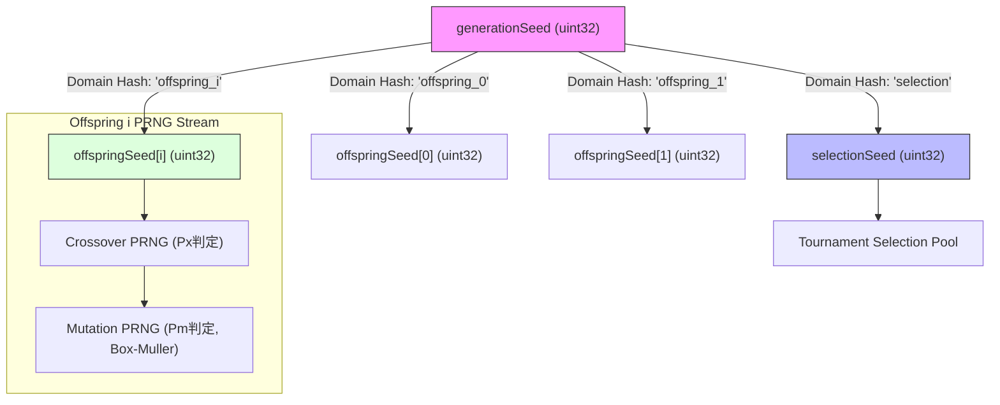

# BlackPoker Simulator Genetic Operators Design V1
# + Runtime Performance Telemetry / Artifact Policy

新規作業ID: `BP-SIM-AI-GENETIC-OPERATORS-DESIGN-V1`  
ステータス: **PROPOSED / DESIGNED (PENDING INDEPENDENT REVIEW)**  
対象リポジトリ: `BlackPoker/BlackPoker`  
対象ブランチ: `BlackPoker/issue551-core-flow`  
先行仕様:
- `tools/simulator/docs/ai-fitness-design-v1.md` (Formal Accepted)
- `tools/simulator/docs/ai-population-selection-design-v1.md` (Formal Accepted)
- `tools/simulator/src/domain/ai/DecisionDNATypes.ts` (Implemented)
- `tools/simulator/src/engine/ai/DecisionDNACodec.ts` (Implemented)
- `tools/simulator/src/domain/ai/PopulationSelectionTypes.ts` (Implemented)
- `tools/simulator/src/engine/ai/PopulationSelector.ts` (Implemented)

---

## 1. Purpose (設計目的)

本設計書は、BlackPoker Simulator AI 自己対戦進化（Phase 4.0: Self-Play Evolution）において、親個体の選択（Selection）の後に実行される **遺伝的操作子（Genetic Operators: Crossover / Mutation / Elite Inheritance / Offspring Lineage / 次世代 Population 境界）** の境界契約（Boundary Contract）を定義する。

さらに、今後の大規模自動対戦および世代交代実験において、必要な計算資源と所要時間を正確に見積もり・分析可能とするための **実行時間計測テレメトリ（Runtime Performance Telemetry）** および **実行時成果物保存方針（Runtime Artifact Policy）** を確定する。

### 解決する課題
1. **交叉（Crossover）の設計**: 23,452 次元の巨大な線形・双線形決定 DNA（Decision DNA）に対して、ゲーム規則非依存（Rule-Agnostic）でありながら既存の特徴量相関を不当に破壊しない交叉方式の選定。
2. **突然変異（Mutation）の設計**: 数値的発散や `NaN` / `Infinity` を防ぎ、重み空間を連続的かつ安全に探索する変異方式とパラメータ契約。
3. **自己交配（Self-Mating）の回避とリトライ契約**: トーナメント選択で同一個体が親 A・B に選ばれた場合の安全なハンドリング。
4. **乱数シード領域分離（Seed Domain Separation）**: 選択シードと遺伝操作シードの干渉を排除し、完全な決定論的再現性を保証。
5. **エリート継承（Elite Inheritance）の境界**: エリート個体のジェノタイプ（DNA）保存と、**Fitness Score 非継承（世代ごとの再評価必須）** の厳格な分離。
6. **次世代母集団構成境界**: エリート枠とオフスプリング枠による次世代生成契約（固定値 100 のハードコード排除）。
7. **実行時間テレメトリ（Runtime Performance Telemetry）**: 1 試合単位の所要時間（`elapsedMs`）、DNA 評価時間、世代全体時間の計測規約。
8. **実行時成果物方針（Runtime Artifact Policy）**: 大量対戦ログ（JSONL 等）を Git リポジトリに混入させず、ローカル成果物ディレクトリ（`.artifacts/ai-runs/<runId>/`）へ集約・隔離する管理方針。

> [!IMPORTANT]
> **本作業のスコープ境界**  
> 本ドキュメントは **DESIGN ONLY（設計仕様の策定）** であり、Crossover、Mutation、Generation Runner、Evolution Loop のプロダクションコード（TypeScript）の実装は行いません。  
> ただし、将来の自動対戦ログを Git 管理外とするための `.gitignore` への最小変更（1行追加）のみを許容・実施します。

---

## 2. Prerequisites (前提条件と最重要原則)

### 2.1 Formal Accepted 済み前提コンポーネント
- **Decision Feature Schema v4**: Viewer-Relative, Secret-Safe, Stage Semantics Preservation。
- **Decision DNA v1**:
  - スコアリングモデル: `linear-bilinear-v1`
  - 重み構造:
    - `patternWeights`: 143 次元（パターンバイアス）
    - `contextPatternWeights`: 163（コンテキスト特徴量） $\times$ 143（パターン特徴量） = 23,309 次元（行優先フラット配列）
    - 総重み次元数: 143 + 23,309 = 23,452 次元
    - `metadata`: JSON-safe DTO（スコアリング計算には影響を与えない）
- **GenomePolicy / GenomeScorer**: 決定論的 Argmax ポリシー。
- **Outcome-First Fitness Design & Evaluation V1**:
  - 最重要原則: **"Victory is the objective. Life is a resource, not a score."**
  - 勝敗結果（Outcome）に基づく Match Point Average (MPA)。
  - 残りライフ、ターン数、ダメージ等のテレメトリは Fitness に一切算入しない。
  - 3 値ステータス: `VALID`（Tier 1）, `INSUFFICIENT_EVIDENCE`（Tier 2）, `INVALID`（Tier 3）。
- **Population & Tournament Selection V1 + R1**:
  - Population と Fitness は別スナップショットとして管理（DNA への Fitness 直接書き込み禁止）。
  - `VALID` 個体のみが通常選択プール（Standard Selection Pool）の対象。
  - 決定論的 Mulberry32 トーナメント選択（Provisional Default $k=3$）。
  - エリート選択（Provisional Default $E=1$）。

### 2.2 遺伝的操作子の基本原則（Rule-Agnostic 原則）
Crossover および Mutation は、BlackPoker の個別ルールや特定アクションに依存してはならない。

```text
【絶対禁止事項】
1. 特定の Action ID（例: "action.down", "action.pass"）を参照して交叉点や変異率を変更すること。
2. カードのスート・ランク・役のセマンティクスを参照して重み操作を行うこと。
3. 特定の Rule Package（例: "standard-rule"）専用の特別処理を遺伝操作子に組み込むこと。
4. Telemetry（実行時間、ターン数、残りライフ等）を突然変異量や交叉確率へフィードバックすること。
```

---

## 3. Scope & Non-Goals (スコープと非目標)

### 3.1 本設計のスコープ
- Crossover オペレータの候補比較、V1 推奨方式、構造的粒度の定義。
- Mutation オペレータの候補比較、V1 推奨方式、変異パラメータ・数値クランプの定義。
- Parent Pair 契約と Self-Mating 回避・リトライ規約。
- Seed Domain Separation（選択用 PRNG と遺伝操作用 PRNG の分離モデル）。
- Offspring Identity および Lineage（系統情報）の表現形式。
- Elite Inheritance（ジェノタイプ継承と Fitness 非継承）の境界定義。
- 次世代 Population 生成境界（`populationSize = eliteCount + offspringCount`）。
- 実行時間計測テレメトリ（1 試合 `elapsedMs`、集計メトリクス、DNA/世代単位時間）。
- 実行環境・ハードウェア・実験メタデータの構造定義。
- 実行時成果物の保存レイアウト（`.artifacts/ai-runs/<runId>/`）と Git 除外方針。

### 3.2 Non-Goals (本作業で実施しないこと)
- TypeScript による Crossover / Mutation クラスのプロダクション実装。
- 世代交代を実行する Generation Runner / Evolution Loop の実装。
- GameSession, Regulation, FitnessEvaluator, PopulationSelector のプロダクションコード修正。
- 外部データベースを用いた巨大な系統系譜（Genealogy Tree）管理システムの構築。
- マルチプロセス並列実行エンジンの実装（並列実行時の Telemetry 記録契約のみを設計）。

---

## 4. Crossover Candidates Comparison (交叉候補方式の比較)

Decision DNA v1（23,452 次元）に対する代表的な交叉方式を比較検討する。

| 方式名 | 概要 | 長所 | 短所 | V1 評価 |
| :--- | :--- | :--- | :--- | :--- |
| **A. Uniform Crossover (一様交叉)** | 各重みインデックス $i$ ごとに、独立確率 $P_x$（通常 0.5）で親 A または親 B の重みを選択する。 | ・完全に対称かつ汎用的。<br>・位置バイアス（Positional Bias）がゼロ。<br>・重み配列の並び順に依存しない。<br>・実装が極めて単純。 | ・23k 次元で完全に独立選択すると、双線形相互作用の共適応（Co-adaptation）が分断されるリスクがある。 | **V1 推奨基盤** |
| **B. One-Point / Two-Point Crossover (1点・2点交叉)** | フラット配列上の 1 つまたは 2 つのインデックスを境界として親の配列を分割・結合する。 | ・連続したブロック（局所相関）を一体として保持できる。 | ・配列のインデックス配置順序に強い位置バイアスが生じる。<br>・双線形行列（$163 \times 143$）を行優先フラット化しているため、幾何学的な意味での局所性が歪む。 | **不採用** |
| **C. Arithmetic / Blend Crossover (BLX-$\alpha$, 算術交叉)** | 両親の重みの線形結合 $w' = \alpha w_A + (1-\alpha) w_B$、またはその周辺の一様分布からサンプリングする。 | ・連続値最適化において滑らかな中間解を生成できる。 | ・重みの平均化によりコントラストが薄まり、Argmax 方針における明確な意思決定分離が鈍化しやすい。<br>・極端な特徴量バイアスが失われやすい。 | **不採用** |

---

## 5. Recommended Crossover V1 (V1推奨交叉方式)

### 推奨: Block-Segmented Uniform Crossover (ブロック分割型一様交叉)

V1 においては、**Block-Segmented Uniform Crossover** を採用する。

#### 選定理由
1. **Positional Bias の排除**: 1点・2点交叉のように「配列の先頭にあるパターンは親 A、末尾にあるパターンは親 B」という人為的なインデックス順バイアスを排除できる。
2. **完全な対称性と再現性**: 両親に対して偏りがなく、$P_x = 0.5$ により等しい遺伝的寄与を与える。
3. **ゲーム規則からの完全な独立性**: Action ID やルール定義を一切参照せず、純粋な浮動小数点配列操作として決定論的に完結する。

> [!NOTE]
> 本方式は「理論上最適」と断定するものではなく、実装の堅牢性・再現性・対称性を最大化するための **Provisional Engineering Default（暫定エンジニアリングデフォルト）** である。

---

## 6. Crossover Granularity (交叉の粒度と重み構造整合)

Decision DNA v1 の内部構造に基づき、交叉を適用する論理的粒度を定義する。

### 6.1 既存の Decision DNA v1 構造
`DecisionDNATypes.ts` に定義されている構造は以下の 2 つの重みブロックのみである（存在しない架空のブロックは一切定義しない）:
1. `patternWeights`: 143 次元（パターンバイアスベクトル）
2. `contextPatternWeights`: 23,309 次元（コンテキスト $\times$ パターンの双線形相互作用行列、行優先フラット配列）
※ `contextWeights` 単体は V1 には存在しない（Argmax 意思決定において定数項として相殺されるため）。

### 6.2 粒度の選択肢比較
- **Flat Full-Array Uniform Crossover**: 23,452 次元を 1 本のフラット配列とみなし、全要素を一様に $P_x = 0.5$ で選択。
- **Block-Level Unit Swap**: `patternWeights` 全体を親 A から、`contextPatternWeights` 全体を親 B から選ぶ（粒度が粗すぎる）。
- **Block-Segmented Uniform Crossover (推奨)**:
  - `patternWeights`（143 要素）に対して独立に Uniform Crossover（$P_x = 0.5$）を適用。
  - `contextPatternWeights`（23,309 要素）に対して独立に Uniform Crossover（$P_x = 0.5$）を適用。
  - 各ブロックの境界を意識し、型安全な DTO 構造を維持したままオフスプリングを生成する。

---

## 7. Parent Pair Contract (親ペア入力契約)

親ペアは、先行する Population Selection レイヤ（`PopulationSelector`）から提供される。

```typescript
export interface GeneticParentPair {
  readonly parentA: SelectedParent;
  readonly parentB: SelectedParent;
}
```

### 厳格な契約境界
1. **Fitness の再計算・再確認禁止**: Crossover レイヤは親の `fitnessScore` や勝敗統計を再検証しない。Selection レイヤが選出した出力をそのまま信用して受容する。
2. **provisionalScore の参照禁止**: Selection レイヤを通過した個体のみが渡されるため、Crossover 側で `provisionalScore` を覗き見たり、それに応じて交叉確率を変動させたりしてはならない。
3. **DNA の不変性**: 入力された親 DNA オブジェクト（`parentA.dna`, `parentB.dna`）を変更（mutate）してはならず、必ず新たな DNA オブジェクトを構築して返却する。

---

## 8. Self-Mating Policy & Retry Logic (自己交配回避とリトライ契約)

トーナメント選択は各親の選出において独立に行われるため、偶然に同一の個体が親 A と親 B の両方に選出されるケース（Self-Mating: 自己交配）が発生し得る。

### 8.1 自己交配の区別
- **Case 1 (同一 ID 自己交配)**: `parentA.genomeId === parentB.genomeId`（同一インスタンス・同一ゲノム ID）。
- **Case 2 (同義ゲノム交配)**: `parentA.genomeId !== parentB.genomeId` だが、DNA の重み配列が完全に一致するクローン。

### 8.2 V1 ポリシー
- **Case 1 に対するリトライ契約**:
  - Selection Pool 内の適格個体数（`validPoolSize`）が 2 以上の場合、親 B の再選択（Retry）を試行する。
  - **最大リトライ回数**: `maxSelfMatingRetries = 3`（Provisional Default）。
  - リトライ時のシード消費: 派生シードを用いて決定論的に進行する。
  - **リトライ枯渇時の動作（Fail-Closed 原則の維持）**:
    - リトライを 3 回繰り返しても同一個体が選ばれ続けた場合、あるいは `validPoolSize === 1` の極限状態の場合、**例外終了（クラッシュ）はさせず、自己交配（Self-Mating）として受容する**。
    - 自己交配の場合、Crossover は実質的に親 A のクローンを出力し、その後の Mutation によって多様性を導入する（無性生殖＋変異モデル）。
    - **【絶対禁止】**: リトライが枯渇したからといって、適格でない `INSUFFICIENT_EVIDENCE` や `INVALID` 個体を親 B としてフォールバック採用してはならない。
- **Case 2 に対する方針**:
  - V1 では重みの一致判定（23k 次元の全比較）によるブロッキングは行わない。将来の多様性維持課題（Open Question）として扱う。

---

## 9. Mutation Candidates Comparison (突然変異候補方式の比較)

突然変異の対象遺伝子の選択方式を比較する。

| 方式名 | 概要 | 特徴と評価 | V1 評価 |
| :--- | :--- | :--- | :--- |
| **A. Per-Gene Probability (一様確率変異)** | 各重みインデックス $i$ に対して独立に確率 $p_m$ で変異を発生させる。 | ・標準的遺伝的アルゴリズムの王道。<br>・ゲノム全体に均等な探索圧力を配分。<br>・次元数 $N=23,452$ に対して適切な $p_m$（例: $0.01$ または $1/N$）を設定可能。 | **V1 推奨** |
| **B. Fixed-N Mutated Genes (固定個数変異)** | ゲノム全体からランダムにちょうど $K$ 個（例: 200 個）の重みを選んで変異させる。 | ・毎世代の変異遺伝子数が厳密に一定になる。<br>・非復元抽出のオーバーヘッドが 23k 次元で発生する。 | **不採用** |
| **C. Block-Level Mutation (ブロック単位変異)** | コンテキスト行単位やパターン単位など、意味のあるブロック全体をまとめて変異させる。 | ・協調的な変化を起こしやすい反面、粗すぎて既存の優良な意思決定構造を壊滅させやすい。 | **不採用** |

---

## 10. Recommended Mutation V1 (V1推奨突然変異方式)

### 推奨: Per-Gene Gaussian Perturbation with Clamping (クランプ付き各遺伝子ガウス摂動)

各重み $w_i$ に対し、独立確率 $p_m$（`mutationRate`）で以下のようにガウスノイズを加算する。

$$w'_i = \text{clamp}(w_i + \mathcal{N}(0, \sigma^2), -W_{\text{max}}, +W_{\text{max}})$$

ここで、$\mathcal{N}(0, \sigma^2)$ は決定論的擬似乱数から Box-Muller 変換により生成される標準正規分布乱数に $\sigma$（`mutationSigma`）を乗じた値である。

#### 選定理由
1. **局所探索の連続性**: 既存の優れた重み値の近傍を探索できるため、破壊的なランダム置換（Replacement）に比べて進化的改善が蓄積しやすい。
2. **大域的探索の共存**: ガウス分布の裾野により、稀に大きな重み変動が発生し、局所解からの脱出が可能。
3. **クランプによる安全性**: 極端な値の発散を物理的に防止する。

---

## 11. Mutation Parameters & Provisional Defaults (突然変異パラメータと暫定デフォルト)

V1 における突然変異パラメータおよびそのエンジニアリングデフォルト値は以下の通りとする。

| パラメータ名 | 型 | Provisional Default | 意味と役割 |
| :--- | :--- | :--- | :--- |
| `mutationRate` ($p_m$) | `number` | `0.01` (1.0%) | 各重みが変異対象となる確率。全 23,452 重みのうち平均約 234 個が変異。 |
| `mutationSigma` ($\sigma$) | `number` | `0.05` | ガウスノイズの標準偏差。重みの微小調整に適した摂動規模。 |
| `mutationClampMin` | `number` | `-10.0` | 変異後の重み下限値。 |
| `mutationClampMax` | `number` | `+10.0` | 変異後の重み上限値。 |

> [!NOTE]
> これらのデフォルト値は初期設計用の仮値（Provisional Engineering Defaults）であり、「最適値」と断定するものではない。BlackPoker の実戦における適正値は、将来の自己対戦ベンチマーク実験によって調整・確立する。

---

## 12. Numeric Safety & Weight Clamping (数値安全性と重みクランプ)

### 12.1 不正数値の完全排除
突然変異および交叉処理の出力において、以下の値が発生することは厳格に禁止される:
- `NaN`
- `Infinity`
- `-Infinity`

### 12.2 重みクランプ契約
- 加算結果が上限値 `+10.0` を超えた場合は `+10.0` へクランプする。
- 加算結果が下限値 `-10.0` を下回った場合は `-10.0` へクランプする。
- 浮動小数点演算の誤差により万一非有限値（Non-finite）が検出された場合は、変異前の元の重み値を保持するか、安全に例外を送出してフェイルクローズする。

### 12.3 既存 DecisionDNACodec との完全整合
生成されたオフスプリング DNA は、既存の `DecisionDNACodec.validateDecisionDNA()` の契約を 100% 満たす。新たな重複したバリデーション体系は構築せず、既存の公式スキーマ定義に従う。

---

## 13. Genetic Seed Contract & Mulberry32 PRNG (決定論的シード契約)

遺伝的操作は、**完全な決定論的再現性（Seeded Determinism）** を持たなければならない。

```text
【絶対禁止事項】
Math.random()
Date.now()
crypto.randomUUID()
環境時刻・プロセスPIDに基づく非決定論的乱数
```

### 乱数生成器の契約
- 32-bit 整数のシード値 `geneticSeed` を入力として受け取る。
- 既存の `PopulationSelector` やシミュレータコアと同様に、**Mulberry32 PRNG** アルゴリズムを使用する。
- 同一の親ペア、同一のオペレータ設定、同一の `geneticSeed` が与えられた場合、生成されるオフスプリング DNA の全 23,452 重みは **ビット単位で 100% 完全一致** しなければならない。

---

## 14. Seed Domain Separation Model (シード領域分離モデル)

Selection の乱数ストリームと、Genetic Operators の乱数ストリームを同一の線形乱数消費列で暗黙共有してはならない。



### 領域分離の利点
1. **局所変更の隔離**: 交叉率や変異率を変更しても、親の選択結果（Tournament Selection の当選系列）が一切変化しない。
2. **個体ごとの独立再現**: オフスプリング $i$ の生成は `offspringSeed[i]` のみに依存するため、並列計算環境でもシード消費順序の競合による非決定論が発生しない。

---

## 15. Offspring Identity / Lineage (子個体識別と系統追跡契約)

新たに生成されたオフスプリングは、両親とは異なる一意のゲノム識別子（`genomeId`）を付与される。

### 15.1 最小系統メタデータ（Lineage Contract）
オフスプリングの `metadata`（`DecisionDNAMetadata`）には、将来の系統追跡・可視化に必要な最小限の情報を記録可能とする。

```typescript
export interface OffspringLineageMetadata {
  readonly genomeId: string;
  readonly generation: number;
  readonly parentGenomeIds: readonly string[]; // [parentAId, parentBId] または [parentAId]
  readonly crossoverOperator: "block-uniform-v1" | "none";
  readonly mutationOperator: "gaussian-perturbation-v1" | "none";
  readonly geneticSeed: number;
}
```

> [!NOTE]
> 巨大な家系図データベースや全世代の DNA 差分ツリーをオンメモリに保持することは非目標とする。各個体が自身の直前の親 ID と適用オペレータを自己完結的に保持する軽量構造に留める。

---

## 16. Elite Inheritance Contract (エリート継承契約)

前世代で最も優秀であった個体（Best-Known Genotype）の消失を防ぐため、エリート保存（Elitism）を適用する。

### 16.1 厳格な継承ルール
1. **Genotype の完全不変保存**: エリートに選ばれた個体の DNA は、Crossover を受けず、Mutation も受けない。ビット単位で完全に同一の重み配列が次世代に引き継がれる。
2. **Fitness Score の非継承（最重要原則）**:
   - **前世代の `fitnessScore` は次世代へ絶対に引き継いではならない**。
   - エリート個体であっても、次世代（Generation $g+1$）の評価コンテキストにおいて、他の全個体と全く同列に対戦を実施し、**ゼロから再評価（Re-evaluated）されなければならない**。

```text
【エリート原則の数式表現】
Genotype Inheritance:
  DNA_{elite}(g+1) = DNA_{best}(g)   (完全一致)

Fitness Non-Inheritance:
  Fitness_{elite}(g+1) = Evaluate(DNA_{elite}(g+1), Context(g+1))
  ※ Fitness(g) の持ち越しは厳禁
```

### 16.2 理由
自己対戦環境においては、集団全体の DNA 構成が世代ごとに変化するため、同一の DNA であっても世代 $g$ と世代 $g+1$ で測定される適応度（Measured Fitness）は本質的に異なり得る。過去のスコアを持ち越すことは評価コンテキストの一貫性を破壊する。

---

## 17. Next Generation Population Boundary & Size (次世代母集団構成境界とサイズ)

次世代母集団のサイズ構成は以下の関係式を満たす。

$$\text{populationSize} = \text{eliteCount} + \text{offspringCount}$$

### 17.1 設定可能性契約
- `populationSize`: Provisional Default = `100`（$\ge 2$ の任意値として設定可能）。
- `eliteCount`: Provisional Default = `1`（$0 \le \text{eliteCount} < \text{populationSize}$）。
- `offspringCount`: $\text{populationSize} - \text{eliteCount}$（例: $100 - 1 = 99$ 個体）。
- **ハードコードの禁止**: 次世代を構築する Generation Builder は、母集団サイズ 100 を固定値としてコードに焼き付けてはならず、コンフィグから可変に受け取る設計とする。

---

## 18. Diversity Considerations (多様性確保とFitness非混合)

母集団の早期収束（Premature Convergence）を防ぐための多様性（Diversity）維持策について、境界契約を定義する。

### 18.1 最重要原則: Fitness への非混合
多様性指標（遺伝的距離、行動エントロピー、ユニーク手番率等）を、**Fitness スコアや Selection スコアに直接加算・混合することは厳禁**とする。
BlackPoker の進化適応度は、あくまで「対戦結果（Outcome）」のみによって決定されなければならない（Outcome-First 原則）。

### 18.2 許容される多様性制御手段（将来の探索空間）
- 突然変異率（`mutationRate`）および摂動規模（`mutationSigma`）の動的調整。
- 重複個体（同一 DNA）の検出とトーナメント選択プールでの抑制。
- トーナメントサイズ $k$ の調整による選択圧力の緩和。
- これらはすべてオペレータおよび選択アルゴリズムのパラメータ制御として行い、評価関数は汚染しない。

---

## 19. Runtime Performance Telemetry Principles (実行時間計測の基本方針)

今後、世代交代や大規模自己対戦を安定して運用するためには、「1 世代に何分かかるのか」「10,000 試合を回すのに何時間必要か」を正確に予測・把握できなければならない。

### 19.1 最重要原則
1. **観測専用（Observation Only）**: 計測された実行時間（Elapsed Time）は、テレメトリおよび計算資源見積もり専用であり、**ゲームロジック、意思決定、Fitness 計算、選択処理には 1 ピコ秒たりとも影響を与えてはならない**。
2. **非決定論性の受容**: 実行時間は OS のスケジューリング、CPU 負荷、クロック変動、Docker オーバーヘッド等によって変動する。したがって、実行時間そのものは決定論的テストの検証対象としてはならず、統計値（平均、中央値、p95）として扱う。
3. **高精度モノトニッククロック**: 時刻同期や閏秒の影響を受ける `Date.now()` ではなく、Node.js 標準の高精度モノトニッククロック（`performance.now()`）を使用する。

---

## 20. Match Timing Contract (1試合単位の計測仕様)

### 20.1 1 試合の定義と計測境界
- **計測開始点**: `GameSession` の対戦ループ実行直前（初期化完了直後）。
- **計測終了点**: 対戦終了判定（勝利、引き分け、最大手数到達、または例外発生）直後。
- ログ書き込み時間や世代セットアップ時間は含めない。

### 20.2 Match Timing Record の構造
各試合の実行結果ログには、最低限以下のフィールドを含める。

```typescript
export interface MatchTimingRecord {
  readonly matchIndex: number;
  readonly matchSeed: number;
  readonly generation: number;
  readonly participantAId: string;
  readonly participantBId: string;
  readonly seatAssignment: "P1_A_P2_B" | "P1_B_P2_A";
  readonly status: "COMPLETED" | "INCOMPLETE" | "FAILED";
  readonly elapsedMs: number;       // 高精度浮動小数点（ミリ秒）
  readonly decisionCount: number;  // 実行された意思決定手数
}
```

> [!IMPORTANT]
> **すべてのステータスで計測**: `COMPLETED` だけでなく、`INCOMPLETE`（手数上限中断）や `FAILED`（エラー）の試合においても `elapsedMs` を必ず記録する。これにより、異常な長時間化やクラッシュ箇所の性能的特定が可能となる。

---

## 21. Batch / DNA / Generation Timing (バッチ・DNA・世代単位の集計仕様)

### 21.1 バッチ集計メトリクス（Batch Timing Summary）
一定の対戦バッチ終了時に、以下の統計量を集計・記録する。

- `matchCount`: 総試合数
- `completedCount`: 正常完了数
- `incompleteCount`: 手数上限到達等の中断数
- `failedCount`: 例外・エラー数
- `totalElapsedMs`: バッチ内試合の累積実行時間（ミリ秒）
- `meanElapsedMs`: 試合所要時間の算術平均
- `medianElapsedMs`: 中央値（p50）
- `p95ElapsedMs`: 95 パーセンタイル
- `minElapsedMs`: 最小時間
- `maxElapsedMs`: 最大時間
- `matchesPerSecond`: 秒間処理試合数（スループット）
- `totalDecisionCount`: 総意思決定手数
- `meanMsPerDecision`: 1 手番あたりの平均所要時間

### 21.2 DNA 評価単位の時間（DNA Evaluation Timing）
1 個の DNA を評価するために複数試合を実行する場合、個体ごとの総評価時間 `evaluationElapsedMs` を記録可能とする。これにより、母集団 100 個体の評価時間の外挿が可能となる。

### 21.3 世代全体時間（Generation Timing）
世代交代ループ 1 サイクル全体の経過時間を記録する。
- `generationElapsedMs`（必須）: 世代開始から次世代母集団生成までの総ウォールクロック時間。
- 内訳（推奨）:
  - `evaluationElapsedMs`: 対戦実行フェーズ
  - `fitnessElapsedMs`: 適応度集計フェーズ
  - `selectionElapsedMs`: 親選択フェーズ
  - `geneticOperatorsElapsedMs`: 交叉・変異・次世代生成フェーズ

---

## 22. Execution Environment & Hardware Metadata (実行環境・ハードウェアメタデータ仕様)

実行速度のベンチマーク比較を意味あるものにするため、各実行ラン（Run）のメタデータとして以下を記録する。

```typescript
export interface ExecutionEnvironmentMetadata {
  readonly buildSha: string;
  readonly buildRef: string;
  readonly nodeVersion: string;
  readonly platform: string;        // process.platform (例: "linux", "win32")
  readonly arch: string;            // process.arch (例: "x64", "arm64")
  readonly cpuModel: string;        // os.cpus()[0]?.model
  readonly logicalCpuCount: number; // os.cpus().length
  readonly concurrency: number;     // 実行並列度 (例: 1, 8)
}
```

```typescript
export interface ExperimentMetadata {
  readonly regulationId: string;
  readonly frameId: string;
  readonly rulePackageId: string;
  readonly rulePackageVersion: string;
  readonly populationSize: number;
  readonly matchesPerParticipant: number;
  readonly maxDecisionsPerMatch: number;
  readonly seedScheduleIdentity: string;
}
```

> [!NOTE]
> メタデータ取得は Node.js 標準 API（`os`, `process`）のみを使用し、Python や OS 固有の外部コマンドに依存しない。

---

## 23. Runtime Artifact Policy (実行時成果物方針)

大規模自己対戦やベンチマーク実行によって生成される大量のログデータは、**絶対に Git リポジトリへコミットしてはならない**。

### 23.1 基本方針
- **Git 管理対象**: ソースコード、型定義、ドキュメント、単体テスト、固定 Fixture、`.gitignore`。
- **Git 非管理対象（除外）**:
  - 対戦ログ生データ（`matches.jsonl`）
  - ベンチマーク詳細時間ログ（`timing.jsonl`）
  - エラーダンプ（`errors.jsonl`）
  - 大量対戦の集計ファイル（`run-summary.json`）
- **成果物ルート**: `tools/simulator/.artifacts/`
- **Git 除外設定**: ルートの `.gitignore` に `tools/simulator/.artifacts/` を追加し、意図しないコミットを物理的に防止する。

---

## 24. Artifact Layout (.artifacts/ai-runs/<runId>/)

実行時成果物は、一意のラン識別子（`runId`、例: `20261013T090000Z-gen001`）を持つディレクトリ内に整理・出力される。

```text
tools/simulator/.artifacts/ai-runs/<runId>/
├── run-summary.json             # ラン全体のメタデータと集計統計（軽量）
├── matches.jsonl                # 全対戦の個別レコード（1行1試合、ストリーミング追記）
├── timing.jsonl                 # 高精度レイテンシイベントログ
└── errors.jsonl                 # 発生したエラー・例外スタック（0件の場合は空）
```

### JSONL 形式の採用理由
1. **ストリーミング追記**: 1 試合終了ごとに 1 行ずつ追記（Append）できるため、10 万試合の対戦でも全件をメモリに保持する必要がない。
2. **クラッシュ耐性**: プロセスが途中で中断しても、直前の完了試合までのログがディスク上に完全に残る。

---

## 25. Git Policy (厳格なGit非コミット方針)

### 25.1 コミット境界の厳格な分離
- 自動対戦ログはローカル環境および CI 実行環境でのみ生成・保持される。
- Independent Review やエビデンス確認において生ログが必要とされる場合であっても、ファイルを Git にコミットしてプッシュしてはならない。

### 25.2 Independent Review への成果物伝達契約
Antigravity が自己対戦やベンチマークを実行した場合、最終報告チャットにおいて以下の情報を明記する:
- **Artifact Root**: 相対パスまたは絶対パス（例: `tools/simulator/.artifacts/ai-runs/<runId>/`）
- **Run ID**: ラン識別子
- **生成ファイル一覧**: `run-summary.json`, `matches.jsonl` 等
- **主要集計サマリ**: `run-summary.json` の主要抜粋

ユーザーはこのパスから該当ファイルを取り出し、必要に応じてレビュー用チャットへ直接アップロードできる運用とする。

---

## 26. Worked Examples (具体的ユースケース検証)

### Case A: 同一親ペア・同一 geneticSeed
- **条件**: 親 A、親 B、および `geneticSeed = 12345` が与えられる。
- **結果**: 交叉および変異の乱数決定論性により、2 回実行しても生成されるオフスプリング DNA の 23,452 重みは 100% 完全に一致する。

### Case B: 同一親ペア・異なる geneticSeed
- **条件**: 親 A、親 B に対して、`geneticSeed = 12345` と `geneticSeed = 67890` を与える。
- **結果**: 交叉における親選択判定および変異ノイズが異なるため、それぞれ異なるオフスプリング DNA が生成される。

### Case C: 同一 genomeId の親ペア (自己交配)
- **条件**: トーナメント選択で同一個体（ID: `genome-001`）が親 A と親 B の両方に選出。母集団内の適格個体数は 5 個体。
- **動作**:
  1. `parentA.genomeId === parentB.genomeId` を検知。
  2. 親 B の再選択（Retry）を実行。
  3. 最大 3 回のリトライで異なる親 B（例: `genome-004`）が選ばれれば正常に交配。
  4. 万一 3 回連続で `genome-001` が選ばれ続けた場合は、例外停止せず自己交配を受容し、親 A の変異クローンを出力する（無性生殖）。適格でない個体へのフォールバックは絶対に行わない。

### Case D: エリート個体の継承
- **条件**: 世代 $g$ で最高適応度（$0.85$）を記録した個体 `genome-elite`。
- **動作**:
  - ジェノタイプ（DNA 重み）は変異・交叉を一切受けず、そのまま世代 $g+1$ に引き継がれる。
  - 前世代の適応度スコア $0.85$ は破棄され、世代 $g+1$ の母集団との対戦によってゼロから再評価される。

### Case E: 突然変異による非有限値の発生防止
- **条件**: 既存の重みが $+9.98$ のとき、ガウス変異により $+0.08$ が加算される。
- **動作**: 合計 $+10.06$ はクランプ上限 $+10.0$ により安全にクランプされ、`+10.0` が出力される。`NaN` や `Infinity` の発生は完全に防止される。

### Case F: 100 試合の実行時間集計
- **条件**: 100 試合のバッチ対戦が実行され、各試合の `elapsedMs` が記録される。
- **動作**:
  - `totalElapsedMs`（例: 12,450 ms）、`meanElapsedMs`（124.5 ms）、`medianElapsedMs`（118.0 ms）、`p95ElapsedMs`（185.2 ms）、`minElapsedMs`（82.0 ms）、`maxElapsedMs`（240.0 ms）が決定論的に算出・出力される。

### Case G: 同一 Seed・異なるハードウェア環境での実行
- **条件**: 同一の対戦シード系列を用いて、PC A（Intel Core i7）と PC B（Apple M2）で対戦を実行。
- **結果**:
  - 勝敗結果、ターン数、手番行動などのゲーム論理結果は 100% 完全一致する（Game Determinism 保証）。
  - `elapsedMs` は CPU 性能やクロック周波数に応じて異なる値となる（Timing の非決定論性の受容）。

### Case H: 並列度 1 vs 並列度 8 (Concurrency の区別)
- **条件**: 800 試合を実行。Case H1 は `concurrency = 1`、Case H2 は `concurrency = 8`。
- **動作**:
  - 1 試合あたりの個別レイテンシ（`meanElapsedMs`）は約 120 ms で同等。
  - しかし全体の経過時間（Wall-clock time）は、Case H1 が約 96 秒であるのに対し、Case H2 は約 15 秒となる。
  - メタデータに `concurrency` が記録されているため、総計算時間と並列スループットを混同せずに正確に見積もることが可能となる。

---

## 27. Non-Goals (将来対応・非スコープ事項)

- ニューラルネットワーク型ゲノム構造への拡張（V1 は線形・双線形 DNA に特化）。
- 動的集団サイズ調整アルゴリズム（可変 Population Size）。
- 分散クラスタマシン間での分散遺伝的アルゴリズム（MPI 等）。
- リアルタイム対戦中のオンライントレーニング・強化学習。

---

## 28. Open Questions (将来の検討課題)

1. **双線形相互作用ブロックの局所構造保存**:
   - 行優先フラット配列の完全一様交叉では、同一コンテキスト行（特定の戦況下での 143 パターンに対する相対重み）の相関が崩れやすい可能性がある。将来、行単位の交叉（Row-wise Uniform Crossover）を比較実験すべきか。
2. **自己適応型突然変異（Self-Adaptive Mutation Rate）**:
   - 世代経過に伴い進化が停滞した場合に変異率 $\sigma$ や $p_m$ を自動調整する仕組みを導入すべきか。
3. **同義 DNA（クローン）の検出コスト**:
   - 23,452 次元の完全一致判定を全ペアに対して行う場合の計算オーバーヘッドと、多様性維持効果のトレードオフ検証。
