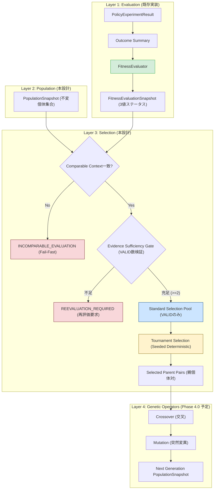

# BlackPoker Simulator Population & Selection Design V1

新規作業ID: `BP-SIM-AI-POPULATION-SELECTION-DESIGN-V1`  
ステータス: **PROPOSED / DESIGNED (PENDING INDEPENDENT REVIEW)**  
対象リポジトリ: `BlackPoker/BlackPoker`  
対象ブランチ: `BlackPoker/issue551-core-flow`  
先行仕様:
- `tools/simulator/docs/ai-fitness-design-v1.md` (Formal Accepted)
- `tools/simulator/src/domain/ai/FitnessEvaluationTypes.ts` (Implemented)
- `tools/simulator/src/engine/ai/FitnessEvaluator.ts` (Implemented)

---

## 1. Purpose (設計目的)

本設計書は、BlackPoker Simulator AI 基盤における自己対戦進化（Self-Play Evolution: Phase 4.0）の前提となる **Population（母集団）** および **Selection（親個体選択）** の境界契約（Boundary Contract）を定義する。

### 解決する課題
1. **Population とは何か**: 単なる `DecisionDNA[]` 配列ではなく、個体識別子、世代番号、DNA 参照を保持する不変スナップショットの定義。
2. **DNA と Fitness の分離**: なぜ Fitness スコアを DNA 自体に書き込んではならないのかの理由と境界。
3. **Fitness 結果の Selection への受け渡し**: 比較可能な評価コンテキスト（Comparable Evaluation Context）の保証。
4. **親候補の適格性**: どのステータスの個体が親候補となり得るかの厳格な選別。
5. **INSUFFICIENT_EVIDENCE（Tier 2）の処遇**: 完了試合不足・完了率不足の個体を、見かけの暫定スコア（`provisionalScore`）だけで昇格・選択させないフェイルクローズ設計。
6. **INVALID（Tier 3）の処遇**: FAILED 試合を含むクラッシュ個体の完全排除。
7. **同点（Tie）処理**: Match Point Average（MPA）で頻発する同点スコアを、配列順バイアスなく決定論的に解決する手法。
8. **決定論的再現性（Determinism）**: 同一シードにおいて選択される親系列が 100% 完全一致する契約。

> [!IMPORTANT]
> **本作業のスコープ**  
> 本ドキュメントは **DESIGN ONLY（設計仕様の確定のみ）** であり、TypeScript による本番実装（Population クラス、Selection オペレータ、Crossover、Mutation、Evolution Loop）は行いません。

---

## 2. Prerequisites (前提条件と最重要原則)

### 2.1 Formal Accepted 済み前提コンポーネント
- **Decision Feature Schema v4**: Viewer-Relative, Secret-Safe, Stage Semantics Preservation
- **Decision DNA v1**: 線形・双線形重み配列（23,452 次元）、JSON-safe DTO
- **GenomePolicy / GenomeScorer**: 決定論的 Argmax ポリシー
- **Genome Sensitivity V1 + R1**: DNA 差分が意思決定差・実戦行動差に反映されることの実証済み基盤
- **Outcome-First Fitness Design & Evaluation V1**:
  - 最重要原則: **"Victory is the objective. Life is a resource, not a score."**
  - 結果主義（Outcome-First）: 勝敗・引き分け（WIN, LOSS, DRAW）のみを評価し、Remaining Life, Turn Count, Damage, Telemetry を完全除外。
  - 3 値ステータス契約:
    - **`VALID` (Tier 1)**: Authoritative Fitness Score (`[0.0, 1.0]`) を保有。
    - **`INSUFFICIENT_EVIDENCE` (Tier 2)**: Authoritative スコアなし (`fitnessScore = null`)。`provisionalScore` は参考値。
    - **`INVALID` (Tier 3)**: FAILED 試合発生による失格。Authoritative スコアなし (`fitnessScore = null`)。

### 2.2 最優先原則: Fitness Contract の厳格遵守
Selection レイヤは、先行する Fitness レイヤの契約をいかなる理由があっても侵犯してはならない。

```text
【絶対禁止事項】
INSUFFICIENT_EVIDENCE の provisionalScore を通常親選択に使用してはならない。

例:
  DNA A: VALID                  (fitnessScore = 0.70)
  DNA B: INSUFFICIENT_EVIDENCE  (provisionalScore = 1.00)

この場合、DNA B を「1.00 だから A より勝率が高い」として親に選ぶことは厳禁である。
provisionalScore は Authoritative ではないため、証拠不十分の個体を優遇してはならない。
```

---

## 3. Architecture & Separation of Concerns (責務の分離)

進化サイクルにおける各フェーズの責務境界を明確に分離する。各レイヤは独立した入出力契約を持ち、互いの責務を侵食しない。



### レイヤごとの責務定義
- **A. Fitness Evaluation (既存完了)**:
  「この DNA の対戦成績は信頼できるか？ 信頼できるなら正規スコア（Authoritative Fitness）は何点か？」
- **B. Population (本設計)**:
  「世代 $g$ に存在する不変の個体集合は何か？」
- **C. Selection (本設計)**:
  「信頼性の確認された VALID な個体集合から、次世代を作るための親をどのように決定論的かつ公平に選ぶか？」
- **D. Genetic Operators (Phase 4.0 予定)**:
  「選ばれた親の重み配列をどのように交叉・変異させて新しい DNA を合成するか？」

> [!NOTE]
> `FitnessEvaluator` に親選択のロジックを組み込んではならず、また `Selection` レイヤが対戦結果から勝率を勝手に再計算してもならない。

---

## 4. Population Model (母集団モデル)

### 4.1 PopulationEntry の概念
Population は単なる `DecisionDNA[]` 配列ではなく、個体の系統、世代、識別情報を保持するエントリの集合として定義される。

```typescript
interface PopulationEntry {
  /** 母集団内で一意の個体識別子 (例: "gen001-ind042") */
  readonly genomeId: string;
  /** 安定した DNA アーティファクト参照 (ハッシュまたはファイルパス) */
  readonly dnaRef: string;
  /** 当該個体が属する世代番号 (非負整数) */
  readonly generation: number;
  /** 実際の DecisionDNA 実体 (不変) */
  readonly dna: DecisionDNA;
}
```

### 4.2 Population Size (母集団サイズ) の性質
- **Provisional Default**: **`populationSize = 100`**
- **設計上の位置づけ**:
  `populationSize = 100` はロードマップ記載の初期仮値（Provisional Default）であり、固定不変のハードコード仕様ではない。
- **設定可能性（Configurability）**:
  小規模テスト（例: `populationSize = 20`）や大規模探索（例: `populationSize = 500`）に対応できるよう、呼出元から override 可能なハイパーパラメータとして設計する。
- **安全性制約**:
  有性生殖（Crossover）を前提とする場合、最低限 2 個体が必要であるため、`populationSize >= 2` を強制する（Fail-Fast）。

---

## 5. DNA vs Fitness Separation (DNA と Fitness の厳格な分離)

### 分離の理由
`DecisionDNAMetadata` には便宜上の `fitness?: number` プロパティが定義されているが、**進化ループにおいて Fitness Score を DNA オブジェクトそのものへ書き込んではならない**。

1. **評価値の文脈依存性**:
   同じ DNA であっても、対戦相手の質、初期デッキシード、レギュレーション、ルールバージョン、評価世代、Evaluation Config（閾値）によって Fitness は変動する。DNA は絶対的な不変ゲノムであり、評価結果は相対的・一時的な観測値である。
2. **スナップショットの不変性汚染防止**:
   DNA オブジェクトにスコアを破壊的代入すると、同一 DNA を過去世代や Hall of Fame（殿堂入り）で再利用した際に古い世代のスコアが上書きされ、監査性が崩壊する。
3. **データフローの明確化**:
   入力（`PopulationSnapshot`）と評価結果（`FitnessEvaluationSnapshot`）を独立した Snapshot DTO として扱い、Selection に 2 つを対等に渡すデータフローを確立する。

---

## 6. Population Snapshot Immutability (母集団スナップショットの不変性)

世代 $g$ の評価期間中、`PopulationSnapshot` のメンバーは一切変更（追加・削除・置換）されない。

```text
Generation g:
Population Snapshot (N個体)
        ↓
Evaluation (対戦実施 & 集計)
        ↓
Fitness Evaluation Snapshot (N個体分の結果)
        ↓
Selection (親選択)
        ↓
Generation g+1
```

### 隔離と監査性
- 個体が `INVALID`（クラッシュ）や `INSUFFICIENT_EVIDENCE`（未決着多発）であっても、その世代の `PopulationSnapshot` から物理削除してはならない。
- **「選択プール（Selection Pool）からの除外」と「アーティファクトの物理削除」を混同しない**。
- 不適格個体もスナップショット内に残すことで、なぜその個体が失敗したのかの事後検証や回帰テストが可能となる。

---

## 7. Comparable Evaluation Context (評価コンテキストの比較可能性)

Selection レイヤにおいて、数値としての `fitnessScore` を単純比較して親を選定する前に、**「それらのスコアが同一の条件下で得られた比較可能な値であるか」** を検証する契約（Precondition）を設ける。

### 比較可能性を定義するパラメータ群
同一の `ComparableEvaluationContext` に属さないスコア同士を比較してはならない：

| コンテキスト属性 | 説明 | 不一致時の影響 |
|---|---|---|
| `environmentRef` | ルールセット識別子（例: `rules-vnext:playtest`） | ルールが異なればスコアの意味が全く異なる |
| `regulationId` / `frameId` | レギュレーション・フォーマット | デッキ構築条件や初期手札枚数が異なる |
| `rulePackageVersion` | ルールパッケージのバージョン | カード効果の挙動が異なる |
| `fitnessConfig` | `minCompletedMatches`, `minCompletionRate` | VALID 判定基準の厳しさが異なる |
| `generation` | 対象世代番号 | 異なる世代のスコアは対戦相手プールの強度が異なる |
| `evaluationScheduleId` | スケジュールID（対戦相手サンプリング方式） | 対戦相手の強さの偏りが生じる |
| `seedScheduleIdentity` | 適用されたシード系列 | 引きの有利不利の統制が異なる |

### 不一致時の振る舞い
母集団内の個体間で上記パラメータが一致しない場合、Selection は実行されず、**`INCOMPARABLE_EVALUATION`** として Fail-Fast で停止する。

---

## 8. Selection Pool Contract (選択プール契約)

Selection レイヤが親個体として考慮を許可されるのは、以下の厳格な基準を満たした個体のみである。

### 8.1 プール適格性定義
$$\text{StandardSelectionPool} = \{ e \in \text{Population} \mid \text{fitness}(e).\text{status} === \text{"VALID"} \}$$

### 8.2 重要な境界条件
1. **`VALID` かつ `fitnessScore = 0.0` の個体**:
   - 100 試合正常完了し 0 勝 100 敗（全敗）した個体は、`status = "VALID"`, `fitnessScore = 0.0` である。
   - この個体は十分な対戦証拠を持ち、ルールに違反せず最後まで対戦を完走した正当な個体である。
   - **`fitnessScore = 0.0` は `INVALID` でも `INSUFFICIENT_EVIDENCE` でもない**。
   - したがって、**Standard Selection Pool から `fitnessScore > 0` などの安易な条件で除外してはならない**（劣後して選ばれにくくなるのは自然だが、プール自体には属する）。
2. **`INSUFFICIENT_EVIDENCE` (Tier 2)**:
   - Standard Selection Pool から完全に除外される。
3. **`INVALID` (Tier 3)**:
   - Standard Selection Pool から完全に除外される。

---

## 9. Tier 2 Decision: Evidence Sufficiency vs Fallback

初期世代において DNA の行動特性が未熟な場合、手数上限（`maxDecisionsPerMatch`）に達して未決着（INCOMPLETE）が頻発し、母集団の大部分が `INSUFFICIENT_EVIDENCE` となるシナリオが想定される。このときの設計方針を決定する。

### 9.1 アプローチの比較

| 項目 | 案 A: フェイルクローズ再評価要求 (推奨) | 案 B: 完了率順フォールバック昇格 |
|---|---|---|
| **概要** | VALID 個体数が不足した場合、Selection を中断し `REEVALUATION_REQUIRED` を返す。 | VALID 個体が不足した場合、Tier 2 から完了率の高い順に親へ昇格させる。 |
| **Fitness Contract 整合性** | **完全準拠**。証拠不十分なスコアを進化に使用しない。 | **一部背馳**。不十分な証拠を進化アルゴリズムが容認してしまう。 |
| **遅延戦法の抑止力** | **極めて強固**。決着をつけない個体は絶対に子孫を残せない。 | **脆弱**。他が全滅した際に未決着多発個体が生き残るリスクがある。 |
| **自動実行の継続性** | 手数上限見直しや追加対戦の介入が必要。 | 無停止で世代交代が進む。 |

### 9.2 V1 推奨設計決定: 案 A（再評価要求）
Fitness V1 の最重要原則（"Victory is the objective. Life is a resource, not a score." および Fail-Closed 原則）を貫徹するため、**案 A を推奨仕様として確定する**。

```text
【V1 確定方針】
VALID 個体数が Selection の下限（minimumValidPopulationCount）を満たさない場合、
Selection は実行されず、ステータス「REEVALUATION_REQUIRED」を出力して停止する。

証拠不足（Evidence Sufficiency 不足）を Selection レイヤの小細工で推測・救済してはならない。
証拠が足りないなら、評価レイヤ側で手数上限を広げるか、試合数を増やして再評価すべきである。
```

> [!CAUTION]
> いかなるフォールバックを将来検討する場合であっても、**「Tier 2 の provisionalScore の高さ順で親を選ぶ」ことは Fitness Contract 違反となるため絶対に採用しない**。

---

## 10. Selection Readiness (選択レディネス状態遷移)

母集団と評価結果を受け取った Selection レイヤは、選択処理に先立ち以下の 4 値ステータスを判定する。

```typescript
type SelectionReadinessStatus =
  | "READY"                     // VALID 個体数が閾値を満たし、選択実行可能
  | "REEVALUATION_REQUIRED"      // VALID 個体数が不足しており、対戦再評価が必要
  | "INVALID_POPULATION"        // 母集団スナップショット自体に構造的不備あり (Fail-Fast)
  | "INCOMPARABLE_EVALUATION";  // 異なる評価コンテキストが混在している (Fail-Fast)
```

### 判定規則と遷移フロー
1. **データ整合性チェック**:
   - 母集団サイズが不正（`length < 2`）、`genomeId` の重複、または Fitness 結果との 1:1 対応が崩れている場合 $\Longrightarrow$ **`INVALID_POPULATION`**。
2. **比較可能性チェック**:
   - 全個体の評価コンテキストが同一でない場合 $\Longrightarrow$ **`INCOMPARABLE_EVALUATION`**。
3. **VALID 個体数チェック**:
   - $\text{validCount} = |\{ e \in \text{Population} \mid \text{fitness}(e).\text{status} === \text{"VALID"} \}|$
   - $\text{validCount} < \text{minimumValidPopulationCount}$ $\Longrightarrow$ **`REEVALUATION_REQUIRED`**。
     - $\text{validCount} = 0$: 完全証拠不足。
     - $\text{validCount} = 1$: 単一個体のみでは有性交叉ペアを形成できないため不足。
4. **選択準備完了**:
   - 上記をすべてクリアした場合 $\Longrightarrow$ **`READY`**（Selection アルゴリズムへ進行）。

### Minimum Valid Population パラメータ
- `minimumValidPopulationCount`:
  - **Provisional Default: 2**（有性交叉に必要な最低個体数）
  - 将来の設定拡張として `minimumValidPopulationRate`（例: 0.20 = 20% 以上が VALID であること）の併用を許容。

---

## 11. Parent Selection Candidates & Evaluation (親選択アルゴリズムの比較)

VALID な個体集合から次世代の親ペア（Parent A, Parent B）を選出するアルゴリズムとして、代表的な 3 方式を比較検討した。

### 比較検討表

| 評価観点 | 案 1: 適応度比例ルーレット選択 (Roulette) | 案 2: ランキング選択 (Rank Selection) | 案 3: トーナメント選択 (Tournament) [推奨] |
|---|---|---|---|
| **Fitness 0.0 の扱い** | 選択確率 0 となり、他の正の個体に完全に埋没。 | 順位付けされるため最低確率として選択可能。 | **自然に比較可能**。他の 0.0 と互角に対戦可能。 |
| **全個体 0.0 時の挙動** | **Zero-Division で破綻**（合計適応度 = 0）。 | 全個体同順位となり一様ランダムにフォールバック。 | **正常動作**。同点タイブレークにより一様選択。 |
| **スケーリング感受性** | 極めて敏感（0.98 と 0.99 はほぼ同等、0.01 と 0.02 は2倍差）。 | 順位に基づくため適度。 | **無関係**（純粋な順序比較のみ）。 |
| **選択圧の調整** | 調整困難（適応度関数の変換が必要）。 | ランキング傾斜パラメータで調整。 | **`tournamentSize` の変更だけで容易に調整可能**。 |
| **計算量と実装** | $O(N)$（累積確率配列の構築）。 | $O(N \log N)$（全体ソート必須）。 | **$O(k)$（局所比較のみ、全体ソート不要）**。 |
| **決定論的再現性** | 浮動小数点累積加算の丸め誤差リスクあり。 | 再現可能。 | **PRNG からの $k$ 回サンプリングのみで完全決定論的**。 |

---

## 12. Recommended Selection V1: Tournament Selection

Fitness V1 の特性（MPA が $[0.0, 1.0]$ の有界値であり、初期世代では全敗 0.0 や同点 0.5 が頻発すること）に最も適合する方式として、**トーナメント選択（Tournament Selection）を V1 推奨アルゴリズムとして確定する**。

### 12.1 アルゴリズムの定義
1. 母集団から次世代を形成するために必要な回数（例: 各個体生成ごとに 2 親）だけトーナメントを実行する。
2. 1 回のトーナメントでは、Standard Selection Pool から復元抽出（with replacement）により $k$ 個体を一様ランダムにサンプリングする。
3. サンプリングされた $k$ 個体の中で、Authoritative `fitnessScore` が最も高い個体を勝者（親）として選出する。

### 12.2 Tournament Size ($k$) の設計
- **Provisional Default**: **`tournamentSize = 3`**
- **工学的根拠**:
  - $k = 1$: 純粋な一様ランダム選択（選択圧ゼロ、進化が停滞）。
  - $k = 2$: 穏やかな選択圧。多様性を高く維持するが、収束が遅い。
  - $k = 3$: 標準的な GA において最も広く用いられるバランスの良い選択圧。適度にエリートを優遇しつつ下位の多様性も残す。
  - $k \ge 5$: 強すぎる選択圧。少数の高スコア個体へ急激に集約し、局所解（早熟収束: Premature Convergence）に陥るリスクが高い。
- **制約**: $2 \le k \le \text{validCount}$。呼出側から override 可能。

---

## 13. Deterministic RNG & Seed Contract (決定論的乱数契約)

Selection は 100% 再現可能（Deterministic）でなければならない。

```text
【厳格な禁止事項】
- Math.random() の使用禁止
- シードなし PRNG の使用禁止
- 配列順の偶然性による選択禁止
```

### Seed 伝搬モデル
```text
Experiment Base Seed
        ↓
Generation Seed (Gen g)
        ├─► Self-Play Match Seeds (各対戦へ伝搬)
        └─► Selection Seed (Selection 専用 PRNG へ伝搬)
              └─► Tournament Sampling & Tie-Breaking
```

同一の `PopulationSnapshot`、`FitnessEvaluationSnapshot`、`SelectionConfig`、`selectionSeed` が与えられた場合、**選出される親個体の系列および順序は完全にビットレベルで一致する**ことを保証する。

---

## 14. Tie Handling (同点処理契約)

Match Point Average（MPA）は離散的な試合数から計算されるため、同点（Tie）が頻発する（例: 60 勝 40 敗の個体と、48 勝 24 敗 28 分の個体がいずれも MPA = 0.60）。

### 14.1 課題と禁止事項
- **配列順バイアスの禁止**:
  トーナメント内で同点が発生した際に「配列のインデックスが若い方」「先頭の要素」を無条件に勝者としてはならない。これを許すと、世代初期に登録された `genomeId` が常に有利になるという不当な偏り（Structural Position Bias）が生じる。
- **ID辞書順バイアスの禁止**:
  `genomeId` のアルファベット昇順だけでタイブレークすると、ID 発行アルゴリズムに依存した永続的偏りが発生する。

### 14.2 推奨仕様: Seeded Deterministic Tie-Break
1. トーナメント内の最大 `fitnessScore` を持つ個体が複数存在する場合、**その同点個体群の中から `selectionSeed` に紐づく PRNG を用いて一様ランダムに勝者を決定する**。
2. これにより、特定のインデックスや ID への偏りを完全に中和しつつ、決定論的再現性を 100% 担保する。
3. 監査・デバッグログ用には、トーナメントに参加した全候補の `(genomeId, score)` およびタイブレーク選択理由を記録する。

---

## 15. Duplicate Parent Policy (重複親個体ポリシー)

親個体の選出において、2 種類の「重複」を明確に区別して扱う。

### 15.1 異なる offspring に対する同一親の反復選択 (Repeated Selection)
- **方針**: **許可（自然な選択）**
- **理由**: 優秀な DNA が次世代の複数の子ども（offspring）の親として何度も選ばれることは、自然淘汰および適応度向上の中核原理である。これを禁止すると優秀な遺伝子の拡散が阻害される。

### 15.2 単一 Crossover ペア内での自己交配 (Self-Mating: Parent A === Parent B)
- **方針**: **条件付き回避（可能な限り防止）**
- **理由**: 同一の個体 A と個体 A を交叉させても、重みの組み換え（Crossover）による新規パターンは一切発生せず、事実上のクローン（突然変異のみ）に退化する。
- **推奨仕様**:
  - Standard Selection Pool 内の個体数 $\ge 2$ の場合、Parent B の選出時に Parent A と同一の `genomeId` が選ばれたときは、PRNG を用いて一定回数（例: 最大 3 回）再サンプリングを試みる。
  - プール内に実質 1 種類の個体しか残っていない等の極限状況では、無限ループを防ぐため自己交配を許容してフォールバックする。

---

## 16. Elitism (エリート保存戦略)

### 16.1 概念と役割
エリート保存（Elitism）とは、当該世代の最優秀個体（Top $E$ 個体）を、交叉や突然変異による破壊から保護し、**そのまま無変更で次世代の母集団スナップショットへコピーする機構**である。

### 16.2 比較とトレードオフ

| 方式 | 特徴 | リスク |
|---|---|---|
| **$E = 0$ (エリートなし)** | 探索空間を広く維持。 | 優秀な解が交叉や変異によって失われ、世代間で最高適応度が後退する。 |
| **$E = 1 \sim 2$ (推奨)** | **最高適応度の単調非減少を保証**。98% 以上の枠は進化探索に残る。 | 適切なバランス。多様性喪失のリスクは極めて低い。 |
| **$E \ge 10$ (過剰エリート)** | 初期収束が高速。 | **早熟収束（Premature Convergence）**。同一系統が母集団を占拠し進化が停止する。 |

### 16.3 V1 推奨設計
- **Provisional Default**: **`eliteCount = 1`**（Population 100 に対して 1 個体のみ保存）
- **選定規則**:
  - Standard Selection Pool（`VALID`）の最上位個体から選出。
  - 同点首位が複数存在する場合は、Seeded Deterministic Tie-Break により 1 個体を確定。
  - `INVALID` や `INSUFFICIENT_EVIDENCE` はエリート選出対象外。

---

## 17. Diversity Considerations (多様性の考慮)

### 境界原則: Fitness と Diversity の完全分離
母集団の多様性（Diversity）を維持することは重要であるが、**Fitness 計算式に多様性指標（重み間ユークリッド距離、新規性スコア、行動頻度差など）を加算してはならない**。
Fitness はあくまで「勝敗結果（Outcome）」のみを反映する。

### 多様性を担保すべきレイヤ
多様性の維持・制御は、Selection および Genetic Operators の責務として扱う：
1. **Selection Pressure の抑制**:
   トーナメントサイズ $k$ を過大にしない（デフォルト $k = 3$）。
2. **自己交配の防止**:
   Parent A と Parent B の重複回避。
3. **エリート枠の制限**:
   `eliteCount` を 1〜2% に抑制。
4. **将来フェーズ（Phase 4.1+）の拡張**:
   - Speciation（種分化・適合度細分化）
   - Novelty Archive
   - Island Model（島モデル並列進化）

---

## 18. Input Integrity & Error Handling (入力整合性検証)

Selection レイヤの実行開始時に、以下のデータ整合性を検証する（Fail-Fast）。

```typescript
class PopulationSelectionIntegrityError extends Error {
  constructor(message: string) {
    super(message);
    this.name = "PopulationSelectionIntegrityError";
  }
}
```

### 検証項目
1. **Population 整合性**:
   - `population.entries` が非空配列（長さ $\ge 2$）。
   - 全 `genomeId` が母集団内で一意であること。
2. **Fitness 1:1 対応整合性**:
   - Population に存在するすべての `genomeId` に対し、対応する `FitnessEvaluationResult` が過不足なく正確に 1 件存在すること。
   - Population に存在しない `genomeId` の Fitness 結果が混入していないこと。
   - Fitness 欠損個体を暗黙に無視・スキップしないこと。
3. **ステータス不変性**:
   - `INVALID` や `INSUFFICIENT_EVIDENCE` の個体が、Selection 入力前に不正に `VALID` へ改ざんされていないこと。

---

## 19. Worked Examples (ケーススタディ)

### Case A: 正常な混在母集団からの標準選択
- **入力**:
  - DNA A: `VALID` (fitnessScore = 0.80)
  - DNA B: `VALID` (fitnessScore = 0.60)
  - DNA C: `VALID` (fitnessScore = 0.00)
  - DNA D: `INSUFFICIENT_EVIDENCE` (fitnessScore = null, provisionalScore = 1.00)
  - DNA E: `INVALID` (fitnessScore = null, failedMatches = 1)
- **判定**:
  - **Standard Selection Pool: `{ DNA A, DNA B, DNA C }` のみ**。
  - DNA D は見かけの provisionalScore が 1.00 であっても証拠不十分のため除外。
  - DNA E は失格のため除外。
  - DNA C はスコア 0.00 であっても VALID のためプールに残留。
  - **結果: Selection は A, B, C の中から Tournament Selection を実行する**。

### Case B: VALID 不足母集団 (1 VALID, 99 INSUFFICIENT)
- **入力**: 100 個体中、1 個体のみ `VALID`、99 個体が未決着過多により `INSUFFICIENT_EVIDENCE`。
- **判定**:
  - $\text{validCount} = 1 < \text{minimumValidPopulationCount} (2)$。
  - Tier 2 の個体を暫定スコア順に繰り上げ昇格させることはしない。
  - **結果: ステータス `REEVALUATION_REQUIRED` を返して停止**。追加の手数上限での再対戦を要求。

### Case C: 全滅母集団 (0 VALID, 90 INSUFFICIENT, 10 INVALID)
- **入力**: 100 個体中、90 個体が `INSUFFICIENT_EVIDENCE`、10 個体がクラッシュ `INVALID`。
- **判定**:
  - $\text{validCount} = 0$。
  - `INVALID` 個体の救済は一切行わない。
  - **結果: ステータス `REEVALUATION_REQUIRED` を返して停止**。

### Case D: 全員全敗母集団 (100 VALID, 全員 fitnessScore = 0.00)
- **入力**: 100 個体全員が正常に 100 試合を完走したが、相手が強力で全員 0 勝 100 敗（全員 `fitnessScore = 0.00`）。
- **判定**:
  - 全員 `status = "VALID"` であるため、Standard Selection Pool に 100 個体すべてが登録。
  - トーナメント選択では全候補がスコア 0.00 で同点となる。
  - Seeded Deterministic Tie-Break により、一様ランダムかつ決定論的に親が選出される。
  - ルーレット選択のように Zero-Division エラーで破綻することはない。
  - **結果: 正常に Selection 完走**。

### Case E: スコア完全同点時のタイブレーク (A = 0.50, B = 0.50)
- **入力**: トーナメント内で DNA A (0.50) と DNA B (0.50) が対決。
- **判定**:
  - 配列上のインデックスや ID 昇順を理由に勝者を固定しない。
  - `selectionSeed` から派生した PRNG により公平にタイブレーク。
  - 同一シードでの再実行時は 100% 同一の個体が勝者となる。
  - **結果: バイアスなき決定論的勝者確定**。

### Case F: 異なる評価コンテキストの混在拒絶
- **入力**:
  - DNA A: `environmentRef = "rules-vnext:playtest"` で評価
  - DNA B: `environmentRef = "rules-vnext:standard-pack"` で評価
- **判定**:
  - 評価コンテキストが異なるため、直接のスコア比較は無意味。
  - **結果: `INCOMPARABLE_EVALUATION` エラーとして即時停止**。

### Case G: Fitness 結果の欠損 (データ不整合)
- **入力**: Population に 100 個体存在するが、Fitness Snapshot には 99 個体分しか結果がない。
- **判定**:
  - 欠損個体を勝手に無視して除外してはならない。
  - **結果: `PopulationSelectionIntegrityError` として即時停止**。

---

## 20. Non-Goals (今回の非対象事項)

本設計において決定しない、または実装しない事項：
- Crossover（交叉）の具体的アルゴリズム（1点交叉、一様交叉、BLX-α 等）
- Mutation（突然変異）の具体的アルゴリズム（ガウス変異、ビット反転等）および変異率の最適値
- Generation Runner / Evolution Loop の自動実行サイクル
- Hall of Fame（殿堂入り）の保存・管理機構
- レーティング方式（Elo, Glicko-2）による動的評価
- 人間対戦ログ（Human Match Log）からの初期シード学習
- Speciation（種分化）およびニッチング手法
- Population 並列シミュレーション実行エンジン

---

## 21. Open Questions (今後の検討課題)

1. **実戦レギュレーションにおける適正トーナメントサイズ**:
   BlackPoker のゲーム性において、$k = 3$ が十分な探索・活用のバランスをもたらすか、あるいは多様性維持のため $k = 2$ が望ましいかの実証実験。
2. **REEVALUATION_REQUIRED 時の自動リカバリプロトコル**:
   未決着多発により再評価が必要となった際、Generation Runner が `maxDecisionsPerMatch` を自動インクリメントして再実行すべきか、あるいは人間の実験管理者に警告を発して停止すべきかの設計。
3. **エリート個体の評価再利用**:
   次世代へ無変更でコピーされたエリート個体について、次世代の対戦評価を省略して前世代スコアを流用できるか、あるいは母集団全体の強さ変化に追従するために毎世代再評価すべきか（推奨: 毎世代再評価）。
