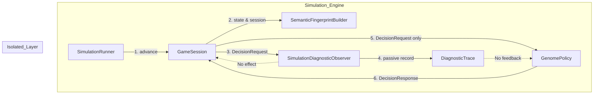

# BlackPoker Simulator
# Semantic Stall / Cycle Detection Design V1

作業ID: `BP-SIM-AI-SEMANTIC-STALL-CYCLE-DESIGN-V1`  
ステータス: **PENDING INDEPENDENT REVIEW**  
作成日: 2026-10-16  
対象ブランチ: `BlackPoker/issue551-core-flow`  
ベースコミット (Design V1-R2): `4c9f8c273d9c2bd8068173dd1333bcc55547668a`  
実装コミット (Implementation V1-R2): `975788f80054f4e5a08e446ee9967d400726bca9`  
A/B エビデンスコミット (A/B Evidence V1-R1): `97d2ac1fa2db79f459c75e4f1fd19486125d1ef6`  

---

## 1. Document Identity
本仕様書は、BlackPoker Simulator において意思決定（Decision）が繰り返される中で発生する未完走試合（INCOMPLETE matches, maxDecisions=500 到達）に対し、ゲーム上の意味のある構造的状態変化、同一構造への再訪、同一意思決定状況の再出現、および周期性の候補を、ゲームルールやAI挙動に一切干渉せずに受動的（Passive）かつ決定論的に観測するための **Semantic Stall / Cycle Diagnostic Architecture** の設計仕様を定義する。

---

## 2. Formal Baseline
本設計は、以下の Formal Accepted 成果物を前提として策定されている：
- **Feature Scaling Design V1-R2**: FORMAL ACCEPTED (`4c9f8c273d9c2bd8068173dd1333bcc55547668a`)
- **Feature Scaling Implementation V1-R2**: FORMAL ACCEPTED (`975788f80054f4e5a08e446ee9967d400726bca9`)
- **Controlled Feature Scaling A/B Evidence V1-R1**: FORMAL ACCEPTED (`97d2ac1fa2db79f459c75e4f1fd19486125d1ef6`)
- **Rules / Core Flow**: **RULES UNCHANGED / NO CHANGE PLANNED** (0 diff)

---

## 3. Problem Statement
前工程の統制 A/B 実験（`BP-SIM-AI-FEATURE-SCALING-AB-EVIDENCE-V1-R1`）により、特徴量スケーリング（Schema v5）は各特徴量および相互作用項の振幅を有界化 ($[-1, 1]$) し、PASS と最善非PASSのスコア差分マージンを平均 $+1.565003 \rightarrow +0.052248$ へと大幅に圧縮し、意思決定の軌跡を変化させた。

しかしながら、母集団 $N=6$ (g1) における対戦完了率は：
- **CONTROL (`RAW_V4_EQUIVALENT`)**: Completed 2 / 30 (Incomplete 28 / 30)
- **TREATMENT (`SCALED_V5`)**: Completed 2 / 30 (Incomplete 28 / 30)
と全く変化せず、28 試合が依然として `maxDecisions = 500` の上限に達して未完走となった。

この残存する 28 試合の INCOMPLETE について、
1. 本当にゲーム盤面や状況が循環・再訪しているのか（Semantic State Revisit）
2. 単に手数が長くかかっているだけなのか（Long Match）
3. 単調カウンタ（stateVersion 等）の更新のみで実質的な盤面が進んでいないのか（Bookkeeping Progress Only）
4. 同一の意思決定コンテキストが周期的に訪れているのか（Periodic Decision Context）
を安全かつ決定論的に区別して観測する仕組みが、現行 Simulator には存在しない。本設計はこの観測基盤を確立することを目的とする。

---

## 4. Accepted A/B Findings
Formal Accepted A/B V1-R1 において確定した事実：
- 特徴量振幅: Context 最大 138 $\rightarrow$ 1.0, Pattern 最大 26 $\rightarrow$ 1.0, Interaction 最大 3120 $\rightarrow$ 1.0（不変条件完全充足）。
- マージン圧縮: Mean PASS - Best Non-PASS margin が $+1.565003 \rightarrow +0.052248$ へ圧縮。
- 軌跡変化: 完了試合の組み合わせが Match [28, 29] から Match [7, 21] へと移動。
- 完了率不変: 完了率は両群ともに 2/30 (6.67%)。
- **結論**: 特徴量スケールの大きさ（増幅）単体では残存する 28 件の未完走試合を説明できない。

---

## 5. Explicit Non-Claims (設計開始時点の明示的非主張)
現時点で以下の命題は一切証明されていない。本設計はいずれの命題も事実として前提化しない：
- **Cycle Exists**: **NO PROOF**（循環が存在するとは証明されていない）
- **Infinite Loop Exists**: **NO PROOF**（無限ループが存在するとは証明されていない）
- **Rules Bug Exists**: **NO PROOF**（ルールエンジンにバグが存在するとは証明されていない）
- **Simulator Bug Exists**: **NO PROOF**（シミュレータにバグが存在するとは証明されていない）
- **GenomePolicy Is Cause**: **NO PROOF**（Policy 実装が未完走の原因とは証明されていない）
- **Mutation Bias Is Cause**: **NO PROOF**（変異バイアスが原因とは証明されていない）
- **Fitness Is Cause**: **NO PROOF**（適応度関数が原因とは証明されていない）
- **Feature Representation Is Cause**: **NO PROOF**（特徴量表現が原因とは証明されていない）

---

## 6. Current StateHasher Audit
`tools/simulator/src/engine/simulation/StateHasher.ts` の詳細監査結果：
- **バージョン**: State Hash v2 (`StateHasher.VERSION = 2`)
- **出力形式**: `sh2-${fnv1a64_hex}` (標準 64-bit FNV-1a ハッシュ)
- **目的**: 決定論的 Replay 検証およびシミュレーション状態のインテグリティ保証。
- **ハッシュに含まれる主要フィールド**:
  - `presetId`, `turnCount`, `turnPlayer`, `chancePlayer`
  - `stateVersion` (直接包含)
  - `nextRequestSeq` (直接包含)
  - `turnUsage` (プレイヤー別アクション使用回数)
  - `players` (life, hand, field, fog, grave, graveTopCardId, trumps)
  - `stageRequests` (LIFO 配列順を厳格維持、各要素の sequence 含む)
  - `bufferRequests` (キュー配列順を厳格維持、各要素の sequence 含む)
  - `pendingGraveTopSelections`
- **除外されているフィールド**:
  - `players[pKey].name` (表示用文字列として明示的除外)
  - `sourcePatternId` (デバッグ用として除外)
  - タイムスタンプ、UI状態
- **ハッシュに含まれていないセッション側意味論フィールド (Coverage Gaps)**:
  - `session.passTracker.consecutivePassCount` (GameSession にのみ存在)
  - `session.resolvingRequest` (GameSession にのみ存在、Stage外即時アクションの元リクエスト)
  - `session.resolvingContext` (GameSession にのみ存在)
  - `session.continuation` (GameSession にのみ存在)
  - `state.runtimeShuffleCount` (GameState に存在するが抽出されていない)
  - `session.matchSeed` (GameSession にのみ存在)
- **なぜ現行 StateHash は意味論的進行（Semantic Progress）の証明にならないのか**:
  - `stateVersion` は、意思決定の送信（`session.submitDecision`）や状態変化のたびに無条件で $+1$ インクリメントされる（単調増加）。
  - 例えば、盤面が完全に同一のまま両プレイヤーが PASS を交互に選択し続けた場合、盤面・手札・ライフ・ユニット・ステージの全データは 1bit も変化しないにもかかわらず、`stateVersion` のインクリメントによって `StateHasher.hash(session.state)` は**毎ステップ必ず異なる新しいハッシュ値を生成**する。
  - したがって、「StateHash が毎ステップ異なっている」ことは「ゲームが意味論的に前進している」ことの証明には一切ならない。

---

## 7. Current SimulationRunner Audit
`tools/simulator/src/engine/simulation/SimulationRunner.ts` の監査結果：
- **現在の処理フロー**:
  1. `session.advance()` を呼び出し。
  2. `WAITING_FOR_DECISION` 到達時：
     - `currentStateHash = StateHasher.hash(session.state)` を算出。
     - 合法パターン一覧 `legalPatterns` を生成。
     - `response = policy.choose(step.request)` により意思決定を取得。
     - `logicalDecisionId` を生成 (`d2-${stepPad}-${playerId}-v${stateVersion}-${hashShort}`)。
     - `stepRecord: DecisionTraceRecord` を作成し `decisionTrace` 配列へ追加。
     - `session.submitDecision(response)` を実行。
- **Observer 統合候補点**:
  - `SimulationRunner.run()` の `currentStateHash` 算出直後、および `policy.choose(step.request)` の直前・直後。
  - この位置であれば、生 GameState にアクセスする観測器と、Policy に渡される合法的 `DecisionRequest` にアクセスする観測器の両方を、ルール処理やシミュレーション結果に一切干渉させずに受動的（Passive）に呼び出すことが可能。
- **非改変原則**:
  - 今回の設計作業において `SimulationRunner.ts` は 0 diff（変更禁止）。

---

## 8. Replay Hash vs Diagnostic Fingerprint
本設計では、以下の 4 つの独立した概念を明確に分離・定義する：

| 区分 | 概念名 | 主目的 | 単調カウンタの扱い | 保証する性質 |
|---|---|---|---|---|
| **A** | **Replay / Integrity Hash** (現行: `state-hash-v2`) | 完全な決定論的リプレイ検証・データ改ざん検知 | `stateVersion`, `nextRequestSeq`, `sequence` を **INCLUDE** | 過去の実行と 1bit も違わず同一の内部状態であること |
| **B** | **Structural Gameplay Fingerprint** (新規 PROPOSED) | ゲーム盤面・リクエスト・手番の構造的再訪検知 | 単調カウンタを **EXCLUDE**、配列順・ID関係を保持 | ルール上のゲーム構造が同一であること |
| **C** | **Player Observation Fingerprint** (新規 PROPOSED) | プレイヤー（AI）から観測可能な視点別状況の再出現検知 | 観測不能な秘密情報を除外し、公開・観測可能情報のみで構成 | AI Policy から見て区別不能な状態であること |
| **D** | **Decision Context Fingerprint** (新規 PROPOSED) | 意思決定場面（アクター、合法手配列順序、特徴量コンテキスト）の同一性検知 | 合法手の出現順序・アクター・チャンスを含む | 同一の判断状況が再訪したこと（強い停滞シグナル） |
| **E** | **Continuation Context Fingerprint** (研究用 PROPOSED) | 将来の展開が決定論的に同一となる完全状態の一致 | 全構造＋全コンテキスト＋DNA＋RNG状態を含む | 将来の分岐が同一であること（同一未来の再現） |

---

## 9. Terminology (PROPOSED 保守的用語定義)
誤認や過大主張を防ぐため、以下の用語契約を厳格に適用する：

- **Repeated Structural Fingerprint**: 過去に観測された Structural Gameplay Fingerprint と完全に一致する状態が再出現したこと。
- **Repeated Decision-Context Fingerprint**: 過去に観測された Decision Context Fingerprint（アクター、合法手順序を含む）と完全に一致する状況が再出現したこと。
- **Periodic Fingerprint Candidate**: 同一のフィンガープリント系列（例: $A \rightarrow B \rightarrow C \rightarrow A \rightarrow B \rightarrow C$）が一定周期かつ複数回連続して観測されたこと。
- **No-Semantic-Change Window**: 一定の手数区間（ウィンドウ）において、Structural Fingerprint が全く変化しないか、ごく少数の固定集合間のみを往復していること。
- **Max-Decisions Termination**: シミュレーションが `maxDecisions` (500) のガードレール上限に達して停止したこと。
- **Cycle Candidate**: 構造的再訪や周期的系列から推測される循環の「候補」（※証明ではない）。

> [!CAUTION]
> **使用禁止用語**:  
> `Infinite Loop Proven`, `True Infinite Loop`, `Guaranteed Cycle`, `Deadlock`, `Rule Bug`, `PROGRESSING_LONG_MATCH` は確定証拠なしに使用してはならない。

---

## 10. Structural Gameplay Fingerprint (`structural-gameplay-fingerprint-v1`)
### 10.1 目的
ゲーム進行に実質的な影響を与える論理的構造が同一であるかを判定する。

### 10.2 構成要素
1. **基底情報**: `presetId`
2. **手番・優先権**: `turnPlayer`, `chancePlayer`, `consecutivePassCount` (GameSession から取得)
3. **ターン数**:
   - **Variant S1 (Turn-Aware)**: `turnCount` を **INCLUDE**（同一ターン内での再訪のみ検知）。
   - **Variant S2 (Turn-Invariant)**: `turnCount` を **EXCLUDE**（ターン交代を挟む純粋盤面停滞を検知）。
4. **プレイヤー状態**:
   - `life` (カード順序・ID保持)
   - `hand` (カード順序・ID保持)
   - `field` (ユニット構成、配置、charge/drive、face、battle アサイン)
   - `fog` (フォグ構成、バインディング)
   - `grave` (墓地配列順序・ID保持)
   - `graveTopCardId`
   - `trumps`
5. **未解決アクション構造**:
   - `stageRequests`: LIFO 配列順序を厳格保持。各要素の `actionId`, `controller`, `definitionOwner`, `keyCards`, `targets`, `cost`, `selectedCostPayment` を含む（単調 `sequence` のみ除外）。
   - `bufferRequests`: キュー配列順序を厳格保持。各要素の `actionId`, `controller`, `definitionOwner`, `keyCards`, `triggerBindings`, `sourceEvent` を含む（絶対 `sequence` は相対スロット順へ置換）。
   - `pendingGraveTopSelections`: 保留中墓地TOP選択情報。
   - `resolvingRequest`: ステージ外即時アクションの解決元リクエスト。

### 10.3 排除される Bookkeeping 要素
- `stateVersion`: 完全に除外。
- `nextRequestSeq`: 完全に除外。
- `players[pKey].name`: 完全に除外。
- 動的 ID（`unit-p1-...`, `req-...`）のランタイム連番: 相対出現順序に基づく Canonical ID（`unit#1`, `stage#0` 等）へ置換。

---

## 11. Player Observation Fingerprint (`player-observation-fingerprint-v1`)
### 11.1 目的
特定プレイヤー（AI Policy）が観測可能な情報のみに基づき、そのプレイヤーの視点から「現在の状況が以前観測した状況と区別不能であるか」を判定する。

### 11.2 Full State との分離原則
- **Full Structural Fingerprint**: 相手の手札、相手の非公開防壁の中身、山札・ライフの未公開カードを含む「Simulator 全体」の再訪を検知。
- **Player Observation Fingerprint**: 相手の手札枚数（非公開）、相手の防壁伏せ状態、ライフ公開表示（相手9以下/10以上）等の「合法観測情報」のみで構成。
- **注記**: Player Observation Fingerprint が同一であっても、未公開手札やライフの内部カードが異なれば Full State は異なる。したがって、Player Observation Fingerprint を「Semantic State Fingerprint」と呼んではならない。

---

## 12. Decision Context Fingerprint (`decision-context-fingerprint-v1`)
### 12.1 目的
意思決定が要求された瞬間の「判断場面」が再訪しているかを判定する。Structural Fingerprint よりも強力な Policy レベルの停滞検知シグナルとなる。

### 12.2 構成要素
1. **判断主体**: `request.playerId`
2. **手番・優先権**: `turnPlayer`, `chancePlayer`
3. **判断発生理由**: `request.source` (`ACTION_REQUEST`, `EFFECT_RESOLUTION`, `ZONE_TOP_SELECTION`)
4. **観測盤面**: Player Observation View
5. **Stage 外解決元**: `request.observation.effectSourceRequest`
6. **AI Context 特徴量関連値**: `request.observation.turnCount`
7. **合法パターン配列**:
   - `request.patterns` の全要素（kind, actionSelectionRef, costPaymentRef, targetSelectionRef, effectSelectionRef）。
   - **配列順序の厳格保持 (CRITICAL)**:
     - `GenomePolicy` は同点時のタイブレークとして「最初に出現したパターン（最小 patternRef）を優先」する仕様となっている。
     - パターン配列のソートはタイブレーク時の選択結果を物理的に変更し得るため、**パターン配列の順序は潜在的に意味論的（Semantic）である**。したがって、パターン配列をソートしてハッシュ化することは厳禁とする。

---

## 13. Continuation Context Fingerprint (`continuation-context-fingerprint-v1` / RESEARCH)
### 13.1 目的
「同一の未来が決定論的に再現する」ための必要十分条件を検証する研究用コンテキスト。

### 13.2 構成要素
1. Full Structural Gameplay State
2. Full Decision Context
3. Policy DNA Digest (`policy.dna.weights` SHA-256 ダイジェスト)
4. PRNG 内部状態 (`matchSeed`, `state.runtimeShuffleCount`, `SeededRandom.state`)

### 13.3 Proof Boundary
上記 4 要素のいずれか 1 つでも欠落または未検証である場合、「同一の未来が必ず再現する（Continuation Equivalence）」と主張してはならない。

---

## 14. Field Registry Contract
全フィールドの分類・監査結果を `tools/simulator/docs/ai-semantic-fingerprint-field-registry-v1.json` にて機械可読形式で管理する。

### 14.1 Registry Coverage Summary (Docker Node 集計検証済み)
- **Total Audited Fields**: **47**
- **INCLUDE**: **32**
- **EXCLUDE_BOOKKEEPING**: **5** (`state.stateVersion`, `state.nextRequestSeq`, `state.players[pKey].name`, `state.stage.requests[].sequence`, `request.decisionId`)
- **INCLUDE_CONDITIONAL**: **8** (`state.turnCount`, `state.players[pKey].field[].unitId`, `state.requestBuffer.requests[].sequence`, `state.runtimeShuffleCount`, `session.matchSeed`, `policy.dna.weights`, `policy.dna.metadata.id`, `random.seededRandom.state`)
- **REVIEW_REQUIRED**: **2** (`state.stage.requests[].paidCostSummary`, `state.players[pKey].fog[].bindings`)
- **UNKNOWN**: **0**

---

## 15. Identity Canonicalization
### 15.1 課題
実行時に動的生成される ID（`unit-p1-1234567890-v1`, `req-42` 等）は、同一の論理状態であっても実行ごとに文字列が異なり、ハッシュ一致を阻害する。

### 15.2 Canonicalization 規則
1. **決定論的走査順序での登録**: Players (p1 $\rightarrow$ p2), Hand, Life, Field, Fog, Grave, Stage, Buffer の固定順序でエンティティを走査し、出現順に `unit#1`, `card#1`, `fog#1`, `stage#0`, `buffer#0` へ写像。
2. **クロスリファレンスの完全保持**:
   - ユニット A が `blocksUnitId` でユニット B を参照している場合、写像後も `blocksUnitId: "unit#2"` として関係性を完全保持。
   - リクエスト A がターゲットとしてリクエスト B を参照している場合、写像後も `targetRequestId: "stage#1"` として関係性を保持。
   - 参照先を同一の固定文字列に潰す（collapse）ことは禁止する。

---

## 16. Ordering Semantics
1. **Stage Requests**: LIFO 順序が解決順序を定義するため、配列順序を厳格に保持する（ソート禁止）。
2. **Request Buffer**: FIFO / Priority 順序が積載順序を定義するため、配列順序を厳格に保持する（ソート禁止）。
3. **Card Zones (Life / Grave)**: 先頭・末尾の順序がドロー・ダメージ・墓地トップに影響するため、配列順序を保持する。
4. **Legal Patterns in DecisionRequest**: Policy の Argmax タイブレークが配列先頭インデックス優先であるため、配列順序を厳格に保持する（ソート禁止）。
5. **Unordered Sets (Field Units, Labels)**: 順序がルール上無意味な集合のみ、Canonical Stringify 時にキーまたはプロパティ名でソートを許容する。

---

## 17. Hidden Information
- **Full Structural State**: ルール関連の非公開情報（山札順序、ライフ配列順、手札中身）を一切欠落させずに保持する。
- **Player Observation**: 観測者の視点からルール上合法的かつ既知の情報のみで構成し、相手の非公開手札中身等は `HIDDEN` 表現として扱う。

---

## 18. RNG Context
- BlackPoker における決定論的ランダム性は `SeededRandom` (Mulberry32) および `DeterministicShuffle` により制御される。
- ランタイムシャッフルは `state.runtimeShuffleCount` をカウンタとしてシード `deriveRuntimeShuffleSeed(matchSeed, counter)` を派生させる。
- **結論**: 同じ盤面であっても、PRNG の消費状態（`runtimeShuffleCount`）が異なれば以後のシャッフル結果（ライフドロー、山札リフレッシュ等）は異なる。したがって、Structural Gameplay の一致は「将来の完全同一性」を意味しない。

---

## 19. Policy Context
- **GenomePolicy の内部状態監査**:
  - `GenomePolicy` は `dna` を読み取り専用として保持し、内部に可変な状態・履歴・カウンタを一切持たない（**完全ステートレス**）。
  - 入力 `DecisionRequest` のみが決定を左右する。
- **Policy Identity の分離**:
  - Structural Gameplay Fingerprint には Policy DNA を含めない（ゲーム盤面の再訪はプレイヤーの重みに依存しないため）。
  - Continuation Context では Policy DNA の SHA-256 ダイジェストを含める。

---

## 20. Diagnostic Observer Architecture
将来実装における推奨コンポーネント構成：



### 20.1 責務分離
1. **SemanticFingerprintBuilder**:
   - `GameState` および `GameSession` から `structural-gameplay-fingerprint-v1` を算出。
   - `DecisionRequest` から `decision-context-fingerprint-v1` を算出。
2. **SimulationDiagnosticObserver**:
   - 各ステップのフィンガープリント履歴を受動的に保持。
   - 直近の再訪、周期性候補、無変化区間（No-Semantic-Change）を検知。
3. **DiagnosticTrace / Sidecar**:
   - 観測された診断メタデータを蓄積・出力。
4. **完全遮断**:
   - `GenomePolicy`, `FitnessEvaluator`, `CoreFlowCoordinator` は Diagnostic の存在を一切関知しない。

---

## 21. Detection Algorithms Compared
将来 Observer に搭載する 4 種類の検出アルゴリズム：

### 21.1 Algorithm A: Exact Structural Revisit
- **手法**: `Map<Fingerprint, OccurrenceInfo>` を保持。
- **検出条件**: 現在の `structuralFingerprint` が過去の意思決定ステップですでに登録されている場合。
- **記録情報**: `firstSeenIndex`, `lastSeenIndex`, `repeatCount`, `distanceFromPrevious`。

### 21.2 Algorithm B: Decision Context Revisit
- **手法**: `Map<DecisionContextFingerprint, OccurrenceInfo>` を保持。
- **検出条件**: 現在の `decisionContextFingerprint`（アクター、合法手配列含む）が過去に出現している場合。
- **特徴**: Policy が同一の判断状況に再び直面していることを示す強いシグナル。

### 21.3 Algorithm C: Periodic Fingerprint Candidate
- **手法**: 直近 $W$ ステップ（例: $W=64$）のフィンガープリント配列に対し、周期長 $L \in [1, 16]$ の巡回一致を探索。
- **検出条件**: パターン $P = [f_t, \dots, f_{t+L-1}]$ が $K$ 回以上（例: $K \ge 3$）連続して反復。
- **設定値**: 固定値とせず設定可能（configurable）とする。

### 21.4 Algorithm D: No-Semantic-Change Window
- **手法**: 連続する $M$ 回（例: $M=10$）の意思決定において、Structural Fingerprint が同一であるか、あるいは要素数 2（例: p1 PASS $\leftrightarrow$ p2 PASS）の閉集合内のみを往復している区間長を追跡。

---

## 22. False Positive Analysis (過剰検知リスク)
何を同一と見なしすぎると、実際にはゲームが進んでいるのに「停滞」と誤判定するか：
1. **非公開情報を落とした場合**:
   - 相手の手札やライフのカードが変化しているのに、手札枚数のみで判定すると偽陽性となる。$\rightarrow$ Full Structural Fingerprint ではカード ID を保持して防止。
2. **合法パターン順序をソートした場合**:
   - タイブレークで選ばれる手が異なる可能性があるのに同一コンテキストとみなしてしまう。$\rightarrow$ パターン配列順序を厳格保持して防止。
3. **Turn/Chance コンテキストを落とした場合**:
   - 盤面が同じでも手番やチャンスが異なる場合、次のアクションの合法性が異なる。$\rightarrow$ `turnPlayer`, `chancePlayer` を明示包含して防止。
4. **オブジェクト同一性を潰した場合**:
   - 異なるカードインスタンスへのターゲット指定が同一扱いされ、誤検知となる。$\rightarrow$ クロスリファレンス保持 Canonicalization で防止。

---

## 23. False Negative Analysis (見逃しリスク)
何を含めすぎると、実際には同じ状態へ戻っているのに「新しい状態」と誤判定して見逃すか：
1. **`stateVersion` を含めた場合**:
   - 盤面が全く同じでも毎ステップ $+1$ されるため、100% 見逃す（**現行 StateHasher が直面している最大要因**）。$\rightarrow$ `EXCLUDE_BOOKKEEPING` により解消。
2. **`nextRequestSeq` を含めた場合**:
   - リクエストが生成されるたびに連番が増加するため、過去と同一のリクエスト構造であっても見逃す。$\rightarrow$ 相対スロット番号への写像により解消。
3. **実行時動的 ID のタイムスタンプや連番を含めた場合**:
   - `unit-p1-...-1788234` 等の生文字列を含めると見逃す。$\rightarrow$ プレフィックス＋出現順 Canonical ID への置換により解消。

---

## 24. Memory / CPU Complexity
### 24.1 メモリ計算量
- 最大決定数 $D = 500$（将来 $D=2000$ に拡張時も同様）。
- 各決定ステップで保存するデータ:
  - Fingerprint 文字列（16-hex = 16バイト）
  - 統計情報（数値 4 個 $\approx$ 32バイト）
- 全 500 ステップでのメモリ消費量:
  - フィンガープリント履歴マップ: ユニーク数 $U \le 500 \times 64 \text{バイト} \approx 32 \text{ KB}$。
  - スライディングウィンドウバッファ: $64 \times 16 \text{バイト} \approx 1 \text{ KB}$。
- **結論**: メモリ計算量は $O(U)$ であり、1 対戦あたり数十 KB に収まり、大量 Self-play におけるメモリボトルネックとはならない。Full GameState Snapshot を 500 件保持する設計を明縮に排除。

### 24.2 CPU 計算量
- 1 決定あたりのフィンガープリント生成:
  - 状態抽出＋Canonical Stringify: $O(S)$（$S$ は盤面カード・ユニット総数 $\approx 30 \sim 50$ 要素、1ms 未満）。
  - FNV-1a 64-bit ハッシュ計算: マイクロ秒単位。
  - 周期検出（$L \in [1, 16], W=64$）: $O(L_{\max} \times W) \approx 1000$ 回の整数比較（数マイクロ秒）。
- **結論**: 意思決定あたりのオーバーヘッドは通常のシミュレーション実行時間の 1% 未満であり、シミュレータの性能を損なわない。

---

## 25. Diagnostic Trace Contract
将来実装において `SimulationResult` に付与される診断メタデータ構造案：

```typescript
export interface DecisionDiagnosticMetadata {
  readonly decisionIndex: number;
  readonly replayStateHash: string; // 既存 State Hash v2
  readonly structuralFingerprint: string; // 新規 Structural Fingerprint
  readonly decisionContextFingerprint: string; // 新規 Decision Context Fingerprint
  readonly actor: PlayerKey;
  readonly turnPlayer: PlayerKey;
  readonly chancePlayer: PlayerKey;
  readonly decisionKind: string;
  readonly selectedLogicalPatternId?: string;
  readonly structuralOccurrence: {
    readonly firstSeenIndex: number;
    readonly repeatCount: number;
    readonly distanceFromPrevious?: number;
  };
  readonly periodicCandidate?: {
    readonly periodLength: number;
    readonly repeats: number;
  };
  readonly noSemanticChangeRunLength: number;
}
```

---

## 26. Match Outcome Contract
将来 Diagnostic Observer が以下のシグナルを検出した場合の対戦結果契約：
- `Repeated Structural Fingerprint` を多数回観測した
- `Periodic Fingerprint Candidate` を検出した
- `No-Semantic-Change Window` を検出した

いかなる場合であっても：
- **対戦結果（Match Outcome）を勝手に `DRAW` や `FAILED` に変更してはならない**。
- 現行の公式対戦契約に従い、`maxDecisions` に達して未終了の対戦はすべて **`INCOMPLETE`** として終了する。
- 診断情報は、結果理由の補足メタデータ（Diagnostic Summary）としてのみ記録・出力される。

---

## 27. Competitive vs Test Profile Boundary
将来の自律対戦構想との境界定義：
- **Competitive Profile**: 勝利のみを目的とする AI ポリシー。停滞回避やループ脱出（Loop Escape）は将来のポリシー層の独立設計課題とする。
- **Test / Adversarial Profile**: ルールやシミュレータの穴、循環、停滞トレースを探索・再現するための特殊プロファイル。
- **Shared Diagnostic Infrastructure**:
  - 本設計で定義する Semantic Fingerprint および Diagnostic Observer は、すべてのプロファイルから中立に利用可能な共通基盤とする。
  - 診断層の中に特定の勝利目的ロジックや特定のアクション選択バイアスを埋め込んではならない。

---

## 28. Future Implementation Test Matrix
次工程の実装検証において必須となるテスト一覧：

| Test ID | 対象操作 | 期待される動作 |
|---|---|---|
| **TEST-A** | `stateVersion` のみを $+100$ インクリメント | `structuralFingerprint` は完全同一 |
| **TEST-B** | `nextRequestSeq` のみを $+500$ インクリメント | `structuralFingerprint` は完全同一 |
| **TEST-C** | 盤面カードの 1 枚を手札からライフへ移動 | `structuralFingerprint` は異なる |
| **TEST-D** | ユニットの `state` を `charge` から `drive` へ変更 | `structuralFingerprint` は異なる |
| **TEST-E** | `turnCount` のみ $+1$ インクリメント | Variant S1 では異なる、Variant S2 では同一、Decision Context では異なる |
| **TEST-F** | Stage 上のリクエスト順序を入れ替え | `structuralFingerprint` は異なる（LIFO順厳格性） |
| **TEST-G** | Request Buffer 上のキュー順序を入れ替え | `structuralFingerprint` は異なる（FIFO順厳格性） |
| **TEST-H** | 非公開手札の 1 枚を同ランク・別スートへ変更 | Full Structural は異なる、相手視点 Observation は同一 |
| **TEST-I** | 盤面同一で `chancePlayer` のみ変更 | Decision Context Fingerprint は異なる |
| **TEST-J** | 盤面同一で意思決定要求プレイヤー `playerId` のみ変更 | Decision Context Fingerprint は異なる |
| **TEST-K** | 合法パターン集合同一で `patterns` 配列順序のみ入れ替え | Decision Context Fingerprint は異なる（タイブレーク意味論） |
| **TEST-L** | 動的 ID 文字列のみ変更（クロスリファレンス関係は同一） | Canonicalization により同一フィンガープリントを生成 |
| **TEST-M** | クロスリファレンス変更（ターゲット指定ユニットの差し替え） | フィンガープリントは異なる |

---

## 29. Future Evidence Plan
- **対象**: Formal Accepted 済みの `BP-SIM-AI-FEATURE-SCALING-AB-EVIDENCE-V1-R1` における Treatment 未完走試合（例: Match 0 〜 6, 8 〜 20, 22 〜 27, 28, 29）。
- **検証方法**: 将来実装される Diagnostic Observer を用いて単一決定論的再実行を行い、各 INCOMPLETE match において実際に「Structural Revisit」「Decision Context Revisit」「Periodic Pattern」が観測されるかを診断データとして記録・可視化する。
- **注記**: 本設計フェーズでは再実行は行わない。

---

## 30. Open Questions / REVIEW_REQUIRED Fields
本設計において独立レビューまたは将来実装テストでの検証を要する項目：
1. **`state.stage.requests[].paidCostSummary`**: 表示用文字列でありルール解決には不要とみられるが、外部ツールや MatchLog との整合性テストが必要。
2. **`state.players[pKey].fog[].bindings`**: トリガーバインディング内部の動的参照構造に対する再帰的 Canonicalization の完全性検証。
3. **Turn-Aware vs Turn-Invariant の運用ポリシー**: 診断レポートにおいて Variant S1 と Variant S2 を常時両方併記するか、単一の複合キーとして出力するかの最終決定。

---

## 31. Implementation Preconditions (実装へ進むための前提条件)
次工程（`BP-SIM-AI-SEMANTIC-STALL-CYCLE-IMPLEMENTATION-V1`）へ着手する前に、以下が満たされていること：
1. 本設計書および Field Registry が独立レビューにより Formal Accepted されていること。
2. 2 件の `REVIEW_REQUIRED` フィールドに対する扱いが合意されていること。
3. フィンガープリントの命名・バージョン（`structural-gameplay-fingerprint-v1` 等）が確定していること。
4. Diagnostic 結果が Match Outcome（`INCOMPLETE`）および Fitness を変更しない契約が不変であること。

---

## 32. Explicit Non-Claims (設計完了時点の再確認)
- **PASS Stall Fully Solved**: **NO**（本設計は観測基盤の設計であり、未完走試合を解消するものではない）
- **Infinite Loop Proven**: **NO**（未完走試合が無限ループであると証明されたわけではない）
- **Rule Bug Proven**: **NO**（ルールバグが証明されたわけではない）
- **Policy Cause Proven**: **NO**（ポリシーが原因であると証明されたわけではない）
- **Rules Changed**: **NO / RULES UNCHANGED**（公式ルール・コアフローの変更は一切行わない）

---

## 33. Design Decision Comparison Table

| Concept | Purpose | Includes | Excludes | Strength | False Positive Risk | False Negative Risk | Can Prove Infinite Loop? |
|---|---|---|---|---|---|---|---|
| **Replay Hash v2** (`sh2-...`) | 再現性・インテグリティ検証 | 全盤面, stateVersion, nextRequestSeq, sequence | UI表示名 | 極高 (bit-perfect) | 極低 | 極大 (単調値で再訪検知不能) | **NO** |
| **Structural Gameplay Fingerprint v1** (`sgf1-...`) | ゲーム盤面・未解決構造の再訪検知 | 盤面, ゾーン, ステージ, バッファ, パス回数 | stateVersion, nextRequestSeq, 絶対ID | 高 (構造的同一) | 低 (非公開情報含む) | 低 (単調値排除済み) | **NO** |
| **Player Observation Fingerprint v1** (`pof1-...`) | 観測者視点での同一状況検知 | 観測可能公開情報, 観測可能枚数 | 非公開情報, 単調値 | 中 (観測同一) | 中 (非公開差分を見逃す) | 低 | **NO** |
| **Decision Context Fingerprint v1** (`dcf1-...`) | 意思決定場面・判断状況の再訪検知 | アクター, 観測盤面, パターン配列順序, 特徴量関連値 | 単調値, ランタイムID | 極高 (判断場面同一) | 低 | 低 | **NO** |
| **Continuation Context Fingerprint v1** (`ccf1-...`) | 同一未来の再現性検証 (研究用) | 全構造, 全コンテキスト, DNAダイジェスト, PRNG状態 | 表示名のみ | 完全 (決定論的未来) | なし | 高 (些細な差分で乖離) | **NO** |

---

## 34. Roadmap Position & Final Design Status
- **ロードマップ位置**:
  - `BP-SIM-AI-FEATURE-SCALING-AB-EVIDENCE-V1-R1`: FORMAL ACCEPTED
  - `BP-SIM-AI-SEMANTIC-STALL-CYCLE-DESIGN-V1`: **DESIGNED / PENDING INDEPENDENT REVIEW**
  - 次工程 `BP-SIM-AI-SEMANTIC-STALL-CYCLE-IMPLEMENTATION-V1`: **NOT STARTED**
- **最終ステータス**:
  **DESIGNED / PENDING INDEPENDENT REVIEW**  
  （※独立レビューによる承認を仰ぐため、本ドキュメントをもって Formal Accepted を宣言してはならない）
