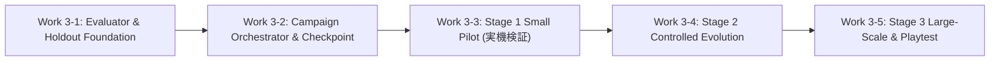

# BlackPoker Simulator Work 3: Standard＋Pack 多世代進化学習 設計仕様書 (R1)

**作業ID:** `BP-SIM-AI-V92-WORK3-MULTIGENERATION-EVOLUTION-PLAN-R1`  
**ステータス:** **PROPOSED / PLAN ONLY (PENDING INDEPENDENT REVIEW)**  
**Base SHA:** `959d6048597e4450786f14cd0ff72882658ad27d`  
**対象ブランチ:** `BlackPoker/issue551-core-flow`  
**作成日時:** 2026-11-02  

---

## 0. 背景と目的

Work 2 において、大規模自動対戦基盤の整備および 10,000 試合安定性試験（`BP-SIM-AI-V92-WORK2-10K-STABILITY-GATE`）が正式承認されました。
実機測定では 10,000 試合を約 40 分で完走し、`FAILED = 0`、`INCOMPLETE = 0`、決定論的再現性、およびメモリ安全性が立証されています。
ただし、この実測値は `FirstLegalPolicy` vs `SeededRandom` のベンチマークであり、`GenomePolicy` 同士の対戦性能と同一視することはできません。

本 Work 3 の目的は、公式レギュレーション **Standard＋Pack**（`official:standard-pack`）において、意思決定重み（Decision DNA）を多世代にわたり進化させ、客観的に強い AI を獲得できる多世代進化学習基盤を設計することです。

**最終目標は、進化によって獲得した DNA を搭載した AI が、人間と BlackPoker を対戦できることです。**

単に世代交代ループが正常に回転することだけを学習成功とみなすのではなく、「対戦能力が客観的・統計的に改善されたこと」を厳格に検証できるアーキテクチャを設計します。

> [!IMPORTANT]
> 本設計仕様書は **PLAN ONLY** です。Production Core、公式ルール、YAML、AI/DNA ロジック、既存 Evidence の変更は一切行わず、新規対戦・ベンチマーク・テストコードの実装も行いません。

---

## 1. 現在のAI進化基盤の実装状況 (Current Capability Analysis)

### 1.1 既存進化学習基盤のコンポーネント監査

リポジトリ内の既存実装（`tools/simulator/src/`）を精査し、Work 3 における再利用性を以下の 4 カテゴリに分類しました。

| コンポーネント | 正確な実装パス | 現状の責務 | Work 3 での分類 | 分類理由・対応方針 |
| :--- | :--- | :--- | :---: | :--- |
| **`EvolutionLoop`** | `src/engine/ai/EvolutionLoop.ts` | 複数世代の決定論的順次実行統括、世代間チェーン検証、REEVALUATION 停止 | **1. 実装済みで再利用可能** | 世代遷移プリミティブとして完全再利用。設計原則 8 に従い、評価や早期終了は内包せず上位層へ委譲。 |
| **`GenerationRunner`** | `src/engine/ai/GenerationRunner.ts` | 1世代内の Double Round Robin 自己対戦、Outcome 集計、適応度計算 | **1. 実装済みで再利用可能** | 1世代実行境界として完全再利用。対戦数計算式 $N(N-1) \times R$ に完全準拠。 |
| **`GenerationBuilder`** | `src/engine/ai/GenerationBuilder.ts` | $g \rightarrow g+1$ の母集団構築、Elite 保存、Offspring 生成、DNA 検証 | **1. 実装済みで再利用可能** | 入力不変性・決定論的アセンブリ契約が確立しており再利用。 |
| **`FitnessEvaluator`** | `src/engine/ai/FitnessEvaluator.ts` | Outcome-First 適応度計算（$\text{wins} / \text{completed}$）、Fail-Closed 検証 | **1. 実装済みで再利用可能** | Outcome-First 原則（"Victory is the objective. Life is a resource, not a score."）の維持に不可欠。 |
| **`PopulationSelector`** | `src/engine/ai/PopulationSelector.ts` | VALID 個体プールからのトーナメント親選択、同点時の Seeded Tie-Break | **1. 実装済みで再利用可能** | 決定論的トーナメント選択アルゴリズムを再利用。 |
| **`GeneticCrossover`** | `src/engine/ai/GeneticCrossover.ts` | Block-Segmented Uniform Crossover による親 DNA の交叉 | **1. 実装済みで再利用可能** | 23,738 重みのブロック交叉を決定論的に実行可能。 |
| **`GeneticMutation`** | `src/engine/ai/GeneticMutation.ts` | 正規分布摂動（Box-Muller）による重み突然変異、Clamp 処理 | **1. 実装済みで再利用可能** | 決定論的変異演算子を再利用。 |
| **`ParentPairAssembler`** | `src/engine/ai/ParentPairAssembler.ts` | トーナメント選択親からの交叉ペア編成、Self-Mating 再試行 | **1. 実装済みで再利用可能** | ペア編成契約が確立済み。 |
| **`GenomePolicy`** | `src/engine/ai/GenomePolicy.ts` | DecisionRequest を入力とし、Encoder と Scorer で手を選択する Policy | **1. 実装済みで再利用可能** | Core 契約に完全準拠（全 GameState への不正アクセスなし）。対人戦でも同一 Policy を使用。 |
| **`DecisionDNACodec`** | `src/engine/ai/DecisionDNACodec.ts` | DecisionDNA の JSON シリアライズ/デシリアライズ、ディープクローン、形式検証 | **1. 実装済みで再利用可能** | DNA 形式検証・不変性保護の基盤として再利用。 |
| **`GenomeScorer`** | `src/engine/ai/GenomeScorer.ts` | 線形＋相互作用重みによる合法手のスコアリング、決定論的 Argmax | **1. 実装済みで再利用可能** | Feature Schema v6 (308次元) に対応済み。 |
| **`DecisionFeatureEncoder`** | `src/engine/ai/DecisionFeatureEncoder.ts` | 観測情報から特徴量（308次元）を正規化・有界スケーリング抽出 | **1. 実装済みで再利用可能** | Feature Scaling v6 対応済み。 |
| **`ExecutionManifest`** | `src/engine/manifest/ExecutionManifest.ts` | Git 検証、RulePackage Digest、SHA-256 チェックサム保護 | **1. 実装済みで再利用可能** | 正式 Evidence 保存の fail-closed 契約（`VERIFIED` 必須）を再利用。 |
| **`LargeScaleBatchRunner`** | `src/simulation/LargeScaleBatchRunner.ts` | 大規模バッチ実行、正規化 JSON チェックポイント、SHA-256 改ざん検出 | **1. 実装済みで再利用可能** | チェックポイント・Resume 機構の参照実装として再利用。 |
| **`FirstLegalPolicy`** | `src/engine/simulation/DecisionPolicy.ts` | 合法手リストの先頭手を選択する決定論的 Policy | **1. 実装済みで再利用可能** | ルール提示順序に従う単純 Baseline。攻撃性等の戦略性は持たず、基本的行動遂行のアンカーとして機能。 |
| **`EvolutionDNALoader`** | `src/engine/ai/EvolutionDNALoader.ts` | Champion DNA の読み込みと Playtest への提供 | **2. 検証・拡張が必要** | 現状 `light-entry16` の g1-best にハードコードされており、Standard＋Pack 向けへの拡張が必要。 |
| **`PolicyExperimentRunner`** | `src/engine/ai/PolicyExperimentRunner.ts` | 2者間（Pairwise）の座席入れ替え対戦実験 | **2. 検証・拡張が必要** | 単一ペア実験用であり、全 `decisionRecords` を配列蓄積する実装のため、大規模評価時のメモリ肥大化対策が必要。 |
| **`BaselinePolicies`** | `src/engine/ai/BaselinePolicies.ts` | FirstLegal, SeededRandom, Zero, ManualGeneric | **2. 検証・拡張が必要** | Standard＋Pack での勝率水準の事前把握が必要。 |
| **評価・選定マネージャー** | *(未実装)* | 世代間比較、Validation 評価、Champion 選定、Early Stopping | **3. 新規実装が必要** | `EvolutionCampaignManager` / `EvolutionIndependentEvaluator` の新設が必要。 |
| **Holdout 評価ハーネス** | *(未実装)* | 未使用 Seed による最終 Holdout テスト、統計的検定（95% CI） | **3. 新規実装が必要** | Train / Validation / Test の 3 層分離と有意性検定の仕組み。 |
| **多世代 DNA 可視化 UI** | *(未実装)* | 世代ごとの重み分布や系統樹のブラウザ上での可視化 | **4. Work 3 では不要** | コア学習・強さ認定には直接不要（将来の可視化課題）。 |

---

### 1.2 既存 Evidence の分析と到達点

| 既存 Evidence ファイル | レギュレーション | 試合数・世代 | 確認された事実 (Confirmed Facts) | 未確認事項・限界 (Limitations) |
| :--- | :--- | :--- | :--- | :--- |
| **`v92-v6-evolution-baseline-v1-r1.json`** | `light-entry16` | $N=6$, $R=1$, 30試合 ($g=0 \rightarrow g=1$) | Feature Schema v6 による 1 世代遷移の決定論性、DNA 重み整合性、完全完走。 | 複数世代の累積進化、対戦相手の多様性、Standard＋Pack での挙動。 |
| **`Controlled Multi-Generation Evidence`** (過去記録) | `light-entry16` | $N=6$, $R=1$, $g=0$ 完走, $g=1$ 未完28戦 | $g=1$ オフスプリングが「Turn 1 での PASS 過剰選好」に陥り、千日手・最大意思決定数到達で未完了多発。 | Feature Scaling v6 および Semantic Stall 導入後の多世代での安定完走。 |
| **`standard-pack-evolution-pilot-v1-r3.json`** | `standard-pack` | 2 世代 (Stage A: 12戦, Stage B: 576戦) | Core バグ修正（手番解決）後の決定論的再現性、DNA ダイジェスト一致。 | **重要:** 再利用された 576 条件は Pilot R1/R2 のバグ修正比較であり、**新規の未使用 Holdout 評価ではない**。真の汎化性能は未検証。 |
| **`large-scale-batch-stability-10k.json`** | `standard-pack` | 10,000 試合 (FirstLegal vs SeededRandom) | 10,000 試合を 40 分で完走、FAILED=0、決定論的再現性、メモリ安定性。 | GenomePolicy 同士の対戦性能（計算量、メモリ、速度低下プロファイル）。 |
| **`drift-investigation-A/B.json`** | `standard-pack` | 計 4,000 試合 (条件A 2,000戦, 条件B 2,000戦) | チェックポイント直接 I/O は 335ms (0.07%)。条件Bは 60 秒高速。 | CPU 温度・クロックや V8 断片化の直接プロファイル、GenomePolicy でのドリフト。 |

---

## 2. Work 3 で不足している機能 (Gap Analysis)

1. **世代間評価・Champion 選定レイヤーの欠落:**
   - `EvolutionLoop` は設計原則 8 により世代間比較を責務外としているため、全世代を通じて「どの個体が真に最も強いのか」を選出・追跡する上位管理者が不在。
2. **Train / Validation / Test の厳格なデータセット分離基盤:**
   - 未知の盤面・展開に対する汎化性能を保証する Holdout 機構がなく、同一 Seed 群が繰り返し評価に使われることによる「評価データの汚染（Data Contamination）」を防止する仕組みが欠落。
3. **固定 Baseline Policy との独立評価ハーネス:**
   - 自己対戦の勝率（相対評価）のみでは、世代全体が共倒れ（双方 PASS 連打など）になっても見かけ上の高適応度が出てしまうため、外部の固定アンカー（FirstLegal, SeededRandom, Zero DNA）と戦わせて絶対的な能力を測るハーネスが未整備。
4. **統計的有意性の検定・客観的判定基準:**
   - 座席反転ペア対戦の相関を考慮し、偶然の偏りを排除して「有意に改善した」と判定する検定ロジックが未整備。
5. **Standard＋Pack 向け Champion DNA 管理と Playtest 接続:**
   - `light-entry16` 専用のローダーを Standard＋Pack 向けに汎用化し、UI で安全に対戦させる導線が未整備。
6. **多世代実行の中断・再開（Resume）と Execution Manifest 統合:**
   - 世代単位で安全にチェックポイントを保存し、同一のシード系列・DNA 系譜から 1 ビットの狂いもなく再開する統合管理機構が未整備。

---

## 3. 提案アーキテクチャと責務境界 (Proposed Architecture)

### 3.1 既存 `EvolutionLoop` の責務境界の維持

`EvolutionLoop` の設計仕様（`tools/simulator/docs/ai-evolution-loop-design-v1.md`）に定められた最重要原則を厳格に維持します：
- **原則 1:** GenerationRunner への一元委譲 ("One Generation Only" 境界の維持)
- **原則 2:** 決定論性 (campaignSeed と sourceGeneration による直接シード導出)
- **原則 8:** **世代間 Fitness 比較・改善率計算・早期終了の排除**

`EvolutionLoop` を改造して評価ロジックや早期終了を埋め込むことは禁止します。

### 3.2 `EvolutionLoop` と `CampaignManager` の接続方式

既存の `EvolutionLoop` の Public Contract を維持したまま、世代ごとの Validation・早期終了・チェックポイントを成立させる接続方式を以下のように設計します。

#### (1) `generationCount: 1` によるステップ駆動方式の成立性
- `EvolutionLoop.ts` において、`generationCount` は **世代遷移回数（`requestedTransitions`）** として定義されています。
- `initialPopulation.generation = g` に対し、`generationCount: 1` で実行すると、世代 $g$ の自己対戦（Double Round Robin）が実行され、$g \rightarrow g+1$ の母集団構築が行われて `finalPopulation.generation = g+1` が返されます。
- したがって、上位の `EvolutionCampaignManager` が `EvolutionLoop.run({ initialPopulation: P_g, config: { generationCount: 1, ... }, campaignSeed })` を世代ごとに呼び出す方式は、既存契約と 100% 整合します。

#### (2) 一括実行と分割実行での決定論的完全一致の保証
- `EvolutionLoop` では、各世代のシードが以下のように導出されます：
  $$\text{generationSeed} = \text{deriveSeed}(\text{campaignSeed}, \text{canonicalGenerationStreamKey}(\text{sourceGeneration}))$$
- この導出は前世代の実行結果や乱数状態に依存せず、`campaignSeed` と `sourceGeneration` のみから純粋関数で計算されます。
- したがって、最初から `generationCount: G` で一括実行した場合と、`generationCount: 1` を $G$ 回呼び出して前回の `finalPopulation` を次回の `initialPopulation` として引き渡した場合で、生成される世代シード、対戦スケジュール、対戦結果、選定親、交叉・変異シード、および次世代 DNA は **1 ビットの狂いもなく完全同一** になることが数学的・構造的に保証されます。

#### (3) 評価対象母集団の特定と Validation のタイミング
- `EvolutionLoop(generationCount: 1)` を実行すると、以下の成果物が得られます：
  - `logicalResult.fitnessSnapshot`: 世代 $g$ の自己対戦実績（各個体の勝率・適応度）
  - `logicalResult.finalPopulation`: 交叉・突然変異によって新たに生成された未対戦の次世代母集団 $P_{g+1}$
- **Champion 候補の特定:**
  - 評価対象とすべきは、未対戦の $P_{g+1}$ ではなく、**自己対戦を完了して適応度が確定した世代 $g$ の個体群** です。
  - 世代 $g$ の中で最も自己対戦適応度が高い個体（同点時は Seeded Tie-Break）を **「世代 $g$ の Champion 候補」** として特定します。
- **Validation の実行タイミング:**
  - `EvolutionLoop` の実行完了直後、次世代 $g+1$ の自己対戦を開始する前に、世代 $g$ の Champion 候補に対して `EvolutionIndependentEvaluator` による Validation（固定 Baseline 群との対戦）を実行します。

#### (4) Early Stopping と保存 Champion の定義
- Validation スコアを歴代の Champion 候補と比較し、改善が認められれば「暫定最良 Champion」を更新します。
- 連続 $K$ 世代にわたり改善が認められない場合は Early Stopping を発動します。
- **保存 Champion の厳格な定義:**
  - Early Stopping 後（または全世代完走後）に保存される Champion は、「最終世代の個体」ではなく、**「全世代を通じて Validation スコアが最高であった暫定最良 Champion（Best-Validation Individual）」** です。
  - これにより、末期世代で過学習や性能ドリフトが発生していた場合でも、最良状態の DNA が確実に保護されます。

#### (5) Resume 時の重複防止
- チェックポイントには、① 完了済み世代 $g$ の結果・Validation レコード、② 構築済み次世代母集団 $P_{g+1}$、③ 暫定最良 Champion を不可分（アトミック）に保存します。
- 再開時は $P_{g+1}$ をロードして世代 $g+1$ の自己対戦から開始するため、世代 $g$ の自己対戦や Validation の再実行（二重実行）は発生しません。

---

## 4. 多世代進化のアルゴリズムと学習条件 (Evolution Algorithm)

### 4.1 進化ライフサイクルの完全フロー

```text
[初期母集団生成 (多様性確保)]
         ↓
 ┌─→ [自己対戦 (Double Round Robin)]  ← GenerationRunner (1世代実行)
 │       ↓
 │   [Fitness評価 (Outcome-First)]     ← FitnessEvaluator
 │       ↓
 │   [世代 g Champion候補特定]         ← 自己対戦最上位個体
 │       ↓
 │   [Validation評価 (固定相手)]       ← EvolutionIndependentEvaluator
 │       ↓
 │   [Champion候補追跡 & 早期停止判定] ← EvolutionCampaignManager
 │       ↓ (継続の場合)
 │   [親選択 (Tournament Selection)]   ← PopulationSelector
 │       ↓
 │   [交叉 & 突然変異 (Elite保存)]     ← GenerationBuilder / GeneticOperators
 │       ↓
 │   [次世代母集団 P_(g+1) 生成]       ← PopulationSnapshot(g+1)
 │       ↓
 │   [チェックポイント保存]            ← CampaignCheckpointManager
 │       ↓
 └── (世代 g+1 のループへ)
         ↓ (全世代完走 または Early Stopping)
[最終 Champion 認定 (未使用 Holdout テスト)] ← HoldoutTestHarness (完全ブラインド)
         ↓
[正式 Evidence & Champion DNA 保存]          ← ExecutionManifest 統合
         ↓
[Playtest UI での対人戦利用]                 ← PlaytestPolicyFactory
```

### 4.2 初期母集団の生成と多様性の確保

全ゲノムを同一の Zero DNA（全重み 0.0）から開始すると、第 0 世代の自己対戦がすべて同一挙動となり、多様性が失われます。
- 個体 0: **Zero DNA**（基準アンカー）
- 個体 1: **Manual Generic Genome**（既存の発見的重み）
- 個体 $2 \sim N-1$: **微小摂動 DNA**（Zero または Manual DNA に対し、Campaign Seed から派生した決定論的乱数で微小なガウス摂動 $\mathcal{N}(0, \sigma_{\text{init}}^2)$ を加えた重み）
- すべての初期 DNA は `DecisionDNACodec.validate()` を通過させ、有限数・有界値を保証します。

### 4.3 自己対戦スケジュールと試合数計算式

既存の `GenerationRunner.planSchedule` の Double Round Robin 契約を完全遵守します。
母集団サイズを $N$、ペア繰り返し数を $R$（基本 $R=1$）とすると、1 世代あたりの自己対戦数は厳密に以下となります：

$$M_{\text{train\_gen}} = N(N - 1) \times R$$

世代遷移回数を $G$（$g=0 \rightarrow \dots \rightarrow g=G$）とすると、総自己対戦数は：

$$M_{\text{train\_total}} = G \times N(N - 1) \times R$$

### 4.4 Outcome-First Fitness 評価

既存 `FitnessEvaluator` の設計原則を 100% 遵守します：
$$\text{fitnessScore} = \frac{\text{wins} \times 1.0 + \text{draws} \times 0.5}{\text{completedMatches}}$$
- **"Victory is the objective. Life is a resource, not a score."**
- ライフ残量、与ダメージ、ターン数などを安易にスコアへ加算することは固く禁止します。
- FAILED 試合が 1 件でも発生した個体は即座に `status: "INVALID"`（失格）とし、選択プールから完全除外します。

---

## 5. 強さの評価・統計判定・過学習防止方法 (Strength Evaluation)

### 5.1 自己対戦の限界と評価の2大軸の分離

自己対戦（Self-Play）の適応度のみでは、メタ循環（じゃんけん関係）や共倒れ（PASS 連打への収束）を検出できません。
したがって、評価を以下の **2 大軸** に明確に分離します：

1. **絶対的能力水準（Absolute Competency）:**
   - 固定された外部 Baseline に対する対戦成績。ゲームの基本行動遂行能力、ランダム行動耐性、無学習状態に対する優位性を測る。
2. **進化的向上度（Evolutionary Improvement）:**
   - 初期世代（$g=0$ Champion）および過去世代 Champion との直接比較。学習が進むことで初期状態よりも有意に強くなっているかを測る。

### 5.2 評価対戦相手の選定と選定根拠

| 対戦相手 Policy | 役割 | 選定根拠 | 設計上の初期仮説目標 (Provisional Target) |
| :--- | :--- | :--- | :--- |
| **`FirstLegalPolicy`** | ルール提示順序に従う単純行動に対する優位性 | 最も基本的な決定論的 Baseline。これに安定して勝てない AI は、ゲーム遂行の基本水準において不十分。 | ペア勝率 > 55%（仮値、実証後に再校正） |
| **`SeededRandom`** | ランダムノイズ・奇手耐性の検証 | 予測不能な行動に対して取りこぼさず、確実に勝ち切れるかを検証。 | ペア勝率 > 65%（仮値、実証後に再校正） |
| **`Zero DNA (GenomePolicy)`** | 無学習状態に対する優位性の検証 | 重み付けが一切存在しない初期ゲノムに対する優位性の確認。 | ペア勝率 > 60%（仮値、実証後に再校正） |
| **`Past Champion (g=0, g-1)`** | 世代を通じた絶対的成長の検証 | 初期世代および前世代の Champion に対し、優位または互角以上であることの確認。 | ペア勝率 $\ge$ 50% |

> [!NOTE]
> 上記の目標勝率は、過去の Standard＋Pack での十分な対戦実績が存在しないため、**「設計上の初期仮説（Provisional Target）」** として扱います。Stage 1 (Small Pilot) の実測値に基づき、後続ステージの合格基準を正式校正します。

### 5.3 Train / Validation / Test の厳格な 3 層分離

データ漏洩（Contamination）を防ぐため、シード空間を厳格に 3 層分離します。

```text
[全シード空間 (Campaign Seed から決定論的派生)]
  ├── Training Seeds     (自己対戦用: 世代 g ごとに独立ストリーム派生)
  ├── Validation Seeds   (各世代 Champion 候補選定用: 全世代共通の固定 Seed 群)
  └── Holdout Test Seeds (最終 Champion 独立認定用: 完全ブラインド・未使用 Seed 群)
```

- **Holdout Test の保護原則:**
  - **Stage 1 (Small Pilot) では Holdout Test を一切実行しません。**
  - Holdout Test は、Stage 3（または最終候補が存在するステージ）の完了時に、**最終 Champion 1体に対してのみ 1 回限り** 実行します。
  - Holdout 結果を見てアルゴリズムやハイパーパラメータを調整した場合、その Holdout Seed は汚染されたとみなし、次回は新たな Seed 集合を割り当てます。

### 5.4 座席反転ペア対戦と統計的判定の厳格化

#### (1) 座席反転ペア対戦 (Seat-Swapped Paired Matches)
単一の Seed $S$ において、先後手を入れ替えた以下の 2 試合（1 ペア）を必ず実行します：
- Leg 0: $P_1 = \text{Candidate}, P_2 = \text{Opponent}$ (Seed: $S$)
- Leg 1: $P_1 = \text{Opponent}, P_2 = \text{Candidate}$ (Seed: $S$)

※座席反転により、特定の初期シードにおける先後手有利の影響を構造的に相殺・緩和し、座席による不公平性を低減します（「バイアスが完全に除去される」と過剰主張せず、相殺・緩和効果として位置付けます）。

#### (2) ペア単位スコアリング (Paired Match Outcome)
Leg 0 と Leg 1 は同一シードに基づくため互いに独立試行ではありません。したがって、統計的検定の独立試行の単位は「1試合」ではなく **「1ペア（2試合）」** として定義します。

各ペア $i$ のペアスコア $X_i \in \{0.0, 0.25, 0.5, 0.75, 1.0\}$：
- 2勝 0敗: $X_i = 1.0$ (ペア完勝)
- 1勝 1分: $X_i = 0.75$
- 1勝 1敗 または 2分: $X_i = 0.5$ (引き分け・相殺)
- 1敗 1分: $X_i = 0.25$
- 0勝 2敗: $X_i = 0.0$ (ペア完敗)

平均ペアスコア $\bar{X} = \frac{1}{n} \sum_{i=1}^n X_i$ を算出し、ペア単位の勝率として扱います。

#### (3) 異常系の厳格な扱い (Fail-Closed)
- 引き分けはスコア 0.5 として厳密に計算に含めます。
- **FAILED / INCOMPLETE 試合は勝敗へ自動換算（0勝や0.5分）してはなりません。**
- FAILED が 1 件でも発生した場合は、評価全体を **`INVALID_EVIDENCE`**（無効な証拠）として失格・即時停止します。
- INCOMPLETE が発生した場合は、**`INSUFFICIENT_EVIDENCE`**（証拠不十分）として判定保留とします。

#### (4) 判定ステータスの 4 区分
改善の成否を以下の 4 つの直交ステータスで厳密に区別します：
1. **`IMPROVEMENT_VERIFIED` (改善認定):**
   - 統計的検定（95% 信頼区間の下限 > 0.5）において、Baseline および初期 Champion に対する有意な改善が実証された状態。
2. **`IMPROVEMENT_UNVERIFIED` (改善未証明):**
   - サンプルサイズ不足やスコア差僅少により有意差が検出できなかった状態（※性能低下が証明されたわけではない）。
3. **`CONFIRMED_REGRESSION` (性能低下確認):**
   - 初期 Champion や Baseline に対し、統計的に有意に性能が劣化した状態。
4. **`INVALID_EVIDENCE` (証拠無効):**
   - FAILED 試合の混入、チェックサム不整合、データ破損等により評価が成立しない状態。

---

## 6. 学習規模と計算資源の試算 (Computational Sizing)

### 6.1 GenomePolicy 対戦の計算特性と試算シナリオ

GenomePolicy は 1 意思決定ごとに特徴量抽出（308次元）と全合法手重み計算（23,738重み）を行うため、FirstLegal より演算負荷が高くなります。
現時点では Standard＋Pack での GenomePolicy vs GenomePolicy の大規模実測スループットは存在しないため、以下を **「仮のシナリオ試算値（Scenario Estimate）」** として定義します（実測値ではありません）。

- **仮定シナリオ値:** 1 プロセスあたり約 **2.0 試合/秒**（保守的仮定）
- **工程別計算量の分離:**

| 工程 | 対戦主体 | 1試合あたり意思決定数 | 備考 |
| :--- | :--- | :---: | :--- |
| **学習対戦 (Training)** | Genome vs Genome | 約 150 〜 200 | 両者が特徴量・重み計算を実行 |
| **Validation 対戦** | Genome vs Baseline | 約 150 〜 200 | 片側のみ特徴量・重み計算を実行 |
| **Holdout 対戦** | Genome vs Baseline / Genome | 約 150 〜 200 | 最終 Champion のみ 1 回実行 |
| **DNA 生成・シリアライズ** | CPU 演算 | - | 世代あたり数 ms（無視可能） |
| **Checkpoint** | JSON 直列化・ハッシュ・I/O | - | 世代あたり約 50 〜 150 ms |
| **Resume 検証** | JSON デシリアライズ・検証 | - | 起動時 1 回、約 100 ms |

### 6.2 Stage 別の再設計試合数と内訳

各 Stage において、Seed 数、対戦相手数、座席反転（常に 2 試合）、Validation 世代数を完全に分離して集計しました。

#### 試合数計算式
- **Training 試合数:** $M_{\text{train}} = G \times N(N-1) \times R$
- **Validation 試合数:** $M_{\text{val}} = G \times K_{\text{val}} \times S_{\text{val}} \times 2$
- **Holdout 試合数:** $M_{\text{holdout}} = 1 \times K_{\text{holdout}} \times S_{\text{holdout}} \times 2$

#### Stage 別集計表

| 項目 | Stage 1: Small Pilot | Stage 2: Controlled Evolution | Stage 3: Large-Scale Evolution |
| :--- | :---: | :---: | :---: |
| **主目的** | 複数世代遷移、決定論性、中断再開 | 改善傾向確認、PASS千日手検出 | 長時間安定学習、最終 Champion 認定 |
| **母集団サイズ ($N$)** | **$N = 6$** | **$N = 8$** | **$N = 12$** |
| **世代遷移回数 ($G$)** | **$G = 2$** ($g=0 \rightarrow 1 \rightarrow 2$) | **$G = 5$** ($g=0 \rightarrow \dots \rightarrow 5$) | **$G = 10$** ($g=0 \rightarrow \dots \rightarrow 10$) |
| **自己対戦 / 世代** | $6 \times 5 = 30$ 試合 | $8 \times 7 = 56$ 試合 | $12 \times 11 = 132$ 試合 |
| **Training 総試合数** | **60 試合** | **280 試合** | **1,320 試合** |
| **Validation 相手数 ($K_{\text{val}}$)** | 2 種 (FirstLegal, SeededRandom) | 2 種 (FirstLegal, SeededRandom) | 2 種 (FirstLegal, SeededRandom) |
| **Validation Seed数 ($S_{\text{val}}$)** | 5 Seeds (座席反転計 10 試合/相手) | 10 Seeds (座席反転計 20 試合/相手) | 15 Seeds (座席反転計 30 試合/相手) |
| **Validation 試合 / 世代** | $1 \times 2 \times 5 \times 2 = 20$ 試合 | $1 \times 2 \times 10 \times 2 = 40$ 試合 | $1 \times 2 \times 15 \times 2 = 60$ 試合 |
| **Validation 総試合数** | **40 試合** (2世代分) | **200 試合** (5世代分) | **600 試合** (10世代分) |
| **Holdout 実施有無** | **なし (0 試合)** | 探索用 Holdout (Stage 2 専用) | **本番 Holdout (完全未使用)** |
| **Holdout 相手数 ($K_{\text{holdout}}$)** | - | 3 種 (FirstLegal, Random, Zero) | 4 種 (FirstLegal, Random, Zero, g0) |
| **Holdout Seed数 ($S_{\text{holdout}}$)** | - | 20 Seeds | 30 Seeds |
| **Holdout 総試合数** | **0 試合** | **120 試合** ($1 \times 3 \times 20 \times 2$) | **240 試合** ($1 \times 4 \times 30 \times 2$) |
| **Stage 総試合数** | **100 試合** | **600 試合** | **2,160 試合** |
| **推定所要時間 (仮定 2.0 mps)** | **約 1 分** | **約 5 〜 7 分** | **約 18 〜 25 分** |
| **推定 Heap メモリ** | $\le 120$ MB | $\le 180$ MB | $\le 250$ MB |

> [!IMPORTANT]
> 「1時間以内に確実に完走する」という保証表現は撤回します。
> **適応型再見積もり計画:** 最初の Stage 1 (Small Pilot: 100 試合) において、実機コンテナ環境での GenomePolicy の実測スループットおよびメモリ推移を計測します。その実測プロファイルに基づき、Stage 2 および Stage 3 の試合数・所要時間を正式に再校正します。

---

## 7. 学習結果と Evidence の保存設計 (Evidence & Resume Design)

### 7.1 メモリ肥大化対策 (`PolicyExperimentRunner` 統合方針)

- **課題:** 既存の `PolicyExperimentRunner` は `decisionRecords: PolicyDecisionRecord[]` を全件メモリ配列に無制限 `push` しており、数千試合の評価時にメモリ爆発を招く構造的リスクがあります。
- **対策:**
  - 評価用に対戦ループを重複実装することは避け、`PolicyExperimentRunner` または `SimulationRunner` の呼び出しにおいて、生レコードの蓄積を抑止し、勝敗カウントおよび動作メトリクスの **ストリーミング集計（O(1) メモリ）** を行う設計とします。

### 7.2 一時 Checkpoint と 正式 Evidence の厳格な分離

- **一時 Checkpoint (`.artifacts/checkpoints/`):**
  - 1 世代終了ごとに保存される途中再開用ファイル（Git 管理外）。
  - 保存内容: 完了世代番号 $g$、`currentPopulation`、歴代 Validation レコード、暫定最良 Champion、`campaignSeed`。
- **正式 Evidence (`tools/simulator/reports/ai/`):**
  - キャンペーン全工程および Holdout テストが完了した後にのみ生成（Git 管理下）。
  - 保存内容: Execution Manifest、Git Commit SHA (`VERIFIED`), RulePackage Digest, Feature Schema v6, DNA Format v1, Campaign Seed, 全世代サマリ, 最終 Champion DNA, Holdout ペアスコア・95% CI レポート。
  - **学習未達成時の保存:** 統計的検定で改善が認められなかった場合でも、結果を改ざん・破棄せず、`status: "IMPROVEMENT_UNVERIFIED"` または `"CONFIRMED_REGRESSION"` として正式 Evidence を保存します。

---

## 8. Playtest への接続方針 (Human vs AI Integration)

- **Champion DNA の出力:** `tools/simulator/src/data/ai/standard-pack-champion-v6.json` およびマニフェストを出力。
- **`PlaytestPolicyFactory` の拡張:** Policy ID `evolution-standard-pack-champion` を新設し、UI から選択可能にする。
- **Core 観測境界の維持:** AI は `DecisionRequest` の観測情報のみにアクセス。全 GameState や非公開情報へのアクセスは Core レベルで厳格遮断。

---

## 9. 段階的実装ロードマップ (Phased Implementation Roadmap)

独立レビュー可能な 5 つのサブ Work に分割します。



### Sub-Work 詳細仕様と完了条件

#### 1. Work 3-1: 独立評価ハーネス・Train/Val/Test 分離・統計判定基盤
- **Work ID:** `BP-SIM-AI-V92-WORK3-EVALUATOR-FOUNDATION`
- **目的:** 学習を開始する前に、客観的な「強さの物差し（座席反転ペア対戦・ペア単位スコア・Train/Val/Test 分離）」を確立する。
- **既存機能との関係:** `SimulationRunner`, `BaselinePolicies`, `ExecutionManifest` を再利用。
- **変更・新規ファイル:**
  - `src/domain/ai/EvolutionEvaluationTypes.ts` (新規: 評価設定・ペアスコア・統計結果型定義)
  - `src/engine/ai/EvolutionIndependentEvaluator.ts` (新規: 座席反転ペア対戦・ストリーミング集計・ペアスコア検定)
  - `src/tests/ai/evolutionIndependentEvaluator.test.ts` (新規: 単体テスト)
- **完了条件 (厳格な設計契約):**
  1. 正しい Seed 分離（Train / Val / Holdout のシード重複がないことの検証）
  2. 座席反転の整合性（同一 Seed で Leg 0 / Leg 1 が正しく実行されること）
  3. 試合結果の保存・ペア単位再集計（引き分けスコア 0.5 の正確な計算）
  4. 統計的判定の適用範囲（FAILED による `INVALID_EVIDENCE`、INCOMPLETE による `INSUFFICIENT_EVIDENCE` の Fail-Closed 処理）
  5. 決定論的再現性（同一入力で完全同一の評価スコアが出力されること）
  6. メモリ使用量の制限（全 `decisionRecords` をメモリ蓄積せず、ストリーミング集計で完了すること）
  7. クリーン環境でのテスト 100% PASS、型エラー 0 件
- **次 Work 移行条件:** 独立レビュー承認。

#### 2. Work 3-2: Campaign Orchestrator・Champion 選定・Checkpoint/Resume 統合
- **Work ID:** `BP-SIM-AI-V92-WORK3-CAMPAIGN-ORCHESTRATOR`
- **目的:** `EvolutionLoop(generationCount: 1)` を世代ごとに呼び出し、Validation、Champion 候補追跡、Early Stopping、チェックポイント/Resume を統括する管理層を構築。
- **完了条件:** 途中停止からの決定論的再開テスト PASS、チェックサム改ざん検知テスト PASS、Early Stopping テスト PASS。
- **次 Work 移行条件:** 独立レビュー承認。

#### 3. Work 3-3: Stage 1 Small Pilot 実機検証と決定論性立証
- **Work ID:** `BP-SIM-AI-V92-WORK3-STAGE1-PILOT`
- **目的:** Standard＋Pack において、実機コンテナ環境で小規模（$N=6, G=2$, 計 100 試合）の多世代進化を実行し、決定論性と基盤の健全性を実証する。
- **設計方針:** **Small Pilot の結果が期待した強さに届かない場合も、実験基盤として正常に動作していれば、その事実を Evidence に記録したうえで次の判断へ進める。**
- **完了条件:** 100 試合完走、FAILED = 0、2回実行での完全ビット一致（Run A === Run B）、実測スループット・メモリプロファイル取得、Evidence 保存、CI 成功。
- **次 Work 移行条件:** 独立レビュー承認。

#### 4. Work 3-4: Stage 2 Controlled Evolution・強さ改善確認
- **Work ID:** `BP-SIM-AI-V92-WORK3-STAGE2-CONTROLLED`
- **目的:** Stage 1 の実測プロファイルに基づき校正された規模（約 600 試合）で学習を実施し、Baseline に対する勝率向上傾向および多様性維持を確認。
- **完了条件:** Validation スコアの向上確認、過剰 PASS ストール発生 0 件、CI 成功。
- **次 Work 移行条件:** 独立レビュー承認。

#### 5. Work 3-5: Stage 3 Large-Scale・Champion DNA 保存・Playtest 統合
- **Work ID:** `BP-SIM-AI-V92-WORK3-STAGE3-CHAMPION-PLAYTEST`
- **目的:** 本番規模（約 2,000 試合規模）の学習を実行し、本番 Holdout 認定を受けた Champion DNA を生成・保存し、ブラウザ Playtest から対戦可能にする。
- **完了条件:** 統計的検定（95% CI 下限 > 50%）合格、Playtest E2E テスト PASS、CI 成功。

---

## 10. リスク・未確定事項・推奨する最初のWork (Risks & Open Questions)

- **主なリスクと緩和策:**
  - *過剰 PASS ストール:* `SemanticStallCycleDetector` 常時監視と FirstLegal 不合格時の即時失格。
  - *メモリ肥大化:* `PolicyExperimentRunner` での全意思決定レコード蓄積を廃止し、ストリーミング集計を採用。
  - *過学習・選定バイアス:* Validation は候補絞り込みにのみ使い、最終実力認定は完全ブラインドの未使用 Holdout Test でのみ実施。
- **未確定事項:**
  - Standard＋Pack における GenomePolicy vs GenomePolicy の実測スループット（Stage 1 で実測取得予定）。
  - 突然変異率・変異強度の最適値（Stage 1 / 2 の結果から決定論的に選定）。
- **推奨する最初の Work:**
  - **`Work 3-1: BP-SIM-AI-V92-WORK3-EVALUATOR-FOUNDATION`** への着手を強く推奨します。学習ループを回す前に、まず「ブレない物差し（Train/Val/Test 分離・座席反転ペア対戦・ストリーミング集計・Fail-Closed 判定）」を確立することが、安全な開発原則に合致します。

---

**READY FOR INDEPENDENT REVIEW**
