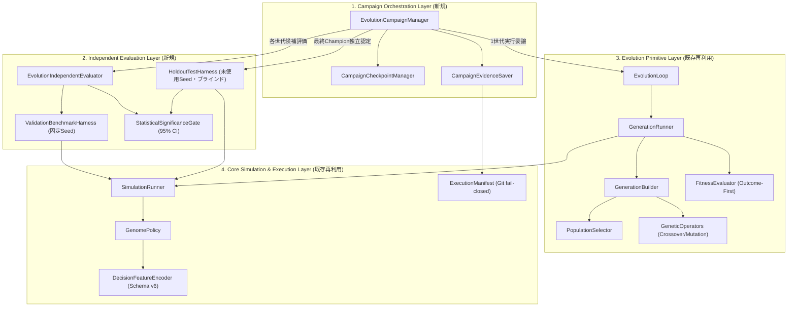
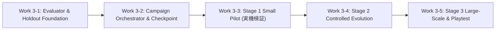

# BlackPoker Simulator Work 3: Standard＋Pack 多世代進化学習 設計仕様書

**作業ID:** `BP-SIM-AI-V92-WORK3-MULTIGENERATION-EVOLUTION-PLAN`  
**ステータス:** **PROPOSED / PLAN ONLY (PENDING INDEPENDENT REVIEW)**  
**Base SHA:** `28a070cc60815e904dd530f07ff27da955e3bfdf`  
**対象ブランチ:** `BlackPoker/issue551-core-flow`  
**作成日時:** 2026-11-02  

---

## 0. 背景と目的

Work 2 において、大規模自動対戦基盤の整備および 10,000 試合安定性試験（`BP-SIM-AI-V92-WORK2-10K-STABILITY-GATE`）が正式承認されました。
実機測定では 10,000 試合を約 40 分で完走し、`FAILED = 0`、`INCOMPLETE = 0`、決定論的再現性、およびメモリ安全性が立証されています。
ただし、この実測値は `FirstLegalPolicy` vs `SeededRandom` のベンチマークであり、`GenomePolicy` 同士の対戦性能と同一ではありません。

本 Work 3 の目的は、公式レギュレーション **Standard＋Pack**（`official:standard-pack`）において、意思決定重み（Decision DNA）を多世代にわたり進化させ、客観的に強い AI を獲得できる多世代進化学習基盤を設計することです。

**最終目標は、進化によって獲得した DNA を搭載した AI が、人間と BlackPoker を対戦できることです。**

単に世代交代ループが正常に回転することだけを学習成功とみなすのではなく、「対戦能力が客観的・統計的に改善されたこと」を厳格に検証できるアーキテクチャを設計します。

> [!IMPORTANT]
> 本設計仕様書は **PLAN ONLY** です。Production Core、公式ルール、YAML、AI/DNA ロジック、既存 Evidence の変更は一切行わず、新規対戦・ベンチマーク・テストコードの実装も行いません。

---

## 1. 現在のAI進化基盤の実装状況 (Current Capability Analysis)

### 1.1 既存進化学習基盤のコンポーネント監査

リポジトリ内の既存実装（`tools/simulator/src/`）を精査し、Work 3 における再利用性を以下の 4 カテゴリに分類しました。

| コンポーネント | 実装ファイル | 現状の責務 | Work 3 での分類 | 分類理由・対応方針 |
| :--- | :--- | :--- | :---: | :--- |
| **`EvolutionLoop`** | `src/engine/ai/EvolutionLoop.ts` | 複数世代の決定論的順次実行統括、世代間チェーン検証、REEVALUATION 停止 | **1. 実装済みで再利用可能** | 世代遷移プリミティブとして完全再利用。設計原則 8 に従い、世代間比較や早期終了は内包させず上位層へ委ねる。 |
| **`GenerationRunner`** | `src/engine/ai/GenerationRunner.ts` | 1世代内の Double Round Robin 自己対戦、Outcome 集計、適応度計算 | **1. 実装済みで再利用可能** | 1世代実行境界として完全再利用。対戦数計算式 $N(N-1) \times R$ に完全準拠。 |
| **`GenerationBuilder`** | `src/engine/ai/GenerationBuilder.ts` | $g \rightarrow g+1$ の母集団構築、Elite 保存、Offspring 生成、DNA 検証 | **1. 実装済みで再利用可能** | 入力不変性・決定論的アセンブリ契約が確立しており、そのまま再利用可能。 |
| **`FitnessEvaluator`** | `src/engine/ai/FitnessEvaluator.ts` | Outcome-First 適応度計算（$\text{wins} / \text{completed}$）、Fail-Closed 検証 | **1. 実装済みで再利用可能** | Outcome-First 原則（"Victory is the objective. Life is a resource, not a score."）の維持に不可欠。 |
| **`PopulationSelector`** | `src/engine/ai/PopulationSelector.ts` | VALID 個体プールからのトーナメント親選択、同点時の Seeded Tie-Break | **1. 実装済みで再利用可能** | 決定論的トーナメント選択アルゴリズムをそのまま再利用。 |
| **`GeneticCrossover`** | `src/engine/ai/GeneticCrossover.ts` | Block-Segmented Uniform Crossover による親 DNA の交叉 | **1. 実装済みで再利用可能** | 23,738 重みのブロック交叉を決定論的に実行可能。 |
| **`GeneticMutation`** | `src/engine/ai/GeneticMutation.ts` | 正規分布摂動（Box-Muller）による重み突然変異、Clamp 処理 | **1. 実装済みで再利用可能** | 決定論的変異演算子を再利用。設定パラメータ（$\sigma$, rate）の探索余地あり。 |
| **`ParentPairAssembler`** | `src/engine/ai/ParentPairAssembler.ts` | トーナメント選択親からの交叉ペア編成、Self-Mating 再試行 | **1. 実装済みで再利用可能** | ペア編成契約が確立済み。 |
| **`GenomePolicy`** | `src/engine/ai/GenomePolicy.ts` | DecisionRequest を入力とし、Encoder と Scorer で手を選択する Policy | **1. 実装済みで再利用可能** | Core 契約に完全準拠（全 GameState への不正アクセスなし）。対人戦でも同一 Policy を使用。 |
| **`DecisionDNACodec`** | `src/engine/ai/DecisionDNACodec.ts` | DecisionDNA の JSON シリアライズ/デシリアライズ、ディープクローン、形式検証 | **1. 実装済みで再利用可能** | DNA 形式検証・不変性保護の基盤として再利用。 |
| **`GenomeScorer`** | `src/engine/ai/GenomeScorer.ts` | 線形＋相互作用重みによる合法手のスコアリング、決定論的 Argmax | **1. 実装済みで再利用可能** | Feature Schema v6 (308次元) に対応済み。 |
| **`DecisionFeatureEncoder`** | `src/engine/ai/DecisionFeatureEncoder.ts` | 観測情報から特徴量（308次元）を正規化・有界スケーリング抽出 | **1. 実装済みで再利用可能** | Feature Scaling v6 対応済み。 |
| **`ExecutionManifest`** | `src/engine/manifest/ExecutionManifest.ts` | Git 検証、RulePackage Digest、SHA-256 チェックサム保護 | **1. 実装済みで再利用可能** | 正式 Evidence 保存の fail-closed 契約（`VERIFIED` 必須）を再利用。 |
| **`LargeScaleBatchRunner`** | `src/simulation/LargeScaleBatchRunner.ts` | 大規模バッチ実行、正規化 JSON チェックポイント、SHA-256 改ざん検出 | **1. 実装済みで再利用可能** | チェックポイント・Resume 機構の参照実装として再利用。 |
| **`EvolutionDNALoader`** | `src/engine/ai/EvolutionDNALoader.ts` | Champion DNA の読み込みと Playtest への提供 | **2. 検証・拡張が必要** | 現状 `light-entry16` の g1-best にハードコードされており、Standard＋Pack 向けへの拡張が必要。 |
| **`PolicyExperimentRunner`** | `src/engine/ai/PolicyExperimentRunner.ts` | 2者間（Pairwise）の座席入れ替え対戦実験 | **2. 検証・拡張が必要** | 単一ペア実験用であり、多世代 Champion 評価用ベンチマークスイートとしての検証が不足。 |
| **`BaselinePolicies`** | `src/engine/ai/BaselinePolicies.ts` | FirstLegal, SeededRandom, Zero, ManualGeneric | **2. 検証・拡張が必要** | 評価相手としての Baseline Suite が揃っているが、Standard＋Pack での勝率水準の事前把握が必要。 |
| **評価・選定マネージャー** | *(未実装)* | 世代間比較、Validation 評価、Champion 選定、Early Stopping | **3. 新規実装が必要** | `EvolutionCampaignManager` / `EvolutionIndependentEvaluator` の新設が必要。 |
| **Holdout 評価ハーネス** | *(未実装)* | 未使用 Seed による最終 Holdout テスト、統計的検定（95% CI） | **3. 新規実装が必要** | Train / Validation / Test の 3 層分離と有意性検定の仕組み。 |
| **多世代 DNA 可視化 UI** | *(未実装)* | 世代ごとの重み分布や系統樹のブラウザ上での可視化 | **4. Work 3 では不要** | コア学習・強さ認定には直接不要（将来の可視化課題）。 |

---

### 1.2 既存 Evidence の分析と到達点

| 既存 Evidence ファイル | レギュレーション | 試合数・世代 | 確認された事実 (Confirmed Facts) | 未確認事項・限界 (Limitations) |
| :--- | :--- | :--- | :--- | :--- |
| **`v92-v6-evolution-baseline-v1-r1.json`** | `light-entry16` | $N=6$, $R=1$, 30試合 ($g=0 \rightarrow g=1$) | Feature Schema v6 による 1 世代遷移の決定論性、DNA 重み整合性、完全完走。 | 複数世代の累積進化、対戦相手の多様性、Standard＋Pack での挙動。 |
| **`Controlled Multi-Generation Evidence`** (過去記録) | `light-entry16` | $N=6$, $R=1$, $g=0$ 完走, $g=1$ 未完28戦 | $g=1$ オフスプリングが「Turn 1 での PASS 過剰選好」に陥り、千日手・最大意思決定数到達で未完了多発。 | Feature Scaling v6 および Semantic Stall 導入後の多世代での安定完走。 |
| **`standard-pack-evolution-pilot-v1-r3.json`** | `standard-pack` | 2 世代 (Stage A: 12戦, Stage B: 576戦) | Core バグ修正（手番解決）後の決定論的再現性、DNA ダイジェスト一致。 | **重要:** 再利用された 576 条件は Pilot R1/R2 のバグ修正比較であり、**新規の未使用 Holdout 評価ではない**。真の汎化性能は未検証。 |
| **`large-scale-batch-stability-10k.json`** | `standard-pack` | 10,000 試合 (FirstLegal vs SeededRandom) | 10,000 試合を 40 分で完走、FAILED=0、決定論的再現性、メモリ安定性。 | GenomePolicy 同士の対戦性能（計算量、メモリ、速度低下プロファイル）。 |
| **`drift-investigation-A/B.json`** | `standard-pack` | 計 4,000 試合 (条件A 2,000戦, 条件B 2,000戦) | チェックポイント直接 I/O は 335ms (0.07%)。条件Bは 60 秒高速。 | CPU 温度・クロックや V8 断片化の直接プロファイル、GenomePolicy でのドリフト。 |

---

## 2. Work 3 で不足している機能 (Gap Analysis)

既存実装は「1 世代の自己対戦と次世代構築（GenerationRunner / GenerationBuilder）」および「機械的な複数世代ループ（EvolutionLoop）」の低水準プリミティブを提供していますが、**「AI が本当に強くなったかを客観的に評価し、強い DNA を安全に抽出・運用する仕組み」**が完全に欠落しています。

1. **世代間評価・Champion 選定レイヤーの欠落:**
   - `EvolutionLoop` は設計原則 8 により、世代間 Fitness 比較や Champion 選定を責務外としています。したがって、全世代を通じて「どの個体が真に最も強いのか」を選び出す上位オーケストレータが存在しません。
2. **Train / Validation / Test の厳格なデータセット分離基盤:**
   - 既存のパイロットでは、同一の Seed 群が学習・評価・検証に繰り返し使われており、機械学習における「データ漏洩（Data Contamination）」が発生していました。未知の盤面・展開に対する汎化性能を保証する Holdout 機構がありません。
3. **固定 Baseline Policy との独立評価ハーネス:**
   - 自己対戦の勝率（相対評価）のみでは、世代全体が共倒れ（例: 双方 PASS 連打の千日手）になっても見かけ上の高適応度が出てしまいます。外部の固定アンカー（FirstLegal, SeededRandom, Zero DNA）と戦わせて絶対的な能力を測るハーネスが未整備です。
4. **統計的有意性の検定・客観的判定基準:**
   - 「10 勝 2 敗だから強くなった」といった小サンプルでの偶然の偏りを排除し、二項検定や信頼区間（95% CI）に基づいて「有意に改善した」と判定するロジックがありません。
5. **Standard＋Pack 向け Champion DNA 管理と Playtest 接続:**
   - 現行の `EvolutionDNALoader` は `light-entry16` 専用のハードコードであり、Standard＋Pack の学習済み Champion DNA をブラウザ Playtest に安全にロードする汎用インターフェースが未整備です。
6. **多世代実行の中断・再開（Resume）と Execution Manifest 統合:**
   - 10 世代以上の学習は数十分〜数時間に及ぶ可能性がありますが、世代途中で安全にチェックポイントを保存し、同一のシード系列・DNA 系譜から 1 ビットの狂いもなく再開する統合管理機構がありません。

---

## 3. 提案アーキテクチャと責務境界 (Proposed Architecture)

### 3.1 既存 `EvolutionLoop` の責務境界の維持

`EvolutionLoop` の設計仕様（`tools/simulator/docs/ai-evolution-loop-design-v1.md`）に定められた最重要原則を厳格に維持します：
- **原則 1:** GenerationRunner への一元委譲 ("One Generation Only" 境界の維持)
- **原則 2:** 決定論性 (campaignSeed と sourceGeneration による直接シード導出)
- **原則 8:** **世代間 Fitness 比較・改善率計算・早期終了の排除**

`EvolutionLoop` を改造して評価ロジックや早期終了を埋め込むことは禁止します。`EvolutionLoop` は「決定論的な世代交代の実行エンジン」として純粋性を保ちます。

### 3.2 提案アーキテクチャ階層図

責務を直交分離するため、以下の 4 層アーキテクチャを提案します。



### 3.3 各レイヤーの責務境界

1. **`EvolutionCampaignManager` (新規上位レイヤー):**
   - キャンペーン全体のライフサイクル統括（初期集団生成、世代進行、中断・再開、終了判定）。
   - 各世代の終了時に `EvolutionIndependentEvaluator` を呼び出し、Validation 評価を実施。
   - 世代間での Champion 候補の追跡、停滞（Stagnation）の検出、Early Stopping の判断。
   - キャンペーン完了時、最終 Champion を選定して Holdout テストを実行し、正式 Evidence を保存。
2. **`EvolutionIndependentEvaluator` (新規独立評価レイヤー):**
   - 自己対戦ループから完全に隔離された独立対戦ハーネス。
   - 固定された対戦相手（FirstLegal, SeededRandom, Zero DNA, 過去 Champion）に対するベンチマーク実行。
   - 先後手バイアスを排除した座席入れ替え（Seat-Swapped Paired Matches）の強制。
   - 二項検定および Wilson スコア信頼区間（95% CI）による統計的有意性の算出。
3. **`EvolutionLoop` / `GenerationRunner` (既存低水準プリミティブ):**
   - 1 世代の自己対戦（Double Round Robin）と次世代母集団の決定論的構築に専念。
4. **`ExecutionManifest` / `LargeScaleBatchRunner` (基盤レイヤー):**
   - Git fail-closed 検証（`VERIFIED` 必須）、チェックポイント改ざん検出、不変性保護。

---

## 4. 多世代進化のアルゴリズムと学習条件 (Evolution Algorithm)

### 4.1 進化ライフサイクル

```text
[初期母集団生成 (多様性確保)]
         ↓
 ┌─→ [自己対戦 (Double Round Robin)]  ← GenerationRunner
 │       ↓
 │   [Fitness評価 (Outcome-First)]     ← FitnessEvaluator
 │       ↓
 │   [Validation評価 (固定相手)]       ← EvolutionIndependentEvaluator (新規)
 │       ↓
 │   [Champion候補選定 & 早期停止判定] ← EvolutionCampaignManager (新規)
 │       ↓ (継続の場合)
 │   [親選択 (Tournament Selection)]   ← PopulationSelector
 │       ↓
 │   [交叉 & 突然変異 (Elite保存)]     ← GenerationBuilder / GeneticOperators
 │       ↓
 │   [次世代母集団生成]                ← PopulationSnapshot(g+1)
 │       ↓
 └── (次世代ループへ)
         ↓ (完了 / 早期停止)
[最終 Champion 認定 (未使用 Holdout テスト)] ← HoldoutTestHarness (新規)
         ↓
[正式 Evidence & Champion DNA 保存]          ← ExecutionManifest 統合
         ↓
[Playtest UI での対人戦利用]                 ← PlaytestPolicyFactory
```

### 4.2 初期母集団の生成と多様性の確保

- **課題:** 全ゲノムを同一の Zero DNA（全重み 0.0）から開始すると、第 0 世代の自己対戦がすべて同一挙動となり、初期の多様性が失われます。
- **提案手法 (Seeded Diverse Initialization):**
  - 個体 0: **Zero DNA**（基準アンカー）
  - 個体 1: **Manual Generic Genome**（既存の発見的重み）
  - 個体 $2 \sim N-1$: **微小摂動 DNA**（Zero または Manual DNA に対し、Campaign Seed から派生した決定論的乱数で微小なガウス摂動 $\mathcal{N}(0, \sigma_{\text{init}}^2)$ を加えた重み）
  - すべての初期 DNA は `DecisionDNACodec.validate()` を通過させ、有限数・有界値を保証します。

### 4.3 自己対戦スケジュールと対戦数計算

既存の `GenerationRunner.planSchedule` の Double Round Robin 契約をそのまま使用します。
母集団サイズを $N$、ペア繰り返し数を $R$（デフォルト $R=1$）とすると、1 世代あたりの自己対戦数は厳密に以下となります：

$$\text{Matches per Generation} = N(N - 1) \times R$$

- $N = 6, R = 1 \implies 30$ 試合 / 世代
- $N = 10, R = 1 \implies 90$ 試合 / 世代
- $N = 16, R = 1 \implies 240$ 試合 / 世代

### 4.4 Outcome-First Fitness 評価

既存 `FitnessEvaluator` の設計原則を 100% 遵守します：
$$\text{fitnessScore} = \frac{\text{wins} \times 1.0 + \text{draws} \times 0.5}{\text{completedMatches}}$$
- **"Victory is the objective. Life is a resource, not a score."**
- ライフ残量、与ダメージ、ターン数、特定カード使用回数などを安易にスコアへ加算することは固く禁止します。ゲームの勝敗のみを学習の評価軸とします。
- FAILED 試合が 1 件でも発生した個体は即座に `status: "INVALID"`（失格）とし、選択プールから完全除外します。

### 4.5 親選択・遺伝的操作子・エリート保存

- **選択方式:** トーナメント選択（`tournamentSize: 2` または `3`）。VALID 個体プールから非復元抽出。
- **エリート保存 (`eliteCount`):**
  - 母集団の上位 $E$ 個体（例: $N=10$ のとき $E=2$、上位 20%）を無改変で次世代へ直接コピー。
  - エリート個体は参照共有を断つため `DecisionDNACodec.clone()` で完全隔離。
- **交叉方式:** `GeneticCrossover`（Block-Segmented Uniform Crossover）。親 A と親 B の重みブロックを 50% の確率で均一組み換え。
- **突然変異方式:** `GeneticMutation`（Deterministic Normal Mutation）。
  - 変異率 $\mu_{\text{rate}} = 0.05 \sim 0.10$（各重みが変異する確率）
  - 変異強度 $\sigma_{\text{mut}} = 0.05 \sim 0.10$
  - 重み有界 Clamp: $[-1.0, 1.0]$ の範囲内に強制クリッピング。

### 4.6 局所最適（過剰 PASS 連打等）への収束対策

過去の Pilot で確認された「双方が PASS を連打して千日手になる」現象を防止するため、以下の多層防御を設計に組み込みます：
1. **Semantic Stall Detector の常時監視:**
   - 自己対戦ループにおいて、同一盤面・手番が循環する千日手や、有意な盤面変化を伴わない PASS 連続を検知。
2. **多様性メトリクス (Population Genetic Diversity):**
   - 世代ごとの母集団内 DNA 重みの平均ユークリッド距離 / コサイン類似度を計測。
   - 多様性が極端に喪失（全個体がほぼ同一 DNA に収束）した場合、`DIVERSITY_LOSS_WARNING` を発行し、変異率を一時的に引き上げる（Adaptive Mutation Boost）。
3. **外部アンカーとの対戦義務化（Validation ゲート）:**
   - 自己対戦でどんなに高勝率であっても、FirstLegalPolicy に対し勝率が著しく低下（PASS 連打で自滅）した個体は Champion 候補から失格とする。

### 4.7 停止条件と Resume 整合性

- **正常完了条件:** 設定された全世代（$G$ 世代）の学習と最終 Holdout 評価が完了。
- **Early Stopping (早期停止):**
  - 連続 $K$ 世代（例: 3 世代）にわたり Validation スコアの改善が認められない場合、無駄な計算リソース消費を防ぐため正常停止。
- **異常停止 (Fail-Closed):**
  - `REEVALUATION_REQUIRED`: 未完了試合や FAILED 試合の発生により有効個体数が不足した場合、直ちに停止。
  - `INTEGRITY_ERROR`: 世代番号の不一致、チェックサム不一致、DNA ダイジェスト不整合を検知した場合、即座に例外送出。
- **Resume 整合性:**
  - チェックポイントには、その時点の `currentPopulation`、世代番号 $g$、`campaignSeed`、およびこれまでの全世代レコードを完全保存。
  - 再開時は `campaignSeed` と再開世代 $g$ から次のシード `deriveSeed(campaignSeed, streamKey)` が一意に導出されるため、途中で停止しても再開後の実行結果は最初から一括実行した場合と完全に決定論的一致（Bit-Identical）します。

---

## 5. 強さの評価・統計判定・過学習防止方法 (Strength Evaluation)

### 5.1 自己対戦の限界と固定対戦相手による独立評価

自己対戦（Self-Play）の適応度のみで進化させると、以下の問題が不可避的に生じます：
- **じゃんけんループ（Cyclic Non-transitive Meta）:** A は B に勝ち、B は C に勝ち、C は A に勝つというメタ循環が発生し、絶対的な強さが向上しない。
- **共倒れ最適化（Collusive Stagnation）:** 母集団全体が「初手からお互いに何もしない」ような自滅的戦略に収束しても、相対勝率は 50% 前後で安定してしまう。

したがって、**「固定された外部 Baseline に対する対戦成績」**を強さの独立指標として定義します。

### 5.2 評価対戦相手の選定と役割

| 対戦相手 Policy | 役割 | 選定根拠 | 合格基準の目安 |
| :--- | :--- | :--- | :--- |
| **`FirstLegalPolicy`** | ルール理解・前進圧力の検証 | 最も基本的かつ攻撃的な合法手を指し続ける Baseline。これに勝てない AI は、ゲームの基本前進力において失格。 | **勝率 > 60%** (Standard＋Pack) |
| **`SeededRandom`** | ランダムノイズ耐性の検証 | 予測不能な奇手やランダム行動に対して取りこぼさず、確実に勝ち切れるかを検証。 | **勝率 > 70%** |
| **`Zero DNA (GenomePolicy)`** | 学習の原点に対する優位性 | 重み付けが一切存在しない初期ゲノム（Argmax タイブレークのみで行動）に対する優位性の確認。 | **勝率 > 65%** |
| **`Past Champion (g-1, g-2...)`** | 世代を通じた絶対的成長の検証 | 前世代の Champion に対し、現世代の Champion が有利または互角以上であることの確認。 | **勝率 $\ge$ 50%** |

### 5.3 Train / Validation / Test の厳格な 3 層分離

機械学習のデータセット分離原則をシミュレーション対戦の Seed 空間に適用します。

```text
[全シード空間 (Campaign Seed から決定論的派生)]
  ├── Training Seeds   (自己対戦用: 世代 g ごとに異なるストリーム)
  ├── Validation Seeds (各世代 Champion 候補選定用: 全世代共通の固定 100 Seeds)
  └── Holdout Test Seeds (最終 Champion 独立認定用: 未使用の未知 200 Seeds)
```

1. **Training Set (進化・親選択):**
   - 各世代の `GenerationRunner` による自己対戦にのみ使用。
   - `deriveSeed(campaignSeed, "generation-" + g)` により世代ごとに独立したシードを生成。
2. **Validation Set (世代間比較・Champion 候補選定):**
   - キャンペーン開始時に固定されたシード群（例: 50 〜 100 Seeds）。
   - 各世代終了時に、その世代の暫定トップ個体が固定 Baseline 群と対戦。
   - 世代間での実力向上や Early Stopping の判定に使用。
3. **Test / Holdout Set (最終実力認定):**
   - **完全ブラインド・未使用のシード群**（例: 200 Seeds）。
   - 学習中やパラメータ探索中には一切実行せず、アクセスを遮断。
   - キャンペーン終了後に、選定された最終 Champion DNA に対して **「1度きり」** 実行。
   - ※Holdout テストの結果を見て DNA やアルゴリズムを再調整した場合は、その Holdout は汚染されたとみなし、次回は新たな Holdout Seed を使用する。

### 5.4 公平性と統計的検定

偶然の偏りによる「見かけ上の強さ」を科学的に排除するため、以下の統計設計を義務付けます：

1. **先後手バイアスの完全排除 (Seat-Swapped Paired Comparison):**
   - 単一のシード $S$ に対し、必ず以下の 2 試合（1 ペア）を実行：
     - Leg 0: $P_1 = \text{Champion}, P_2 = \text{Baseline}$ (Seed: $S$)
     - Leg 1: $P_1 = \text{Baseline}, P_2 = \text{Champion}$ (Seed: $S$)
   - 先攻有利・後攻有利の影響を完全に相殺したペア勝敗（Paired Outcome）を算出。
2. **Wilson スコア信頼区間 (95% Confidence Interval):**
   - 総試合数 $n$、勝利数 $w$、勝率 $\hat{p} = w/n$ に対し、95% 信頼区間 $[p_{\text{lower}}, p_{\text{upper}}]$ を算出：
     $$p_{\text{lower}}, p_{\text{upper}} = \frac{\hat{p} + \frac{z^2}{2n} \pm z \sqrt{\frac{\hat{p}(1-\hat{p})}{n} + \frac{z^2}{4n^2}}}{1 + \frac{z^2}{n}} \quad (z = 1.96)$$
3. **統計的改善認定基準 (Formal Acceptance Gate):**
   - 最終 Champion が「強くなった」と客観的に認定されるための必須条件：
     1. **対 FirstLegalPolicy:** 200 試合（100 ペア）において、勝率 $\hat{p} > 55.0\%$ かつ **95% 信頼区間の下限 $p_{\text{lower}} > 50.0\%$**（偶然の勝利である確率 $p < 0.05$）。
     2. **対 Zero DNA:** 勝率 $\hat{p} > 60.0\%$ かつ $p_{\text{lower}} > 52.0\%$。
     3. **対 初期世代 (g=0 Champion):** 勝率 $\hat{p} \ge 50.0\%$。
   - 上記基準を満たさない場合、進化ループが完走していても学習結果は **「IMPROVEMENT_UNVERIFIED（未改善 / 失敗）」** として判定します。

---

## 6. 計算量と実験規模 (Computational Sizing)

### 6.1 GenomePolicy 対戦の計算コスト特性

Work 2 で計測された FirstLegal vs SeededRandom のスループット（約 4.10 試合/秒）をそのまま GenomePolicy 同士の対戦に適用することはできません。

- **理由:** `GenomePolicy` は 1 意思決定ごとに、① 308 次元の特徴量抽出（`DecisionFeatureEncoder`）、② 全合法手に対する 23,738 重みの線形・相互作用スコア計算（`GenomeScorer`）を実行します。
- **実測参考値:** 過去のベンチマークにおいて、GenomePolicy の 1 意思決定時間は約 **1.5 〜 2.5 ms**（FirstLegal の約 3〜5 倍）。
- **1試合あたりの平均意思決定数:** Standard＋Pack では約 150 〜 200 decisions / 試合。
- **推定対戦スループット:** 1 プロセスあたり約 **1.5 〜 2.5 試合/秒**（保守的に 2.0 試合/秒と見積もる）。

### 6.2 3段階の実験規模提案

最初から大規模な学習を実行せず、以下の 3 段階でリスクを段階的に解消します。

| 項目 | Stage 1: Small Pilot | Stage 2: Controlled Evolution | Stage 3: Large-Scale Evolution |
| :--- | :--- | :--- | :--- |
| **主目的** | 多世代遷移の正常性、決定論性、中断再開 | 複数世代での強さ改善確認、過学習検出 | 長時間安定学習、強力な Champion 獲得 |
| **母集団サイズ ($N$)** | **$N = 6$** | **$N = 10$** | **$N = 16$** |
| **世代数 ($G$)** | **$G = 3$** ($g=0, 1, 2$) | **$G = 6$** ($g=0 \sim 5$) | **$G = 15 \sim 20$** |
| **自己対戦数 / 世代** | $6 \times 5 = 30$ 試合 | $10 \times 9 = 90$ 試合 | $16 \times 15 = 240$ 試合 |
| **総自己対戦数** | 90 試合 | 540 試合 | 3,600 〜 4,800 試合 |
| **Validation 試合数** | 各世代 20 試合 $\times 3 = 60$ 試合 | 各世代 40 試合 $\times 6 = 240$ 試合 | 各世代 60 試合 $\times 20 = 1,200$ 試合 |
| **Holdout 試合数** | 50 試合 | 100 試合 | 200 試合 |
| **総対戦数** | **約 200 試合** | **約 880 試合** | **約 5,000 〜 6,200 試合** |
| **推定所要時間** (2.0 mps) | **約 1.5 〜 2 分** | **約 7 〜 10 分** | **約 40 〜 55 分** |
| **推定メモリ (Heap)** | $\le 120$ MB | $\le 180$ MB | $\le 250$ MB |
| **完了条件** | 200戦完走、決定論的一致、Resume整合 | 世代間勝率改善、過学習・PASS停止なし | 統計的検定合格、正式 Champion 保存 |

> [!NOTE]
> Work 2 で判明した性能ドリフト（長時間実行時のスループット低下傾向）を踏まえ、Stage 3 でも総対戦数を 6,000 試合前後に抑えています。これにより、1 回の学習プロセスが 1 時間以内に確実に収まる安全な設計としています。

---

## 7. 学習結果と Evidence の保存設計 (Evidence & Resume Design)

### 7.1 保存すべきメタデータ体系

正式な学習成果として、以下の情報を包含する Evidence JSON を出力します：

1. **環境・検証メタデータ:**
   - Git Commit SHA、`verificationStatus: "VERIFIED"`、Dirty 状態（`isDirty: false`）
   - RulePackage Digest (`standard-pack` 1.0.0)
   - Feature Schema Version (`6`)、DNA Format Version (`1`)
2. **キャンペーン設定:**
   - `campaignSeed`、母集団サイズ $N$、世代数 $G$、選択設定、変異設定
3. **世代履歴レコード (`generations` 配列):**
   - 各世代の `generationSeed`、自己対戦サマリ、Validation スコア
   - 生の全 Decision Trace は含めず、`traceDigest` のみを保持（メモリ・容量爆発防止）
4. **最終 Champion DNA:**
   - 選定された Champion の Genome ID、系譜（Lineage）、全重み配列
   - `fullDnaDigest`、`patternWeightsDigest`、`contextPatternWeightsDigest`
5. **独立評価 (Holdout) レポート:**
   - Baseline 別勝敗（勝/分/敗/完了率）、Wilson 95% 信頼区間、統計判定結果（`PASSED` / `FAILED`）

### 7.2 一時 Checkpoint と 正式 Evidence の分離

- **一時 Checkpoint (`.artifacts/checkpoints/`):**
  - 1 世代終了ごとに保存される途中再開用ファイル。
  - 最新の `PopulationSnapshot`（全個体の DNA）と未完了世代情報を保持。
  - Git 管理外（`.gitignore` 対象）。次回実行時に自動検出・再開可能。
- **正式 Evidence (`tools/simulator/reports/ai/`):**
  - キャンペーン全工程および Holdout テストが完了した後にのみ生成。
  - Git 管理下に対象コミットとともに永続化。

---

## 8. Playtest への接続方針 (Human vs AI & Browser Playtest Integration)

進化学習によって獲得された Champion DNA を、人間がブラウザ上で対戦できるよう接続する方針を策定します。

### 8.1 Champion DNA のエクスポート形式

学習完了時、Champion DNA は以下の 2 ファイルとして出力されます：
1. `tools/simulator/src/data/ai/standard-pack-champion-v6.json` (純粋な DNA JSON)
2. `tools/simulator/src/data/ai/standard-pack-champion-v6.manifest.json` (SHA-256、学習世代、Holdout 勝率を含むマニフェスト)

### 8.2 `PlaytestPolicyFactory` への統合

既存の [`PlaytestPolicyFactory.ts`](file:///c:/Users/black/git/github/BlackPoker-issue551/tools/simulator/src/engine/playtest/PlaytestPolicyFactory.ts) を拡張し、新しい Policy ID を登録します：

```typescript
// 拡張イメージ (設計案)
case "evolution-standard-pack-champion": {
  if (regulationId !== "standard-pack") {
    throw new Error("Champion AI は Standard＋Pack 専用です");
  }
  return createStandardPackChampionPolicy();
}
```

### 8.3 公平性と Core 境界の遵守 (Cheating Prevention)

- **完全な観測境界の維持:**
  - AI は `DecisionRequest` のみにアクセスします。生 `GameState` や相手の手札・山札・伏せカードの秘密情報へのアクセスは Core レベルで遮断されています。
- **合法手の完全委譲:**
  - AI が指す手はすべて `DecisionRequest.patterns` に含まれる Core 提示の合法手の中から選択されます。AI 側で非合法手を捏造することは構造的に不可能です。
- **UI 表示:**
  - 対戦画面において、AI の名前、獲得世代（例: `Gen-15 Champion`）、学習時勝率、DNA ダイジェストを表示し、プレイヤーに対する透明性を確保します。

---

## 9. 段階的実装ロードマップ (Phased Implementation Roadmap)

Work 3 全体を 5 つの独立レビュー可能なサブ Work に分割します。



### Sub-Work 詳細仕様

#### 1. Work 3-1: 独立評価ハーネス・Train/Val/Test 分離・統計判定基盤
- **Work ID:** `BP-SIM-AI-V92-WORK3-EVALUATOR-FOUNDATION`
- **目的:** 学習を開始する前に、まず「強さを客観的に測る物差し」を実装・検証する。
- **既存機能との関係:** `PolicyExperimentRunner`, `SimulationRunner`, `BaselinePolicies` を再利用。
- **変更・新規ファイル:**
  - `src/domain/ai/EvolutionEvaluationTypes.ts` (新規: 評価設定・統計結果型定義)
  - `src/engine/ai/EvolutionIndependentEvaluator.ts` (新規: 座席入れ替え・Wilson CI 計算・有意性判定)
  - `src/tests/ai/evolutionIndependentEvaluator.test.ts` (新規: 単体テスト)
- **テスト方針:** 既知の勝率ダミーデータでの Wilson CI 計算検証、FirstLegal vs SeededRandom の座席入れ替え対戦の決定論性テスト。
- **完了条件:** 単体テスト 100% PASS、型エラー 0 件。
- **次 Work 移行条件:** 独立レビュー承認。

#### 2. Work 3-2: Campaign Orchestrator・Champion 選定・Checkpoint/Resume 統合
- **Work ID:** `BP-SIM-AI-V92-WORK3-CAMPAIGN-ORCHESTRATOR`
- **目的:** `EvolutionLoop` の外側に、世代間評価、Champion 選定、Early Stopping、チェックポイント/Resume を統括する管理層を構築。
- **既存機能との関係:** `EvolutionLoop`, `LargeScaleBatchRunner` (Checkpoint ロジック), `ExecutionManifest` を再利用。
- **変更・新規ファイル:**
  - `src/domain/ai/EvolutionCampaignTypes.ts` (新規)
  - `src/engine/ai/EvolutionCampaignManager.ts` (新規)
  - `src/tests/ai/evolutionCampaignManager.test.ts` (新規: モック/小規模でのループ・Resume テスト)
- **テスト方針:** 途中停止からの決定論的再開テスト、チェックサム改ざん検知テスト、Early Stopping 発動テスト。
- **完了条件:** テスト PASS、CI 成功。
- **次 Work 移行条件:** 独立レビュー承認。

#### 3. Work 3-3: Stage 1 Small Pilot 実機検証と決定論性立証
- **Work ID:** `BP-SIM-AI-V92-WORK3-STAGE1-PILOT`
- **目的:** Standard＋Pack において、実機コンテナ環境で小規模（$N=6, G=3$, 約200試合）の多世代進化を実行し、決定論性と基盤の健全性を実証する。
- **既存機能との関係:** Work 3-1, 3-2 の実装を使用。
- **変更・新規ファイル:**
  - `src/cli/evolutionStage1PilotRunner.ts` (新規 CLI)
  - `reports/ai/evolution-stage1-pilot.json` (新規 Evidence)
  - `src/tests/ai/evolutionStage1Pilot.test.ts` (新規 検証テスト)
- **テスト方針:** 2 回実行での完全ビット一致（Run A === Run B）、全試合 COMPLETED、FAILED = 0。
- **完了条件:** 3 世代完走、Evidence 保存、CI 成功。
- **次 Work 移行条件:** 独立レビュー承認。

#### 4. Work 3-4: Stage 2 Controlled Evolution・強さ改善確認
- **Work ID:** `BP-SIM-AI-V92-WORK3-STAGE2-CONTROLLED`
- **目的:** $N=10, G=6$（約880試合）の中規模学習を実施し、Baseline に対する勝率の向上および多様性の維持を確認。
- **変更・新規ファイル:**
  - `src/cli/evolutionStage2ControlledRunner.ts` (新規 CLI)
  - `reports/ai/evolution-stage2-controlled.json` (新規 Evidence)
  - `src/tests/ai/evolutionStage2Controlled.test.ts` (新規 検証テスト)
- **完了条件:** Validation スコアの向上確認、過剰 PASS ストール発生 0 件、CI 成功。
- **次 Work 移行条件:** 独立レビュー承認。

#### 5. Work 3-5: Stage 3 Large-Scale・Champion DNA 保存・Playtest 統合
- **Work ID:** `BP-SIM-AI-V92-WORK3-STAGE3-CHAMPION-PLAYTEST`
- **目的:** 本番規模（$N=16, G=15\sim 20$, 約5,000〜6,000試合）の学習を実行し、正式 Holdout 認定を受けた Champion DNA を生成・保存し、ブラウザ Playtest から対戦可能にする。
- **変更・新規ファイル:**
  - `src/data/ai/standard-pack-champion-v6.json` (新規 Champion DNA)
  - `src/data/ai/standard-pack-champion-v6.manifest.json` (新規 マニフェスト)
  - `src/engine/playtest/PlaytestPolicyFactory.ts` (更新: Champion 登録)
  - `reports/ai/evolution-stage3-champion-evidence.json` (新規 正式 Evidence)
  - `src/tests/ai/standardPackChampionPlaytestIntegration.test.ts` (新規 E2E テスト)
- **完了条件:** 統計的検定（95% CI 下限 > 50%）合格、Playtest E2E テスト PASS、CI 成功。

---

## 10. リスク・未確定事項・推奨する最初のWork (Risks & Open Questions)

### 10.1 主なリスクと緩和策

1. **リスク 1: 過剰 PASS 連打（千日手）への局所収束**
   - *リスク:* オフスプリングが安全策として PASS を過剰選択し、進歩が停止する。
   - *緩和策:* `SemanticStallCycleDetector` による早期検知、FirstLegal に対する Validation 不合格時の即時失格ルール。
2. **リスク 2: CPU スロットリングによる学習遅延**
   - *リスク:* 長時間実行に伴い CPU クロックが低下し、学習時間が予定を超過する。
   - *緩和策:* Stage 3 でも総対戦数を 6,000 試合以内（約 40〜55 分）に厳格制限。世代ごとの経過時間を監視。
3. **リスク 3: 過学習（Training への特化と汎化性能の欠如）**
   - *リスク:* 自己対戦の特定ペアにのみ勝てる歪んだ重みが形成される。
   - *緩和策:* 完全ブラインドの未使用 Holdout Test による最終認定。固定 Baseline 群との Validation 評価の義務付け。

### 10.2 未確定事項 (Open Questions)

1. **Standard＋Pack における最適ハイパーパラメータ:**
   - 突然変異率 $\mu_{\text{rate}}$ や強度 $\sigma_{\text{mut}}$ の最適値は未確定。Stage 1 / 2 の結果を見て決定論的に微調整する必要がある。
2. **人間との体感難易度バランス:**
   - FirstLegalPolicy に 80% 勝てる AI が、人間の BlackPoker プレイヤーに対してどの程度の強さ（初級・中級・上級）に相当するかは、Playtest を実施するまで未確定。

### 10.3 推奨する最初の Work

**推奨:** **`Work 3-1: BP-SIM-AI-V92-WORK3-EVALUATOR-FOUNDATION`** に最初に着手することを強く推奨します。

- **理由:** 学習ループを先に回してしまうと、「その結果が本当に強くなっているのか」を客観的に検証できず、過去のパイロットと同様に評価の妥当性が議論のボトルネックになります。まず「ブレない物差し（座席反転対戦・Wilson 95% CI・Train/Val/Test 分離）」を確立してから学習アルゴリズムに進むことが、Fail-Closed な開発原則に合致します。

---

**READY FOR INDEPENDENT REVIEW**
