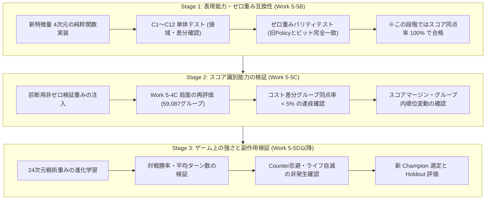

# BlackPoker — Gen 9 コスト支払い評価特徴量検証計画書 (Work 5-5A R1)

**Work ID:** `BP-SIM-AI-GEN9-WORK55A-COST-FEATURE-DESIGN-R1`  
**対象リポジトリ:** `BlackPoker/BlackPoker`  
**対象ブランチ:** `BlackPoker/issue551-core-flow`  
**基準コミット (HEAD):** `8aa24cbc6dc0d90a494d4b4815f6c1206c7a27f0`  
**検証計画ステータス:** R1 最終改訂完了（3段階検証プロトコル、DNA移行テスト、C1〜C12詳細化）

---

## 1. 検証段階の分離 (3-Stage Validation Protocol)

新特徴量の「表現能力」「スコア識別能力」「ゲーム上の強さ」を混同せず、以下の 3 段階に厳密に分離して検証を実施する。

| 検証段階 | 実施 Work | 目的 | 新特徴量の重み | 合格受け入れ条件 |
|:---:|:---:|:---|:---:|:---|
| **Stage 1** | **Work 5-5B** | 特徴量の計算正確性、DNA 移行、既存 AI との完全互換性 | **全ゼロ** `[0, 0, 0, 0]` | - 全 C1〜C12 テスト PASS - ゼロ重み時、全 3,779 局面で旧 Policy とビット完全一致 - DNA 移行テスト PASS |
| **Stage 2** | **Work 5-5C** | コスト差分候補間のスコア識別能力 | **診断用非ゼロ** (固定検証重み) | - コスト差分同点率が **100% $\rightarrow$ 5% 未満** - タイブレーク率が **10% 以下** - スコア異常（NaN等）ゼロ |
| **Stage 3** | **Work 5-5D** | 実戦対戦成績、戦術妥当性、副作用防止 | **進化学習** (最適化重み) | - 対 Gen 8 / Gen 9 R4 勝率向上 - Counter 忌避・ライフ自滅ゼロ - 異常な千日手（遅延）なし |

---

## 2. C1〜C12 必須設計検証ケース (R1 改訂版)

### P0 特徴量の定義（全4次元）
- $t_{20}$: `cost_discard_value_sum` ($x / (x + 10)$)
- $t_{21}$: `cost_discard_joker_count` ($x / (x + 1)$)
- $t_{22}$: `cost_sacrifice_unit_size_sum` ($x / (x + 3)$)
- $t_{23}$: `cost_life_fraction` ($\text{lifeCount} / \max(1, \text{selfLifeCount})$)

### C1〜C12 検証テーブル

| ケース | 比較条件 | 入力局面・候補例 | $t_{20}$ (DiscardVal) | $t_{21}$ (DiscardJk) | $t_{22}$ (Sacrifice) | $t_{23}$ (LifeFrac) | 判定区分と期待される挙動 |
|:---:|:---|:---|:---:|:---:|:---:|:---:|:---|
| **C1** | C3を捨てる vs C8を捨てる | 手札1枚廃棄 候補A: C3 (rank 3) 候補B: C8 (rank 8) | A: $3/13 \approx 0.2308$ B: $8/18 \approx 0.4444$ | A: 0.0 B: 0.0 | A: 0.0 B: 0.0 | A: 0.0 B: 0.0 | **識別成功** $\Delta t_{20} = -0.2136$。 負の重みで C3 優先（C8温存）を学習可能。 |
| **C2** | 同ランクで異なるスートを捨てる | 手札1枚廃棄 候補A: S3 (Spade 3) 候補B: H3 (Heart 3) | A: $3/13 \approx 0.2308$ B: $3/13 \approx 0.2308$ | A: 0.0 B: 0.0 | A: 0.0 B: 0.0 | A: 0.0 B: 0.0 | **P0の表現限界** 特徴量差分 0.0000。 固定スート優劣を排除し、先頭インデックスで決定論的選択。 |
| **C3** | Jokerを捨てる vs 通常カードを捨てる | 手札1枚廃棄 候補A: Joker 候補B: C8 (rank 8) | A: **0.0000** B: **$8/18 \approx 0.4444$** | A: **$1/2 = 0.5000$** B: **0.0000** | A: 0.0 B: 0.0 | A: 0.0 B: 0.0 | **完全識別** Joker は $t_{20}=0, t_{21}=0.5$、通常カードは $t_{20}>0, t_{21}=0$ で完全分離。 |
| **C3b** | Joker複数枚廃棄 | 手札2枚廃棄 候補A: 2枚ともJoker 候補B: Joker 1枚 + C8 | A: 0.0000 B: $8/18 \approx 0.4444$ | A: **$2/3 \approx 0.6667$** B: **$1/2 = 0.5000$** | A: 0.0 B: 0.0 | A: 0.0 B: 0.0 | **飽和有界識別** 複数Joker廃棄時も $[0, 1)$ に収まり、枚数差を正しく識別。 |
| **C4** | 1枚廃棄 vs 2枚廃棄 | 候補A: 1枚廃棄 (C8, raw=8) 候補B: 2枚廃棄 (C3+C4, raw=7) | A: $8/18 \approx 0.4444$ B: $7/17 \approx 0.4118$ | A: 0.0 B: 0.0 | A: 0.0 B: 0.0 | A: 0.0 B: 0.0 | **複合識別** 既存 $cost\_discard\_count$（1枚 vs 2枚）と $t_{20}$（数値合計）の双方が寄与。 |
| **C5** | 防壁Aをドライブ vs 防壁Bをドライブ | 自陣防壁ドライブ 候補A: 防壁A 候補B: 防壁B | A: 0.0 B: 0.0 | A: 0.0 B: 0.0 | A: 0.0 B: 0.0 | A: 0.0 B: 0.0 | **P1延期（非干渉）** 防壁特徴量は P0 から除外。既存の $cost\_driven\_bulwark\_count$ のみ寄与。 |
| **C6** | 兵士Aを犠牲 vs 兵士Bを犠牲 | ユニット犠牲 候補A: 兵士A (size 1) 候補B: 兵士B (size 3) | A: 0.0 B: 0.0 | A: 0.0 B: 0.0 | A: **$1/4 = 0.2500$** B: **$3/6 = 0.5000$** | A: 0.0 B: 0.0 | **戦力差識別** $\Delta t_{22} = -0.2500$。 大型ユニットの犠牲を忌避する重み付けが可能。 |
| **C7** | ライフを支払う vs 支払わない | 候補A: ライフ1点支払い (残8) 候補B: 他アクション（Pass等） | A: 0.0 B: 0.0 | A: 0.0 B: 0.0 | A: 0.0 B: 0.0 | A: **$1/8 = 0.1250$** B: **0.0000** | **ライフ消費識別** 既存 $has\_cost$ に加え、相対リスク $t_{23}$ が正しく反映。 |
| **C8** | ライフが多い vs 少ない | ライフ1点支払いの比較 局面A: 自ライフ 10枚 局面B: 自ライフ 2枚 | A: 0.0 B: 0.0 | A: 0.0 B: 0.0 | A: 0.0 B: 0.0 | 局面A: **$1/10 = 0.1000$** 局面B: **$1/2 = 0.5000$** | **状況依存識別** 同じ1点支払いでも危険度が 5倍（0.10 vs 0.50）高く評価される。 |
| **C9** | カード廃棄＋ライフ支払い | 複合コスト 手札C3廃棄 + ライフ1点(残5) | **$3/13 \approx 0.2308$** | 0.0 | 0.0 | **$1/5 = 0.2000$** | **独立線形合成** 手札損失とライフ危険度が独立してスコアに合算される。 |
| **C10** | 異なる候補が特徴量上完全同一 | 手札1枚廃棄 候補A: H5 (Heart 5) 候補B: D5 (Diamond 5) | A: $5/15 \approx 0.3333$ B: $5/15 \approx 0.3333$ | A: 0.0 B: 0.0 | A: 0.0 B: 0.0 | A: 0.0 B: 0.0 | **意図的一致** 同ランクであれば不当なハッシュ差分を作らず等価扱い。 |
| **C11** | 対象カード情報が観測できない | 相手手札・相手裏向きカード | 0.0000 | 0.0000 | 0.0000 | 0.0000 | **プライバシー保護** Viewer 以外の未公開情報はマップ解決されず 0 にフェイルクローズ。 |
| **C11b**| ID解決失敗（不正参照） | 観測外の不正カードID指定 | 0.0000 | 0.0000 (Joker誤認なし) | 0.0000 | 0.0000 | **検証エラー検知** Jokerと混同せず、診断時/テスト時に参照不整合として検出。 |
| **C12** | コストなし、空選択 | 通常アタックや PASS | **0.0000** | **0.0000** | **0.0000** | **0.0000** | **完全非干渉** コストが存在しない合法手には一切のスコア影響を与えない。 |

---

## 3. DNA 移行テスト仕様 (Work 5-5B)

### 3.1 必須テストケース一覧

| テスト ID | テスト内容 | 入力 DNA | 期待される動作 |
|:---:|:---|:---|:---|
| **DNA-T1** | 旧 20 次元 DNA の完全復元 | 旧 Gen9 DNA（重み配列長 20） | - 元の 20 重みをビット完全一致で保持 - 末尾 4 要素に `[0.0, 0.0, 0.0, 0.0]` をパディング - 個体 ID、世代、originType を一切改変しない |
| **DNA-T2** | 新 24 次元 DNA のラウンドトリップ | 新 Gen9 DNA（重み配列長 24） | - 24 重みすべてを完全復元 - シリアライズ/デシリアライズで数値完全一致 |
| **DNA-T3** | 不正な重み数の拒否 | 長さ 19, 21, 23, 25 の配列 | - 明示的な例外（`Error`）をスロー - 黙ってフォールバックしない |
| **DNA-T4** | 非有限値の拒否 | `NaN`, `Infinity`, `undefined` を含む配列 | - スケーリング/バリデーション例外をスロー |
| **DNA-T5** | Gen8 ベース DNA からの変換 | `tacticalWeights` なしの Schema v6 DNA | - `preset="zero"` で 24 次元ゼロ配列 - `preset="r4"` で 20次元R4 + 末尾4つゼロ |

---

## 4. ゼロ重み互換性テスト仕様 (Work 5-5B)

### 4.1 数理的パリティ検証プロトコル
- **対象局面:** Work 5-4C 診断局面 全 3,779 局面。
- **比較対象:**
  - Policy A: 旧 Gen9 R4 Champion（20次元戦術重み、Encoder: `v7.2`）
  - Policy B: 新 Gen9 R4 互換モデル（24次元戦術重み、末尾4つ=0.0、Encoder: `v7.3`）
- **アサーション条件:**
  1. 全合法手スコアの最大絶対誤差:
     $$\max_{p \in \text{patterns}} |\text{score}_A(p) - \text{score}_B(p)| < 10^{-15}$$
  2. 選択される合法手インデックスの一致率:
     $$\text{selectedPatternRef}_A \equiv \text{selectedPatternRef}_B \quad (100.0\%)$$

---

## 5. コストありアクション全体への副作用検証仕様 (Stage 3)

### 5.1 アクション間選択への波及監視
非ゼロ重みを設定した際、コストありアクション（Counter、召喚等）が不当に避けられていないかを検証する。

1. **Counter 選択率の監視:**
   相手の致死・危険アタックに対する Counter の選択率が、旧モデルと比較して低下していないこと。
2. **PASS 逃避率の監視:**
   コスト支払いを嫌うあまり、無関係な PASS や packOpen へ逃避していないこと（Work 5-4B の成果維持確認）。
3. **平均対戦ターン数:**
   リソース温存による千日手・遅延が発生していないこと（平均ターン数の増加率 `< 10%`）。

---

## 6. 計算量・性能測定計画

1. **ベンチマーク仕様:**
   - 10,000 回の `encode()` 呼び出しにおける所要時間を計測。
   - 1合法手あたりのコスト特徴量計算レイテンシ: `< 0.05ms`。
2. **GC 負荷検証:**
   - ホットパス内で不要なオブジェクト割り当て（配列再生成、文字列結合等）を行っていないこと。

---

## 7. 設計変更履歴 (Revision History)

- **2026-11-10 (R0 / 初版):** Work 5-5A 初回検証計画。
- **2026-11-10 (R1 / 本改訂版):**
  1. 検証プロトコルを Stage 1（表現・互換性）、Stage 2（識別マージン）、Stage 3（ゲーム上の強さ）に厳密分離。
  2. P0 を 4 特徴量（全24次元）へ更新。防壁サイズを C5 から除外（P1 延期）。
  3. C3b（複数Joker）、C11b（不正ID参照検知）ケースを追加。
  4. DNA 移行テスト（DNA-T1〜T5）およびゼロ重みパリティ検証プロトコルを詳細化。
  5. コストありアクション全体への副作用（Counter 忌避等）の監視仕様を追加。
