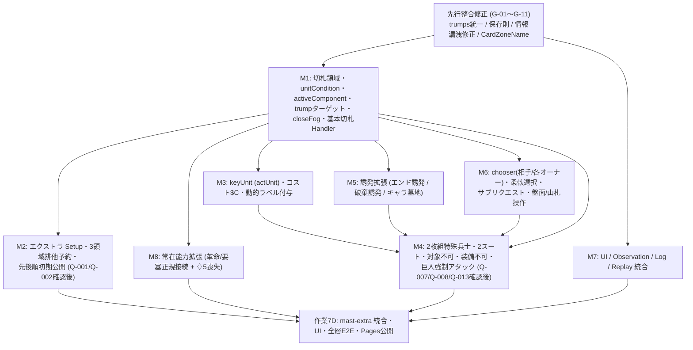

# BlackPoker Simulator 作業7A：エクストラフレーム実装ロードマップ・テスト戦略書

- **作業番号**: 作業7A（依存関係整理・作業7B〜7D計画・テスト計画策定のみ／実装非着手）
- **関連資料**:
  - アーキテクチャ設計書: [`work7a_extra_frame_architecture.md`](./work7a_extra_frame_architecture.md)
  - 全切札・全アクション棚卸し: [`work7a_extra_frame_inventory.md`](./work7a_extra_frame_inventory.md)
  - 公式ルール仕様確認事項: [`work7a_extra_frame_rule_questions.md`](./work7a_extra_frame_rule_questions.md)

---

## 1. 共通機構（`M1`〜`M8`）の依存関係と優先順位（第16.1節対応）

各共通機構が他の機構・既存 Core へ与える影響度と、解放される切札数（全31件中）・エクストラ専用アクション数（全57件中）を以下に整理する。

### 1.1 依存関係フローチャート

### 1.2 共通機構別の依存対象数・優先順位マトリクス

| 優先順位 | 機構ID | 直接依存する切札 / アクション規模 | 前提有無 | 既存7レギュ回帰リスク | 先行要確認事項 (`Q-*`) | 単独検証可否 |
|---|---|---|---|---|---|---|
| **1 (最優先)** | **GFIX＋M1**（データ整合＋切札基本ライフサイクル） | **全31切札 / 57アクション** の土台（単独で汎用4＋直結12解放） | なし | **中**（`ObservationFactory`, `ActionTargetService` 修正あり） | `Q-002`（非スクリプト切札表化時のみ） | 可（切札操作単体テスト） |
| **2** | **M8**（常在能力：革命/要塞統合＋喪失） | **3切札** (`♠A, ♣9, ♢5`)＋戦闘/チャージ全般 | M1 | **低**（既存 `AbilityEvaluator` 拡張、非エクストラ時は不発） | `Q-011`, `Q-014` | 可 |
| **3** | **M2**（エクストラ Setup ＋ 順次初期公開） | **対戦開始（31切札全体）** | GFIX, M1 | **中**（`OfficialRegulationMatchSetup`, `PhysicalCardReservation` 改修） | `Q-001`, `Q-002` | 可（Setup 単体・保存則テスト） |
| **4** | **M3**（`keyUnit` ＋ `$C` ＋ `grantLabel`） | **9アクション**（兵士起因 8＋`ファントムリバース`） | M1 | **低**（`keyUnit` / `$C` 未指定アクションは従来経路） | なし | 可 |
| **5** | **M5**（誘発拡張：エンド・破棄・キャラ墓地） | **11誘発アクション**（うち新規 9件） | M1 | **中**（`CommandRegistry.createRequest`, `discardCards` 共通経路） | `Q-003`, `Q-010`, `Q-014` | 可 |
| **6** | **M6**（相手選択・柔軟選択・サブリクエスト等） | **15切札 / 約25アクション** | M1, M5 | **低〜中**（`EffectContinuation` 既存機構上で動作） | `Q-004`〜`Q-009`, `Q-012` | 可（効果別ユニットテスト） |
| **7** | **M4**（2枚組特殊兵士 6体・能力群） | **6切札 / 20アクション**（Jack 17＋King 3） | M1, M3, M5, M6 | **中**（`ActionTargetService` 対象不可・`LegalPatternGenerator` 巨人制約） | `Q-005`, `Q-007`, `Q-008`, `Q-013` | 可 |
| **8 (統合)** | **M7**（Playtest UI ＋ AI Observation ＋ Log/Replay 完全統合） | **全体**（人間プレイ・公開情報監査・Pages公開） | M1〜M8 | **低**（他レギュ UI は `trumps.length === 0` 時非表示または既存維持） | `Q-002` | E2E＋SSR＋Playwright |

---

## 2. 作業7B〜7D 段階的実装計画（第16.2節対応）

### 2.1 作業7B：共通基盤・Setup 機構・先行バグ修正（サブステップ 4分割）

切札個別データ投入の前に、共通基盤のみを独立検証可能な4段階で整備する。

| ステップ | 実装内容 | 対象レイヤ | 完了条件（Definition of Done） |
|---|---|---|---|
| **7B-1: データ・秘匿・保存則整合修正** | ① `player.trumps` 配列への内部状態統一（`OfficialRegulationMatchSetup`, `ScenarioCompiler`, `createCoreBattlePlaytest`, `cardUtils`） ② `verifyCardConservation()` / `OfficialSetupAuditor` へ `trumps` 集計追加 ③ **`G-03` `ObservationFactory.mapUnit` の裏切札 `componentId`/`kind`/`labels` マスク対応**＋`{ components }` 伝播修正（`G-07`） ④ **`G-04` `SemanticFingerprintCalculator` `opaqueCardId` 正規化修正**＋**`G-05` `StagePanel` の `observation.stageRequests` 統一** ⑤ **`G-06` `CardZoneName` へ `"trump"` 追加・`ViewerAwareGameEventFormatter` 保護**＋`G-11` `discardCards` バッチ墓地化 | Engine Setup, Observation, AI Fingerprint, Log, UI Panel | ・既存全 282テストファイル（3,913テスト）が完全 PASS ・新規単体テストで裏切札メタデータ漏洩ゼロ・`trumps` 保存則違反検知・`StagePanel` 非公開保護を立証 |
| **7B-2: `M1` 切札ライフサイクル ＋ `M8` 常在基盤** | ① `unitCondition` による `trump.secretTrump` ⇔ `trump.<id>` 動的評価実装 ② `ActionActivationConditionEvaluator.activeComponent` 共通実装（`TriggerResolver` と共通関数化） ③ `ActionTargetService`, `LegalPatternGenerator`, `ActionRequestValidator`, `ResolutionTargetValidator`, `PatternExecutor` の `zone: "trump"` 対応 ＋ `fog.close` (`openLock`) 抑止 ④ 基本 Handler 新設：`setTrumpFace`, `moveTrumpToGrave`, `moveCardToTrump` ⑤ `AbilityEvaluator.isStateChangePrevented` (`♢5 喪失` 用) | Rules Engine, Target, Validator, Command Handlers | ・ダミー／基盤テスト用 YAML で裏→表→クローズ→破壊→墓地復帰の一連操作・`closeFog` 封印・物理カードID保存則が Core Flow で完全動作 ・直接即時アクションでのインタラクティブ選択・再開動作を確認 |
| **7B-3: `M2` エクストラ Setup ＋ 順次初期公開** | ※前提：`Q-001`, `Q-002` の方針決定済み ① `RegulationDefinition.ts`（`FrameDefinition.components`, `FrameSetupDefinition.trumpCount` 等）と `RegulationRulePackageSelector.ts` 拡張 ② `PhysicalCardReservation.ts` 3領域相互排他化＋`TrumpSelectionService.ts` 新設 ③ `OfficialRegulationMatchSetup.ts` でエクストラ Setup（2切札裏＋3シナリオ＋1レア＋14パック＋7手札＋裏防壁＋裏プリセット兵士→先攻決定）実装 ④ `GameSession` 開始前手順として「先攻プリセット兵士＋切札1枚公開 → 後攻（先攻結果観測後）プリセット兵士＋切札1枚公開 → 先攻1ドロー開始」実装 ⑤ `ReplayPlanV1` / `OfficialRegulationMatchFactory` / `PlaytestEnvironmentController` へ `trumpSelections` 伝播 | Regulation, Setup, Session, Factory, Replay | ・決定論的 Setup テスト（40枚/54枚デッキ、同スート/同数字2切札、3領域衝突拒否、先後順次公開で後攻が先攻表切札を `Observation` で参照可能、全カード保存則完全成立）PASS ・`ReplayReconstructionService` と `Undo` 分岐再現 PASS |
| **7B-4: `M3` (`keyUnit`/`$C`/`grantLabel`) ＋ `M5` 誘発拡張 ＋ `M6` 柔軟選択・サブリクエスト基盤** | ※前提：`Q-003`〜`Q-009` のうち該当基盤仕様確定 ① `M3`：`ComponentAbility.grantLabel`・`AbilityEvaluator.getEffectiveLabels()`・`ActionDefinition.keyUnit`・`CostParser` `"C"` コスト・`LegalPatternGenerator` 列挙・`Snapshot` `keyUnitId` 保持 ② `M5`：`requestCreated`（`エンド` 誘発＋`Q-003` Stage 積載順補正）、`cardsDiscarded`（手札破棄数バインド）、`unitMovedToGrave`（特定 `componentId` 墓地移動） ③ `M6`：`chooser`（相手／対象プレイヤー／ユニットオーナー）、`minCount`/`maxCount` 複数ユニット選択＋合計サイズ記録、`reorderFieldUnits`、ステージ条件選択、`requestSubAction`、`moveUnitCardsToZoneBottom` 等 ④ `M4` 準備：`untargetable`, `unmountable`, `multiSuit`, 2枚組ユニットの生成・分裂・`summonMultiCardTrumpUnit`・`searchAndSummonTrumpUnit`・`巨人` 制約フィルタ | Interpreter, CostParser, LegalPatternGenerator, TriggerResolver, Command Handlers | ・各新機構の独立単体テスト＋中断再開 (`EffectContinuation`) ＋ `GraveTopCoordinator` 結合テスト PASS ・既存7レギュレーションへの回帰影響ゼロ（全既存テスト PASS） |

---

### 2.2 作業7C：切札・関連アクションの段階的実装（依存関係順 6グループ）

スート順（`♠→♡→♢→♣`）ではなく、**共通機構の依存関係順に 6グループ（`C1`〜`C6`）へ分割** し、各グループ終了ごとに Core Flow 統合テスト＋保存則テストをパスさせる。

> [!NOTE]
> **件数集計の明記**: ある表切札が性質の異なる複数アクションを持つ場合（例：`♠2 スラッシュ` は「C2系 `ｸｲｯｸ兵士召喚♠`」と「C3系 `ｽﾗｯｼｭ`」の双方を持つ）、**アクション単位（57件）は各グループへ排他分類** し、**切札単位（31件）はその切札の全関連アクション・能力が完成するグループをもって完了カウント** とする。

| グループ | 完了する切札単位（計31件） | 所属アクション（計57件） | 前提機構 | 再利用する既存機構 | 主な新規 YAML・実装要素 | 完了条件・重点検証項目 |
|---|---|---|---|---|---|---|
| **Group C1** （既存統合＋汎用切札操作） | **3切札** ・`裏切札 (secretTrump)` ・`♠A 革命` ・`♣9 要塞` | **6アクション** ・`quickOpen`, `open`, `close`, `trumpDestroy` ・`revolutionDraw`, `counterattack` | 7B-1, 7B-2 | `examples/revolution.yaml`, `examples/fortress.yaml`, `damageJudgeUtils`, `AbilityEvaluator.shouldPreventDamage`, `cleanupFogs` | ・`unitCondition` 形式へ `secretTrump`, `trump.sA`, `trump.c9` を整備 ・`fog.close` YAML ・汎用4アクション YAML | ・既存 `revolution.test.ts` / `counterattack.test.ts`＋新統合テスト（裏→表→発動→クローズ封印→破壊→墓地TOP）がすべて Core Flow 上で PASS |
| **Group C2** （`activeComponent`＋既存Handler直結） | **5切札** ・`♠4 威圧` ・`♠5 蘇生` ・`♢A 防壁追加` ・`♢4 相殺` ・`♢5 喪失` （※`♠2,♡3,♢3,♣4,♢9` の一部も先行稼働） | **12アクション** ・`intimidate`, `quickIntimidate`, `resurrection` ・`putBulwark`, `quickSetBulwark` ・`reckoning`, `lethargy`, `rest` ・`quickSoldierSummon{S,H,D,C}` | 7B-2, M8 | `moveMatchingUnitsToGraveyard`, `deploySelectedCardsAsUnits`, `deployTopCardsAsUnits`, `summonUnit`, `dealDamage`, `cancelRequest`, `moveToGraveyard`, `setAllUnitState` | ・8切札コンポーネント YAML＋12アクション YAML ・`♢5` `preventStateChange` 接続・`putBulwark` 1T1回 `usageLimit` | ・コスト `$L`/`$BL`/`$DL`/`$D` 支払検証、1T1回制限、ドライブ条件限定（`虚脱`）、`喪失` 中 `チャージ`＋`ドロー` 挙動（`Q-014`）検証 |
| **Group C3** （`keyUnit`＋`$C`＋動的ラベル） | **4切札** ・`♠2 スラッシュ` ・`♡3 誘惑` ・`♢3 交渉` ・`♣4 スイッチ` （※`♡7 ファントムリバース` 先行稼働） | **5アクション** ・`slash`, `allure`, `negotiate` ・`phantomReverse`, `switch` | 7B-4 (`M3`) | `moveToGraveyard`, `moveUnitToHand`, `setUnitState`, `transformCharacter`, `deploySelectedCardsAsUnits` | ・`grantLabel`（`<スラッシュ>` 等5種）＋`keyUnit`＋`$C` YAML ・`deploySelectedCardsAsUnits` の `fromZone: hand` 対応 | ・切札表裏によるラベル動的出現／消失、`switch` 手札0時（`5.4.4`）、防壁→兵士変身後即攻撃可否、2スート兵士複数ラベル重複付与検証 |
| **Group C4** （誘発拡張＋複合盤面操作） | **8切札** ・`♠7 瞬殺`, `♡4 休戦` ・`♡7 ファントム`, `♢9 充足` ・`♣5 内乱`, `♣7 手札補充` ・`♣8 リセット`, `♣10 悪あがき` | **9アクション** ・`satisfaction`, `handRefill`, `illusion` ・`civilWar`, `riot` ・`instantKill`, `retreat`, `reset`, `lastDitch` | 7B-4 (`M5, M6`), C1 | `drawFromLife`, `setAllUnitState`, `cancelRequest`, `dealDamage`, `discardCards` | ・エンド時誘発3＋破棄時誘発1 YAML（`Q-003`, `Q-010` 反映） ・`moveSelectedUnitsToGraveyard`, `transformSelectedUnits`, `reorderFieldUnits` | ・`エンド` 前に `手札補充`（→7枚超過判定）・`幻影`（2枚組防壁分裂＋並替）・`充足` 解決確認 ・相手2枚選択 (`内乱`)→`暴動` 4点・`リセット` Step 3 で `暴動` 不発＋裏 `♣8` 破壊確認 |
| **Group C5** （上下移動・複数オーナー・サブリクエスト） | **5切札** ・`♠3 ドレイン`, `♡2 援軍` ・`♡5 追撃`, `♡8 救済` ・`♢8 修繕` | **5アクション** ・`drain`, `summonReinforcement` ・`pursuit`, `salvation`, `repair` | 7B-4 (`M6`), C2 | `dealDamage`, `setAllUnitState`, `mountUnit` / `action.attack` / `action.mountSoldier` | ・`requestSubAction`, `revealAndSplitTopLifeCards`, `moveAllMatchingUnitsToOwnerLifeTop`, `moveUnitCardsToZone` (`bottom`) YAML（`Q-004, Q-006, Q-009, Q-012` 反映） | ・2回攻撃 (`追撃`)・コスト無 `装備` 被カウンター時キー回収 (`修繕`)・両オーナー順次ライフ上配置 (`救済`)・ライフ残り1枚時 (`援軍`) 検証 |
| **Group C6** （2枚組特殊兵士 6体：Jack4＋King2） | **6切札** ・`♠J リアニメーター`, `♡J 破砕士` ・`♢J 策士`, `♣J 騎士` ・`♠K 魔王`, `♡K 巨人` | **20アクション** ・Jack系17：`summonReanimator`等4＋`summonWallBreaker`等4＋`summonStrategist`等5＋`summonKnight`等4 ・King系3：`summonDarkLord`, `darkWhisper`, `summonGiant` | 7B-4 (`M4, M5, M6`), C1〜C4 | `CharacterTransformService`（2防壁分裂）, `damageJudgeUtils`（巨人耐性）, `takeUntilLegacyCard`, `drawFromLife` | ・特殊兵士 6コンポーネント YAML（2スート・`unmountable`・`untargetable`・`mandatoryAttack`） ・`summonMultiCardTrumpUnit`, `searchAndSummonTrumpUnit`（`Q-005, Q-007, Q-008, Q-013` 反映） | ・合体召喚・途中切札裏化時不発・相手選択犠牲 (`騎士`)・非対象カウンター (`策士`)・全領域探索＆未開封パック決定論シャッフル (`魔王/巨人`)・場→墓地再生4種 vs 防壁化/バウンス非再生・`魔王` 墓地時 `世代交代` 2回誘発・`巨人` 強制アタック完全検証 |
| **合計検算** | **3 + 5 + 4 + 8 + 5 + 6 = 31切札** | **6 + 12 + 5 + 9 + 5 + 20 = 57アクション** | — | — | 共有4アクション（`packOpen` 等）と合わせ **フレーム全61・`mast-extra` 全98** | **全切札・全アクションの漏れ・重複ゼロ** |

---

### 2.3 作業7D：公式レギュレーション統合・UI・全層検証・公開計画

全6グループの完了後、以下の順で公式レギュレーション `mast-extra` を組み立て、安全性・非公開保護・回帰耐性を検証した上で公開する。

1. **公式レギュレーション定義有効化**:
   - `src/data/regulations/frames/extra.yaml`（`id: extra`, `inherits: strategy`, `actions: 61`, `components: 38`, `setup: trumpCount: 2, presetSoldierInitialFace: down, ...`）および `src/data/regulations/regulations/mast-extra.yaml` を配置。
   - `RegulationValidator.ts` (`IMPLEMENTED_COMBINATIONS.add("mast:extra")`) および `SimulatorDeckProfileResolver.ts` 通知定義を更新。
2. **Playtest UI 実装（Desktop / Tablet / Smartphone）**:
   - `TrumpSetupPanel.tsx` 新設（3領域相互排他・Pass & Play シークレット保護・`PlaytestShareUrl` `tc1`/`tc2` 追加）。
   - `PlayerBoard.tsx` / `PlayerZoneStrip.tsx` / `PlayerObservationPresenter.ts` 切札表示追加（モノトーン基調・Desktop/Tablet/Smartphone 各レイアウト崩れゼロ）。
   - `DecisionPanel.tsx` の `keyUnit` 選択UI・`$S`/`$C` コスト表示・`zone: "trump"` ターゲット表示対応・開始時順次公開UI対応。
3. **非公開情報・ログ・Replay・Undo 全層検証**:
   - 人間 vs 人間 / 人間 vs AI 双方で UI DOM・`Observation`・`GameLog`・エラーメッセージ内に相手の裏切札・手札・非TOP墓地・ライフ・未開封パック中身が一切含まれないことを自動テスト＋ブラウザ目視確認。
   - `DeterministicReplayRunner`＋UI Undo ボタンによる長手数分岐リプレイ・Snapshot V2 中断復元 E2E 検証。
4. **大規模ヘッドレスシミュレーション検証**:
   - `playtestConservative` / `seededRandom` 等を用いて `mast-extra` 対戦を連続実行し、無反応スタック・`Card conservation violated`・`TECHNICAL_ERROR` が 0件であることを確認（`Q-014` 記載の通り、現行 AI の戦術強度向上・DNA 学習は作業7D 公開要件には含めず、合法実行と無エラー完走を保証する）。
5. **既存公式7レギュレーション全量回帰検証 ＋ CI / GitHub Pages 公開**:
   - ローカルテスト全 PASS、Build 成功、`playable:check` / `compare:rules-vnext` / `scenario:rules-vnext` 成功後、GitHub Actions 全テスト緑および GitHub Pages 公開成功をもって作業7D完了とする。

---

## 3. 作業7全体のテスト計画（第17節対応）

### 3.1 14の検証区分別テストマトリクス

全切札の全組合せを総当たり爆破させる非現実的な手法は採らず、**「① 共通機構単体テスト → ② グループ別 Core Flow 結合テスト → ③ 代表的相互作用・異常系テスト → ④ 全層UI/Replay/大量自動対戦」** の4階層ピラミッドで現実的かつ高網羅な検証を行う。

| # | 検証区分 | 具体的検証内容と適用階層 |
|---|---|---|
| 1 | **Setup** | 切札2枚＋シナリオ3枚＋レア1枚の3領域物理カード重複拒否、同スート/同数字切札許可、40〜54枚検証、裏防壁＋裏プリセット兵士、先後決定、先攻公開後に後攻が先攻情報を参照して1枚選ぶ順次公開、初期保存則（合計＝デッキ枚数）。 |
| 2 | **コンポーネント** | `unitCondition` による `secretTrump` ⇔ 30 `表切札` の動的切替、`close`/`休戦`/`追撃`/`リセット` での裏切札復帰、2枚組兵士の防壁2体分裂（`リバース`/`幻影`）と手札/墓地/ライフ2枚同時移動、`○○再生` での墓地→表切札復元と物理ID不変。 |
| 3 | **能力** | `<スラッシュ>` 等5種ラベル動的付与（2スート兵士への複数付与含む）と裏切札化時の即座の剥奪、`♠A` 革命計算（バフ込み現在サイズ）、`♣9` 要塞（相手♠キーカード効果ダメ0化）、`♢5` 喪失（チャージ効果無効＋ドロー維持）、`魔王`/`巨人` 対象不可・装備不可・`巨人` 耐性、`closeFog` オープン封印。 |
| 4 | **合法性** | `activeComponent`（表限定）、`usageLimit`（`防壁追加` 1T1回）、`keyUnit`＋`$C` 組み合わせ生成、`zone: "trump"` ターゲット列挙と `魔王`/`巨人` 除外、`巨人` 強制アタック制約違反パターン除外、UI/AI 非依存の `LegalPatternGenerator` SSOT 検証。 |
| 5 | **効果** | 全57エクストラ専用アクション各々の正常実行（資源支払・領域移動・ダメージ・ドロー・召喚・合体・探索シャッフル・サブリクエスト生成・勝利条件遷移）。 |
| 6 | **誘発** | 全11誘発の条件・優先順位（`9.4.1` 即時先・ターンプレイヤー順）・`暴動`（`$D` 時/効果破棄時 vs `リセット` 除外）・エンド時3種＋`魔王の囁き`・2枚組 `魔王` 墓地時 `世代交代` 2回発火・Jack 兵士の「場→墓地」限定再生 vs バウンス/防壁化時非誘発。 |
| 7 | **中断** | 効果内複数段階選択（`瞬殺`, `幻影`, `先読み`, `援軍`）、相手プレイヤーへの手番渡し（`内乱`, `騎士召喚`, `薙払`, `リセット`）、両オーナー各別順次順序決定（`救済`）、全箇所での `GraveTopCoordinator` 墓地TOP選択＋解決完了境界保留＋`EffectContinuation` 中断再開。 |
| 8 | **公開情報** | **必須プライバシーテスト**：相手裏切札の `componentId`/`kind`/`labels`/`suit`/`rank`/`currentSize` が `Observation`・`DecisionRequest`・`StagePanel`・`PlayerBoard DOM`・`GameLog`・`SemanticFingerprint` に1文字も漏洩しないことの対称（P1/P2）検証。 |
| 9 | **ログ** | `CanonicalMatchLog` における `"trump"` 領域記録、`unit.transformed`/`card.revealed`/`zone.shuffled` 順序整合、解決確定後の `request.resolved` 発行原則維持。 |
| 10 | **Replay** | 事前選択（切札・シナリオ・レア）＋先後順次公開＋対戦中任意選択を含む完全マッチの `DeterministicReplayRunner` 再現と最終 `StateHasher` 一致、探索シャッフル（`魔王`/`巨人`）のシード決定論性。 |
| 11 | **Undo** | 初期公開直後・通常/即時中断中・相手選択直後・墓地TOP待ちからの Undo 巻戻し→別手選択分岐の整合。 |
| 12 | **UI** | `TrumpSetupPanel` Pass & Play DOM 隔離、Desktop / Tablet / Smartphone 各解像度での `PlayerBoard` 切札領域・`DecisionPanel` `keyUnit` / `$S` / `$C` 操作の Storybook/Vitest/Playwright 実操作検証。 |
| 13 | **統合** | `mast-extra` 公式 RulePackage の下での人間同士／AI対人／ランダム大量バトル（100戦超）での保存則・`TECHNICAL_ERROR` 0件完走。 |
| 14 | **回帰** | 既存7公式レギュレーション（`light-entry16` 〜 `mast-strategy`）および `core-battle` の全テスト完全維持、既存 Holdout / DNA / Evidence 非改変確認。 |

### 3.2 異常系・境界ケース検証チェックリスト（全グループ共通必須要件）

各切札・アクションテストには正常系だけでなく必ず以下を含める：
1. **条件不成立**: 解決直前に自分の表切札が `クローズ` / `切札破壊` で裏／墓地になり効果不発（例：`Jack召喚` 4種、`魔王/巨人召喚` 解決時チェック、`カウンター策士召喚` 等）。
2. **対象消失**: リクエスト積載後、解決前に対象兵士・対象防壁・対象リクエストが除去された場合の安全スキップとキーカード墓地回収（`5.4.4`）。
3. **カウンター等による無効化**: `カウンター`, `罠カウンター`, `相殺`, `悪あがき`, `休戦`, `カウンター策士召喚` で無効化された際、支払ったコストが戻らず、キーカード（`修繕` による墓地選択カード含む）が正しく墓地へ移動すること。
4. **即時処理**: 即時アクションが Stage に積まれないこと、一方で効果完了後や相手選択時の墓地TOP待ち／効果選択待ちが正しく一時停止すること。
5. **切札の状態変化**: 表→裏→再オープン、`closeFog` 下でのオープン拒否、2枚組から墓地→再生後の再利用サイクル。
6. **複数誘発**: 1回の事象で複数誘発（例：`革命ドロー` 2回、`反撃` 2回、`魔王` 破壊で `世代交代` 2回、エンド時 `魔王の囁き`＋`幻影`＋`手札補充` 重複）が規則 `9.4.1` 通り解決すること。
7. **複数カード移動**: `威圧`, `救済`, `リセット`, `悪あがき`, `内乱` 等で2枚以上同時移動／相手2枚同時破棄時の `GraveTopCoordinator`（対象者全員分の順次墓地TOP選択と解決完了境界）。
8. **非公開情報**: 裏切札・手札・非TOP墓地・ライフ・未開封パックの漏洩テスト。
9. **勝敗判定境界**: 効果ダメージ（`暴動`, `反撃`, `ドレイン`, `相殺`）やコスト `$L`（`威圧`, `防壁追加`, `修繕`, `リセット`, `メインオープン`）でライフ0に到達した際、解決完了・墓地TOP処理境界と `CheckVictory` が公式ルール通り機能すること。
10. **カード保存則**: すべてのテスト終了時点および主要状態遷移後に `verifyCardConservation` で全プレイヤー 40〜54枚の物理カードIDの消失・重複ゼロを自動検証すること。

---

## 4. 主要リスクと公式環境公開ゲート条件

### 4.1 主要リスクと緩和策

| リスク | 影響 | 緩和策 |
|---|---|---|
| **公式仕様未確定（`Q-001`〜`Q-008`）のまま実装進行し手戻り発生** | Core Flow・Setup・Jack/King・サブリクエストの大幅書き直し | 作業7B着手前に必ず `Q-001`〜`Q-008` のユーザー判断を確定する。曖昧部分は推測実装しない。 |
| **`trumps` 統一や `StagePanel` 修正時の既存テスト波及** | 既存7レギュレーションテスト・AIテストの破壊 | `7B-1` で互換フォールバックを慎重に維持しつつ最小差分で修正し、直後に全 282ファイルテストを実行して回帰ゼロを確認してから `7B-2` へ進む。 |
| **直接即時アクション（`先読み`, `瞬殺`, `リセット`, `悪あがき`）の中断再開不備** | `CommandRegistry.resolveImmediateRequest` が途中選択で例外停止 | `7B-2` 完了条件として「直接即時アクションの効果途中インタラクティブ選択→再開→完了時キーカード墓地TOP選択」E2Eテストを必須化。 |
| **Core Flow への特定切札ロジック混入** | 将来 `ドラフト` や新切札追加時に Core が肥大化 | コードレビュー基準として `src/engine/` 内の個別切札 ID（`trump.s2` 等）直書きを禁止し、必ず `abilities` / `unitCondition` / `activeComponent` の宣言評価を通す。 |
| **裏切札やライフ中身の UI/AI/Log 漏洩** | 対戦ゲームとしての公正性崩壊 | 静的型（`PlayerObservation`）と動的 DOM/Fingerprint 自動テスト（`playtestObservationSecret` 型テストのエクストラ版）を必須ゲート化。 |

### 4.2 公式 `mast-extra` 環境の公開ゲート条件

作業7D 完了時に以下の **全項目** を満たした場合のみ、`mast-extra` を公式 Playable 環境として公開する：
1. `Q-001`〜`Q-008`（および完了時点までの後続確認事項）の仕様確定・反映完了。
2. 全31切札・全57エクストラ専用アクション・特殊兵士6種・フォグ1種の YAML 定義および Core Flow 統合テスト PASS。
3. 全14検証区分テスト＋非公開情報保護テスト（P1/P2対称）＋保存則テスト＋Replay/Undo E2E PASS。
4. `mast-extra` 大量自動対戦バッチで `TECHNICAL_ERROR`・保存則違反・無限ループ 0件。
5. Desktop / Tablet / Smartphone 実機サイズ UI 動作確認完了（白黒基調・操作支障なし）。
6. 既存公式7レギュレーション全テスト・Build・Playable Check・`compare:rules-vnext`・`scenario:rules-vnext` 完全 PASS。
7. GitHub Actions CI 全成功・GitHub Pages 公開確認完了。
